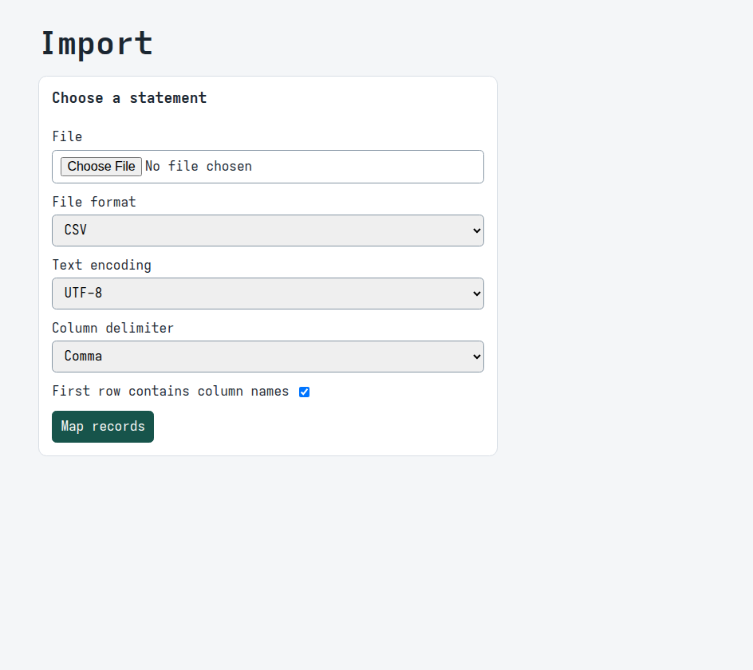
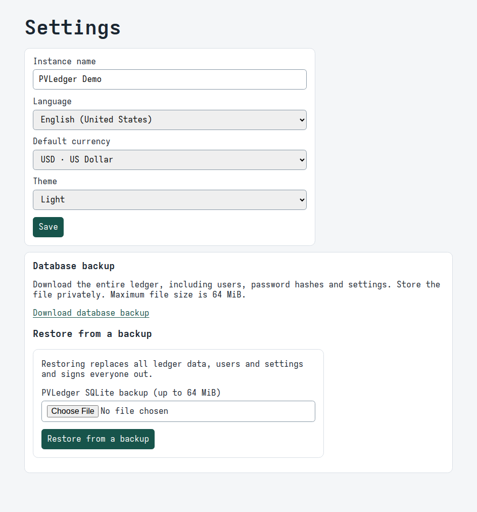

Import, export and backups
==========================

Import expenses
---------------

Open **Data → Import** and select a CSV, QIF, OFX or QFX file. Choose its
encoding and map the destination current account, currency, expense
category, date format and expense sign. For CSV, also select the delimiter,
header and source columns.

   The first step in the import wizard.

Review the preview for parse errors and possible duplicates, select the rows
to post, and confirm. Imported rows are actual expenses. Confirmed rows and
their balance updates are committed together. The wizard accepts up to
500 records in a 512 KiB file. It supports bank, cash and credit-card QIF
sections and single bank or credit-card statements in OFX or QFX. Each
expense must use the destination account's currency.

Export records
--------------

Open **Data → Export**, choose a dataset, output format, filters and columns,
then review the count and sample before downloading. Accounts, history,
financial entries and reference data can be exported as UTF-8 CSV, ODS or
XLSX. For actual transactions from one account in one currency, you can also
choose QIF, OFX or QFX. Downloads support up to 5,000 rows and 8 MiB.
Use filters to split larger exports. Dates in CSV and workbook datasets use
UTC epoch seconds.

.. _backups:

Back up and restore
-------------------

Open **Administration → Settings** and select **Download database backup**.
The snapshot includes financial records, users, password hashes and settings.
Store it privately. Save the server's YAML configuration and any custom
themes, locale files and plugin files separately.

   The backup and restore controls in Settings.

To recover a ledger, choose **Restore from a backup** in Settings or during
first-run setup and select the SQLite backup file. Restoring from Settings
requires confirmation and replaces the ledger. After recovery, sign in with
credentials from the backup. The application checks the database, schema and
administrator account before replacement. Browser backup and restore support
up to 64 MiB.

For larger databases, use SQLite's online backup command or stop PVLedger
before copying the database. For an offline restore, stop PVLedger and point
the configuration at a verified working copy of the backup. Keep the original
database until you have checked the restored records. PVLedger makes a sibling
backup before automatically upgrading a database schema.
