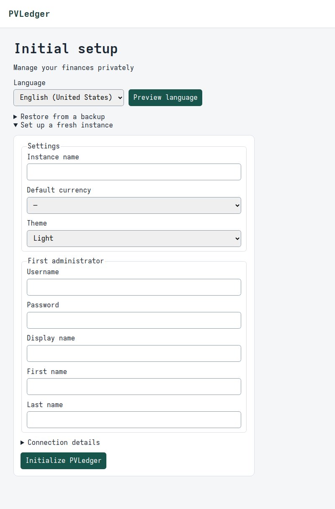
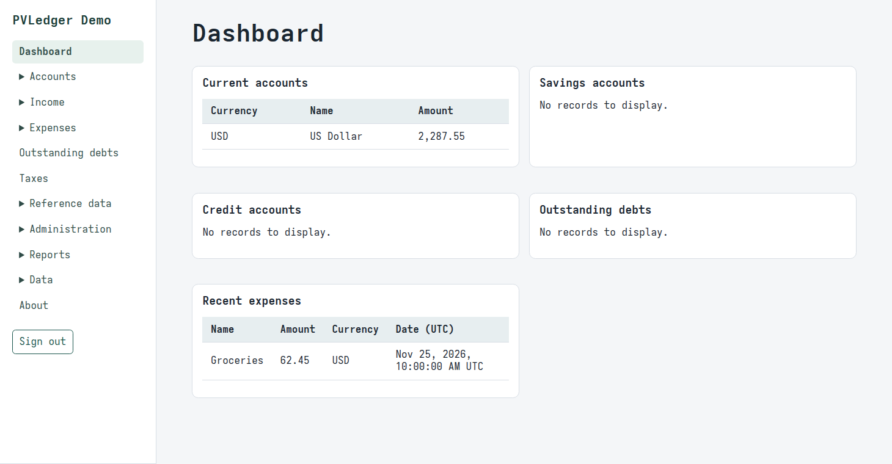
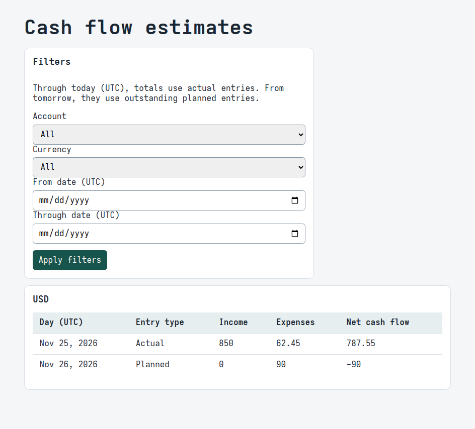

Get started
===========

First run
---------

Open http://127.0.0.1:8080/setup. Select a language and apply the preview
to use it during setup. Expand **Set up a fresh instance**, select the
preferences and create the first administrator with a password of at least
12 characters. Then sign in. To bring over an existing instance, select
**Restore from a backup** and sign in using credentials from that backup.
See :ref:`backups`.

   First-run setup with the fresh instance form expanded.

Setup binds to loopback in a standard installation. For a server running on
another machine, use an SSH tunnel, then open the same local URL.

.. code-block:: sh

   ssh -L 8080:127.0.0.1:8080 user@server

If you configured a non-loopback address, restart after setup to apply it.
For deployed HTTPS access, use an HTTPS reverse proxy and set
``app.secure_cookie: true`` in the server configuration.

Accounts and entries
--------------------

#. Add a bank in **Reference data → Banks**.
#. Create a current account in **Accounts → Current accounts**. Choose the
   bank, owner, currency and opening balance.
#. Add a category under **Expenses → Expense categories**, then enter an
   actual expense or income and check the resulting balance in **Dashboard**.

Saving actual income credits the account. Saving an actual expense debits it in
the account currency. Editing or deleting a posted entry changes the record
alone. Correct the balance on the account when needed. Changes to an existing
current or savings balance record a new history snapshot.

   Dashboard with a sample balance and recent expenses.

Reports
-------

Open **Reports → Cash flow estimates** to see daily income, expenses and
net cash flow by currency. The report includes actual entries through today
in UTC and outstanding plans starting tomorrow. Select a current account to
narrow the report.

   Daily cash flow showing actual entries and a planned expense.

**Spending over time** shows daily actual expenses. **Expenses by category**
groups spending within each currency. **Balance history** shows current and
savings account snapshots, including multiple changes at the same timestamp.
Report results follow the signed-in user's account access.

Users and preferences
---------------------

Administrators can manage users, plugins and instance settings.
Read/Write users can edit finances linked to their own accounts and shared
reference data. Editing countries and currencies requires an administrator.
Viewers can read their own finances and shared reference data. Sessions expire
after 30 minutes of inactivity and on server restart. Administrators can
select the instance language, default currency and theme in
**Administration → Settings**. The Russian application locale uses English
for strings that have yet to be translated.
