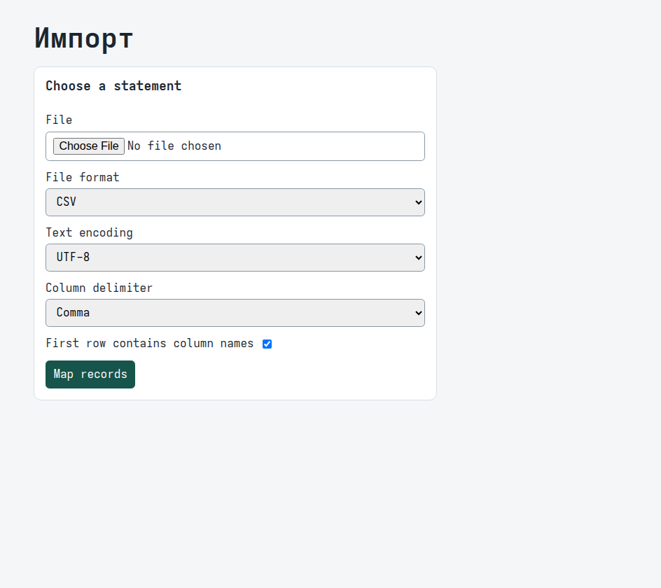
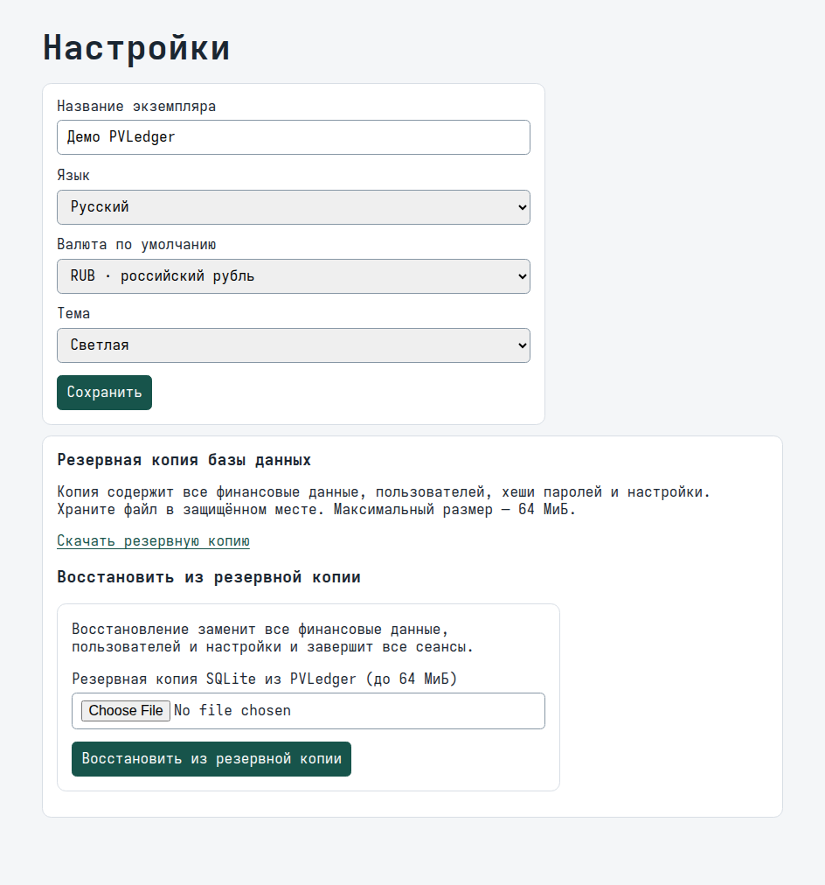

Импорт, экспорт и резервное копирование
=======================================

Импорт расходов
---------------

Откройте **Данные → Импорт** и выберите файл CSV, QIF, OFX или QFX. Укажите
кодировку, текущий счёт, валюту, категорию расходов, формат даты и знак
расхода. Для CSV также укажите разделитель, наличие заголовка и исходные
столбцы.

   Первый шаг мастера импорта.

В предварительном просмотре проверьте ошибки разбора и возможные дубликаты,
выберите нужные строки и подтвердите импорт. Строки сохраняются как
фактические расходы. Записи и соответствующие изменения остатков
сохраняются в одной транзакции. Можно импортировать до 500 записей из
файла размером до 512 КиБ. Поддерживаются банковские, кассовые и
кредитные секции QIF, а также одиночные выписки по банковскому счёту
или кредитной карте в OFX или QFX. Валюта расходов должна совпадать с
валютой счёта.

Экспорт записей
---------------

Откройте **Данные → Экспорт**, выберите набор данных, формат, фильтры и
столбцы. Проверьте количество строк и образец данных перед скачиванием.
Счета, историю, финансовые операции и справочники можно экспортировать
в CSV (UTF-8), ODS или XLSX. Для фактических операций по одному счёту в
одной валюте доступны также QIF, OFX и QFX. Один файл ограничен 5 000
строками и 8 МиБ. Чтобы выгрузить больше, разбейте выборку фильтрами.
В CSV и электронных таблицах даты представлены в секундах с начала
эпохи Unix (UTC).

.. _backups:

Резервное копирование и восстановление
--------------------------------------

Откройте **Администрирование → Настройки** и нажмите **Скачать резервную
копию**. Снимок содержит финансовые данные, пользователей, хеши паролей
и настройки. Храните его в защищённом месте. Отдельно сохраните файл
конфигурации YAML и пользовательские темы, переводы и файлы расширений.

   Резервное копирование и восстановление в настройках.

Чтобы восстановить данные, выберите **Восстановить из резервной копии**
в настройках или при первом запуске и укажите файл SQLite. При
восстановлении из настроек подтвердите замену базы. После восстановления
войдите под учётной записью из копии. Перед заменой приложение проверяет
базу, её схему и наличие администратора. В браузере можно скачать или
восстановить копию размером до 64 МиБ.

Для более крупных баз используйте команду SQLite для резервного
копирования работающей базы или остановите PVLedger перед копированием.
Для восстановления без браузера остановите приложение и укажите в
конфигурации путь к проверенной рабочей копии. Сохраните исходную базу до
проверки восстановленных записей. Перед автоматическим обновлением схемы
PVLedger создаёт резервную копию рядом с файлом базы.
