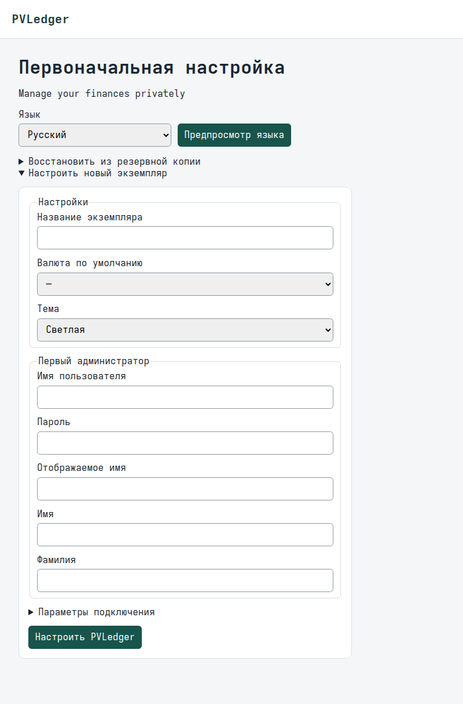
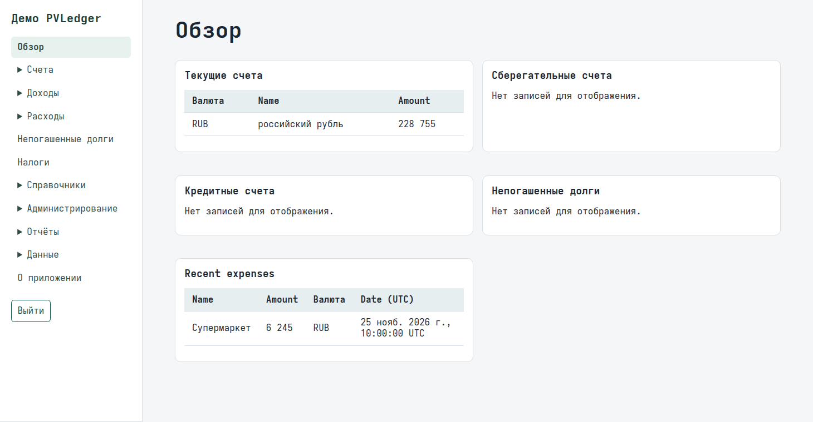
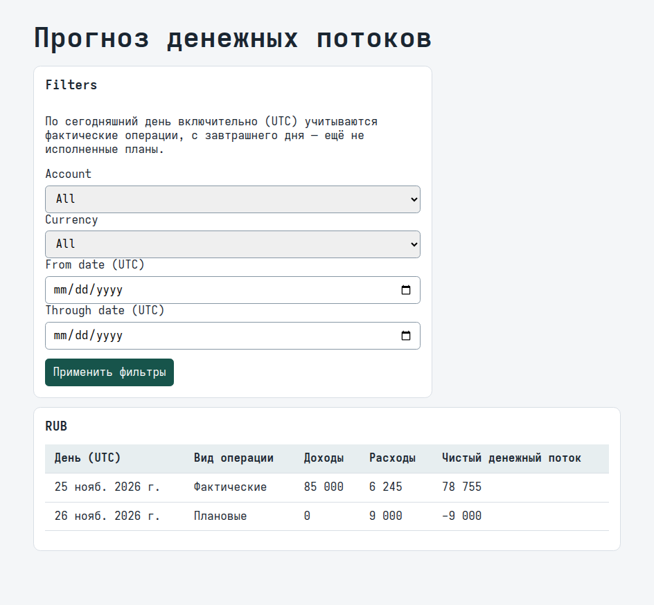

Начало работы
=============

Первый запуск
-------------

Откройте http://127.0.0.1:8080/setup. Выберите язык и нажмите
**Предпросмотр языка**. Разверните **Настроить новый экземпляр**, выберите
параметры и создайте первого администратора с паролем длиной не менее
12 символов. Затем войдите в приложение. Чтобы перенести существующий
экземпляр, выберите **Восстановить из резервной копии** и войдите под
учётной записью из копии. См. :ref:`backups`.

   Первый запуск с открытой формой настройки нового экземпляра.

При стандартной установке мастер доступен на локальном адресе сервера. Если
приложение работает на другой машине, подключите SSH-туннель и откройте
тот же локальный URL.

.. code-block:: sh

   ssh -L 8080:127.0.0.1:8080 user@server

Если вы указали в конфигурации внешний адрес, перезапустите приложение после
настройки, чтобы применить его. Для доступа по HTTPS настройте обратный
прокси с HTTPS и задайте на сервере ``app.secure_cookie: true``.

Счета и операции
----------------

#. Добавьте банк в разделе **Справочники → Банки**.
#. Создайте счёт в разделе **Счета → Текущие счета**. Укажите банк,
   владельца, валюту и начальный остаток.
#. Добавьте категорию в разделе **Расходы → Категории расходов**, затем
   внесите фактический расход или доход и проверьте остаток в разделе **Обзор**.

При сохранении фактический доход зачисляется на счёт, а фактический расход
списывается в валюте счёта. Изменение или удаление проведённой операции
затрагивает только запись. При необходимости исправьте остаток в карточке
счёта. Каждое изменение остатка на существующем текущем или сберегательном
счёте сохраняется в истории.

   Обзор с примером остатка и последними расходами.

Отчёты
------

Откройте **Отчёты → Прогноз денежных потоков**, чтобы увидеть доходы,
расходы и чистый денежный поток по дням и валютам. По сегодняшний день
включительно (UTC) отчёт учитывает фактические операции, с завтрашнего дня —
ещё не исполненные планы. Выберите текущий счёт для фильтрации отчёта.

   Фактические операции и плановый расход по дням.

Отчёт **Расходы по дням** показывает фактические расходы за каждый день.
**Расходы по категориям** группирует суммы по категориям отдельно для
каждой валюты. **История баланса** показывает остатки на текущих и
сберегательных счетах, включая несколько изменений за одну секунду.
В отчёты попадают записи, доступные текущему пользователю.

Пользователи и настройки
------------------------

Администратор управляет пользователями, расширениями и настройками.
Пользователи с правом записи могут менять операции по своим счетам и
общие справочники. Изменять страны и валюты может администратор.
Пользователи с правом чтения видят операции по своим счетам и общие
справочники. Сеансы завершаются через 30 минут бездействия или при
перезапуске сервера. Администратор выбирает язык, валюту по умолчанию и
тему в разделе **Администрирование → Настройки**. Строки интерфейса,
для которых ещё нет русского перевода, показываются на английском.
