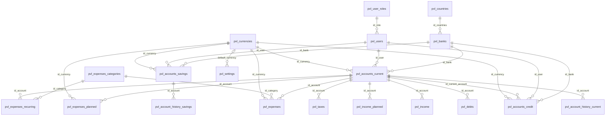

# PVLedger — Database Specification (Draft v0.7.3)

**Source:** [SQLite schema](../../db/pvledger.sql). The SQLite implementation uses four triggers for balance posting and history.

> **Schema contract:** v0.7.3 removes actual-income status and retains the four posting and history triggers introduced in v0.7.2. Startup takes a backup and preserves existing financial entries, balances, history and reference seeds.

## 1. Overview and changes from v0.7

**20 tables · 118 columns · 26 foreign keys · 1 explicit secondary index · 4 triggers · 430 default rows.**

| Change | Current contract |
|---|---|
| Actual income date | `pvl_income.date INTEGER NOT NULL`: Unix timestamp for the income event (UTC epoch seconds by application convention). |
| Planned income date | `pvl_income_planned.date INTEGER NOT NULL`: Unix timestamp for the expected/planned income event (UTC epoch seconds by application convention). |
| Existing schema | All other columns across 20 tables, existing constraints, relationships, indexes and 430 reference rows are unchanged. |
| Current account history | `pvl_account_history_current.id_account` corrected to **NOT NULL**; its `date` and `amount` remain required. |
| Savings account history | No change: `id_account`, `date`, and `amount` are all required. |
| Schema initialization | Removed prior `DROP TABLE IF EXISTS` statements; `CREATE TABLE IF NOT EXISTS` remains. Re-running 430 fixed-ID seed INSERTs is **not** idempotent. |
| Currency ISO (retained from v0.5) | Nullable `pvl_currencies.iso TEXT` and unique index `ux_pvl_currencies_iso`. |
| Default data | 249 countries, 178 currencies, 3 roles; IDs, strings and `NULL`s preserved from the SQL. |
| Password | SHA-256 digest stored as 64 hex characters by application convention (`pvl_users.password TEXT` remains nullable). |
| Financial amounts | Credit = remaining debt; current/checking and savings = current funds; debts = outstanding debt; taxes = tax amount. |
| Planned income and expense status | `0` Planned, `1` Processed, `2` Processed with changes, `3` Declined. |
| Settings | Application singleton (exactly one record after initialization); version/migration tracking, customizable name and first-run language. |
| First user | Created during first application run; source SQL contains no seeded users. |

### 1.1 Storage and invariant rules

- **Unix time:** All `date` and `billing_date` columns use `INTEGER` (draft convention: UTC epoch seconds). Both income `date` columns and both account-history `date` columns are **NOT NULL**; earlier date/billing-date fields retain their original nullability. SQLite column affinity alone does not guarantee timestamp units.
- **Application status/flag codes:** integer-coded values are handled in application logic; no `CHECK` constraints were added. Planned income requires an integer status and planned expenses allow NULL. Both use the same application mapping.
- **Money:** the two historical `amount` columns and both new income `amount` columns are **NOT NULL REAL**; earlier financial `amount` columns retain their original nullable `REAL` definitions. Decimal precision is a separate future design decision.
- **Password:** `pvl_users.password` is nullable `TEXT`. The application is to store a 64-character lowercase or uppercase hex SHA-256 digest; the schema does not validate format. **Security caveat:** SHA-256 alone is too fast for password hashing; a salted password KDF such as Argon2id is recommended for production.
- **Singleton settings:** the app creates and maintains one `pvl_settings` record after first run. The database does not prevent multiple rows, and the source provides no settings row.
- **Foreign keys:** 25 required and 1 optional (`pvl_settings.default_currency`). Enable `PRAGMA foreign_keys=ON` for every SQLite application connection. All FK update/delete actions are `NO ACTION`.

## 2. Database relationships

All 26 relationships below are declared in the SQL. A required FK means each child row needs a parent when foreign keys are enabled; the parent may still have zero children.

| Child column | References | Required? | On update / delete |
|---|---|---|---|
| `pvl_account_history_current.id_account` | `pvl_accounts_current.id` | Yes | NO ACTION / NO ACTION |
| `pvl_account_history_savings.id_account` | `pvl_accounts_savings.id` | Yes | NO ACTION / NO ACTION |
| `pvl_accounts_credit.id_currency` | `pvl_currencies.id` | Yes | NO ACTION / NO ACTION |
| `pvl_accounts_credit.id_current_account` | `pvl_accounts_current.id` | Yes | NO ACTION / NO ACTION |
| `pvl_accounts_credit.id_user` | `pvl_users.id` | Yes | NO ACTION / NO ACTION |
| `pvl_accounts_credit.id_bank` | `pvl_banks.id` | Yes | NO ACTION / NO ACTION |
| `pvl_accounts_current.id_currency` | `pvl_currencies.id` | Yes | NO ACTION / NO ACTION |
| `pvl_accounts_current.id_user` | `pvl_users.id` | Yes | NO ACTION / NO ACTION |
| `pvl_accounts_current.id_bank` | `pvl_banks.id` | Yes | NO ACTION / NO ACTION |
| `pvl_accounts_savings.id_currency` | `pvl_currencies.id` | Yes | NO ACTION / NO ACTION |
| `pvl_accounts_savings.id_user` | `pvl_users.id` | Yes | NO ACTION / NO ACTION |
| `pvl_accounts_savings.id_bank` | `pvl_banks.id` | Yes | NO ACTION / NO ACTION |
| `pvl_banks.id_countries` | `pvl_countries.id` | Yes | NO ACTION / NO ACTION |
| `pvl_debts.id_account` | `pvl_accounts_current.id` | Yes | NO ACTION / NO ACTION |
| `pvl_expenses.id_currency` | `pvl_currencies.id` | Yes | NO ACTION / NO ACTION |
| `pvl_expenses.id_category` | `pvl_expenses_categories.id` | Yes | NO ACTION / NO ACTION |
| `pvl_expenses.id_account` | `pvl_accounts_current.id` | Yes | NO ACTION / NO ACTION |
| `pvl_expenses_planned.id_currency` | `pvl_currencies.id` | Yes | NO ACTION / NO ACTION |
| `pvl_expenses_planned.id_account` | `pvl_accounts_current.id` | Yes | NO ACTION / NO ACTION |
| `pvl_expenses_recurring.id_account` | `pvl_accounts_current.id` | Yes | NO ACTION / NO ACTION |
| `pvl_expenses_recurring.id_category` | `pvl_expenses_categories.id` | Yes | NO ACTION / NO ACTION |
| `pvl_income.id_account` | `pvl_accounts_current.id` | Yes | NO ACTION / NO ACTION |
| `pvl_income_planned.id_account` | `pvl_accounts_current.id` | Yes | NO ACTION / NO ACTION |
| `pvl_settings.default_currency` | `pvl_currencies.id` | No | NO ACTION / NO ACTION |
| `pvl_taxes.id_account` | `pvl_accounts_current.id` | Yes | NO ACTION / NO ACTION |
| `pvl_users.id_role` | `pvl_user_roles.id` | Yes | NO ACTION / NO ACTION |

## 3. Full table specifications

Table `description` metadata is editable and **not** an extra database column. Physical schema and seed rows are captured separately in JSON.

### 3.1 `pvl_account_history_current`

**description:** Historical snapshots of the amount of funds held in a current/checking account at a recorded Unix timestamp.

**description status:** user-specified purpose; editable.

| Column | SQLite type | Nullable | Keys / constraints | Description |
|---|---|---|---|---|
| `id` | `INTEGER` | NO | PK; AUTOINCREMENT | Unique historical balance record identifier. |
| `id_account` | `INTEGER` | NO | NOT NULL; FK → `pvl_accounts_current.id` | Required reference to the current/checking account whose balance is recorded. |
| `date` | `INTEGER` | NO | NOT NULL | Timestamp when this account balance was recorded; application convention: Unix epoch seconds in UTC. |
| `amount` | `REAL` | NO | NOT NULL | Account funds balance at the recorded timestamp, denominated in the currency of the linked account; historical amount, not the live balance. |

**Nullability note:** `pvledger(7).sql` explicitly declares `id_account NOT NULL` for this table.

**Snapshot behavior.** Updating an existing account to a different balance appends the new balance and the current UTC Unix second. Multiple changes in one second retain separate history IDs.

### 3.2 `pvl_account_history_savings`

**description:** Historical snapshots of the amount of funds held in a savings account at a recorded Unix timestamp.

**description status:** user-specified purpose; editable.

| Column | SQLite type | Nullable | Keys / constraints | Description |
|---|---|---|---|---|
| `id` | `INTEGER` | NO | PK; AUTOINCREMENT | Unique historical balance record identifier. |
| `id_account` | `INTEGER` | NO | NOT NULL; FK → `pvl_accounts_savings.id` | Required reference to the savings account whose balance is recorded. |
| `date` | `INTEGER` | NO | NOT NULL | Timestamp when this account balance was recorded; application convention: Unix epoch seconds in UTC. |
| `amount` | `REAL` | NO | NOT NULL | Account funds balance at the recorded timestamp, denominated in the currency of the linked account; historical amount, not the live balance. |

**Nullability note:** `id_account` is NOT NULL; the savings account must exist when SQLite foreign keys are enabled.

**Snapshot behavior.** Updating an existing account to a different balance appends the new balance and the current UTC Unix second. Multiple changes in one second retain separate history IDs.

### 3.3 `pvl_accounts_credit`

**description:** Credit accounts; amount is the remaining debt (outstanding balance) owed on the credit account.

**description status:** user-specified semantics; editable.

| Column | SQLite type | Nullable | Keys / constraints | Description |
|---|---|---|---|---|
| `id` | `INTEGER` | NO | PK; AUTOINCREMENT | Credit-account identifier. |
| `id_bank` | `INTEGER` | NO | NOT NULL; FK → `pvl_banks.id` | Required bank reference. |
| `id_user` | `INTEGER` | NO | NOT NULL; FK → `pvl_users.id` | Required associated user. |
| `name` | `TEXT` | NO | NOT NULL | Credit-account display name. |
| `description` | `TEXT` | YES | — | Optional notes about the credit account. |
| `interest` | `REAL` | YES | — | Interest value; unit and convention not defined. |
| `billing_date` | `INTEGER` | YES | — | Unix timestamp for credit-account billing date or event; exact business meaning pending. |
| `amount` | `REAL` | YES | — | Remaining debt outstanding on this credit account; not the credit limit or original amount borrowed. |
| `id_current_account` | `INTEGER` | NO | NOT NULL; FK → `pvl_accounts_current.id` | Required linked current account. |
| `id_currency` | `INTEGER` | NO | NOT NULL; FK → `pvl_currencies.id` | Required currency reference. |

### 3.4 `pvl_accounts_current`

**description:** Current/checking accounts; amount is the current amount of funds held in each account.

**description status:** user-specified semantics; editable.

| Column | SQLite type | Nullable | Keys / constraints | Description |
|---|---|---|---|---|
| `id` | `INTEGER` | NO | PK; AUTOINCREMENT | Current-account identifier. |
| `id_bank` | `INTEGER` | NO | NOT NULL; FK → `pvl_banks.id` | Required bank reference. |
| `name` | `TEXT` | NO | NOT NULL | Current-account display name. |
| `amount` | `REAL` | YES | — | Current balance of funds in this checking/current account. |
| `description` | `TEXT` | YES | — | Optional notes about the current account. |
| `id_user` | `INTEGER` | NO | NOT NULL; FK → `pvl_users.id` | Required associated user. |
| `id_currency` | `INTEGER` | NO | NOT NULL; FK → `pvl_currencies.id` | Required currency reference. |

### 3.5 `pvl_accounts_savings`

**description:** Savings accounts; amount is the current amount of funds held in each savings account.

**description status:** user-specified semantics; editable.

| Column | SQLite type | Nullable | Keys / constraints | Description |
|---|---|---|---|---|
| `id` | `INTEGER` | NO | PK; AUTOINCREMENT | Savings-account identifier. |
| `id_bank` | `INTEGER` | NO | NOT NULL; FK → `pvl_banks.id` | Required bank reference. |
| `interest` | `REAL` | YES | — | Interest value; annual/monthly basis and unit not defined. |
| `billing_date` | `INTEGER` | YES | — | Unix timestamp for savings-account billing or interest date; exact business meaning pending. |
| `name` | `TEXT` | NO | NOT NULL | Savings-account display name. |
| `description` | `TEXT` | YES | — | Optional notes about the savings account. |
| `id_user` | `INTEGER` | NO | NOT NULL; FK → `pvl_users.id` | Required associated user. |
| `amount` | `REAL` | YES | — | Current balance of funds in this savings account. |
| `id_currency` | `INTEGER` | NO | NOT NULL; FK → `pvl_currencies.id` | Required currency reference. |

### 3.6 `pvl_banks`

**description:** Bank reference records, each assigned to a required country.

**description status:** inferred; editable.

| Column | SQLite type | Nullable | Keys / constraints | Description |
|---|---|---|---|---|
| `id` | `INTEGER` | NO | PK; AUTOINCREMENT | Bank identifier. |
| `name` | `TEXT` | NO | NOT NULL | Bank name. |
| `description` | `TEXT` | YES | — | Optional bank description. |
| `id_countries` | `INTEGER` | NO | NOT NULL; FK → `pvl_countries.id` | Required bank-country reference. |

### 3.7 `pvl_countries`

**description:** ISO 3166-1 alpha-2 countries and territories with native/localized names; 249 default reference rows supplied in the SQL.

**description status:** source data + previous agreed design.
**Seed rows:** 249 (full data in section 5 and JSON).

| Column | SQLite type | Nullable | Keys / constraints | Description |
|---|---|---|---|---|
| `id` | `INTEGER` | NO | PK; AUTOINCREMENT | Country identifier. |
| `name` | `TEXT` | YES | — | Preferred country/territory name written in a locally used language; nullable column despite all 249 seed rows having names. |
| `iso` | `TEXT` | NO | NOT NULL | ISO 3166-1 alpha-2 code (two-letter country/territory code); required, but no unique constraint is present. |

- 249 default rows with explicit IDs are embedded in pvledger(7).sql. Country ISO codes are not constrained UNIQUE by this schema.

### 3.8 `pvl_currencies`

**description:** ISO 4217 currency, unit-of-account, and special-purpose code reference catalog with preferred localized names; 178 default rows supplied in SQL.

**description status:** source data + previous agreed design.
**Seed rows:** 178 (full data in section 5 and JSON).

| Column | SQLite type | Nullable | Keys / constraints | Description |
|---|---|---|---|---|
| `id` | `INTEGER` | NO | PK; AUTOINCREMENT | Currency identifier. |
| `name` | `TEXT` | NO | NOT NULL | Preferred currency or unit name; often localized to the associated currency’s language, with descriptive labels for special codes. |
| `description` | `TEXT` | YES | — | Optional currency description. |
| `iso` | `TEXT` | YES | UNIQUE INDEX `ux_pvl_currencies_iso` | ISO 4217 three-letter currency/special-purpose code; nullable TEXT, with a unique standalone index (multiple NULLs still permitted). |

- New iso TEXT column and standalone UNIQUE index ux_pvl_currencies_iso. The column is nullable; SQLite UNIQUE indexes permit multiple NULL values.
- 178 default currency records with explicit IDs are embedded in pvledger(7).sql, including special and non-circulating ISO codes.

### 3.9 `pvl_debts`

**description:** Debts linked to a required current account; amount represents currently outstanding debt.

**description status:** user-specified semantics; editable.

| Column | SQLite type | Nullable | Keys / constraints | Description |
|---|---|---|---|---|
| `id` | `INTEGER` | NO | PK; AUTOINCREMENT | Debt-entry identifier. |
| `name` | `TEXT` | NO | NOT NULL | Debt label or title. |
| `amount` | `REAL` | YES | — | Current outstanding debt, not the original principal or initial debt amount. |
| `description` | `TEXT` | YES | — | Optional debt notes. |
| `id_account` | `INTEGER` | NO | NOT NULL; FK → `pvl_accounts_current.id` | Current account to which this debt is linked (required). |
| `date` | `INTEGER` | YES | — | Unix timestamp of the debt-related date or event. |

### 3.10 `pvl_expenses`

**description:** Expense transactions assigned to a required current account, expense category, and currency.

**description status:** inferred; editable.

| Column | SQLite type | Nullable | Keys / constraints | Description |
|---|---|---|---|---|
| `id` | `INTEGER` | NO | PK; AUTOINCREMENT | Expense identifier. |
| `id_account` | `INTEGER` | NO | NOT NULL; FK → `pvl_accounts_current.id` | Required current-account reference. |
| `amount` | `REAL` | YES | — | Expense amount; source uses floating-point REAL. |
| `name` | `TEXT` | NO | NOT NULL | Expense title or label. |
| `date` | `INTEGER` | YES | — | Unix timestamp of the expense date or event. |
| `description` | `TEXT` | YES | — | Optional expense details. |
| `id_category` | `INTEGER` | NO | NOT NULL; FK → `pvl_expenses_categories.id` | Required expense-category reference. |
| `id_currency` | `INTEGER` | NO | NOT NULL; FK → `pvl_currencies.id` | Required currency reference. |

### 3.11 `pvl_expenses_categories`

**description:** Reference catalog of categories for ordinary and recurring expenses.

**description status:** inferred; editable.

| Column | SQLite type | Nullable | Keys / constraints | Description |
|---|---|---|---|---|
| `id` | `INTEGER` | NO | PK; AUTOINCREMENT | Expense-category identifier. |
| `name` | `TEXT` | NO | NOT NULL | Category name. |
| `description` | `TEXT` | YES | — | Optional category details. |

### 3.12 `pvl_expenses_planned`

**description:** Planned expense records assigned to a required current account and currency, with an optional integer status code.

**description status:** inferred; editable.

| Column | SQLite type | Nullable | Keys / constraints | Description |
|---|---|---|---|---|
| `id` | `INTEGER` | NO | PK; AUTOINCREMENT | Planned-expense identifier. |
| `id_account` | `INTEGER` | NO | NOT NULL; FK → `pvl_accounts_current.id` | Required current-account reference. |
| `amount` | `REAL` | YES | — | Expected or planned amount. |
| `name` | `TEXT` | NO | NOT NULL | Planned-expense title. |
| `description` | `TEXT` | YES | — | Optional planning notes. |
| `date` | `INTEGER` | YES | — | Unix timestamp of the scheduled planned expense date. |
| `status` | `INTEGER` | YES | — | Processing status code: 0=Planned; 1=Processed; 2=Processed with changes; 3=Declined. NULL is allowed by the SQL schema. |
| `id_currency` | `INTEGER` | NO | NOT NULL; FK → `pvl_currencies.id` | Required currency reference. |

- Corrected spelling pvl_expenses_planned is present in the latest source SQL. Earlier historical SQL used pvl_expenses_planed.
- Application status values: 0 Planned; 1 Processed; 2 Processed with changes; 3 Declined. SQL has no CHECK constraint and permits NULL.

### 3.13 `pvl_expenses_recurring`

**description:** Recurring expense records linked to a required expense category and current account; recurrence frequency is not explicitly modeled.

**description status:** inferred; editable.

| Column | SQLite type | Nullable | Keys / constraints | Description |
|---|---|---|---|---|
| `id` | `INTEGER` | NO | PK; AUTOINCREMENT | Recurring-expense identifier. |
| `name` | `TEXT` | NO | NOT NULL | Recurring-expense title. |
| `description` | `TEXT` | YES | — | Optional recurring-expense notes. |
| `id_category` | `INTEGER` | NO | NOT NULL; FK → `pvl_expenses_categories.id` | Required expense-category reference. |
| `id_account` | `INTEGER` | NO | NOT NULL; FK → `pvl_accounts_current.id` | Required current-account reference. |
| `amount` | `REAL` | YES | — | Recurring amount, if recorded. |
| `date` | `INTEGER` | YES | — | Unix timestamp for the recurring-expense date; recurrence frequency is not defined in this table. |

### 3.14 `pvl_income`

**description:** Income records associated with current/checking accounts. The required date stores the income event time. Insertion credits the signed amount to the current account.

**description status:** inferred from new SQL table name; editable.

| Column | SQLite type | Nullable | Keys / constraints | Description |
|---|---|---|---|---|
| `id` | `INTEGER` | NO | PK; AUTOINCREMENT | Unique income record identifier. |
| `id_account` | `INTEGER` | NO | NOT NULL; FK → `pvl_accounts_current.id` | Required current/checking account associated with this income record. |
| `amount` | `REAL` | NO | NOT NULL | Recorded income amount (SQLite REAL); currency may be inferred from the associated account, but is not stored independently in this table. |
| `name` | `TEXT` | NO | NOT NULL | Required income record name or label. |
| `description` | `TEXT` | YES | — | Optional details about the income record. |
| `date` | `INTEGER` | NO | NOT NULL | Unix timestamp for the actual income event; UTC epoch seconds by application convention. |

**Constraints:** `id` is an autoincrementing primary key; `id_account` is required and references `pvl_accounts_current.id` (NO ACTION on update/delete). No additional unique or CHECK constraints.

**Not specified by the schema:** a separate currency field or a link between planned and actual income.

### 3.15 `pvl_income_planned`

**description:** Planned income records associated with current/checking accounts. The required date stores Unix time; exact scheduling, processing and status-code meanings remain application-defined.

**description status:** inferred from new SQL table name; editable.

| Column | SQLite type | Nullable | Keys / constraints | Description |
|---|---|---|---|---|
| `id` | `INTEGER` | NO | PK; AUTOINCREMENT | Unique planned income record identifier. |
| `id_account` | `INTEGER` | NO | NOT NULL; FK → `pvl_accounts_current.id` | Required current/checking account associated with this planned income. |
| `name` | `TEXT` | NO | NOT NULL | Required planned income name or label. |
| `amount` | `REAL` | NO | NOT NULL | Planned income amount (SQLite REAL); no separate currency column is defined. |
| `status` | `INTEGER` | NO | NOT NULL | Required application-defined integer planned-income status with the mapping in §4.2. |
| `description` | `TEXT` | YES | — | Optional details about the planned income record. |
| `date` | `INTEGER` | NO | NOT NULL | Unix timestamp for the planned income event; UTC epoch seconds by application convention. |

**Constraints:** `id` is an autoincrementing primary key; `id_account` is required and references `pvl_accounts_current.id` (NO ACTION on update/delete). No additional unique or CHECK constraints.

**Not specified by the schema:** a separate currency field or a link between planned and actual income.

### 3.16 `pvl_plugins`

**description:** Plugin registry with optional names, enabled flags, and filesystem paths.

**description status:** inferred; editable.

| Column | SQLite type | Nullable | Keys / constraints | Description |
|---|---|---|---|---|
| `id` | `INTEGER` | NO | PK; AUTOINCREMENT | Plugin identifier. |
| `name` | `TEXT` | YES | — | Plugin name, if recorded. |
| `enabled` | `INTEGER` | YES | — | Application-defined integer state code for a plugin; not constrained to a SQL BOOLEAN. |
| `path` | `TEXT` | YES | — | Plugin path or location, if recorded. |

### 3.17 `pvl_settings`

**description:** Singleton application settings: one row after initial setup; stores schema-version tracking, instance identity, localization, and other application preferences.

**description status:** user-specified semantics; editable.

| Column | SQLite type | Nullable | Keys / constraints | Description |
|---|---|---|---|---|
| `id` | `INTEGER` | NO | PK | Settings-row identifier; no singleton constraint exists. |
| `db_version` | `TEXT` | YES | — | Current database schema version as text; read by the application to determine whether upgrade/migration scripts are required. |
| `instance_name` | `TEXT` | YES | — | User-customizable instance display name; initially unset/blank (exact NULL versus empty-string convention not specified). |
| `lang` | `TEXT` | YES | — | Current application language/locale; configured during first-run setup. |
| `default_currency` | `INTEGER` | YES | FK → `pvl_currencies.id` | Reference to default currency, if recorded. |
| `demo_mode` | `INTEGER` | YES | — | Application-defined integer state code for demo mode; not constrained to a SQL BOOLEAN. |
| `theme` | `TEXT` | YES | — | Application display theme. |

- Application invariant: pvl_settings must contain exactly one row after initialization. The SQL does not enforce a maximum of one row and provides no initial row; application bootstrap must create one.
- The initial instance_name is unspecified/empty; UI may customize it. The first run configures lang; db_version is used to select migration scripts on upgrades.

### 3.18 `pvl_taxes`

**description:** Tax records linked to a required current account; amount is the tax amount.

**description status:** user-specified semantics; editable.

| Column | SQLite type | Nullable | Keys / constraints | Description |
|---|---|---|---|---|
| `id` | `INTEGER` | NO | PK; AUTOINCREMENT | Tax-entry identifier. |
| `id_account` | `INTEGER` | NO | NOT NULL; FK → `pvl_accounts_current.id` | Required current-account reference. |
| `name` | `TEXT` | YES | — | Tax name or label. |
| `amount` | `REAL` | YES | — | Tax amount for this tax entry. |
| `description` | `TEXT` | YES | — | Optional tax details. |
| `date` | `INTEGER` | YES | — | Unix timestamp of the tax-related date or event. |

### 3.19 `pvl_user_roles`

**description:** Available application roles, initialized with Administrator, Read/Write, and Viewer. User-role assignments are mandatory; specific permission rules remain future work.

**description status:** source seed data + user-specified role requirement.
**Seed rows:** 3 (full data in section 5 and JSON).

| Column | SQLite type | Nullable | Keys / constraints | Description |
|---|---|---|---|---|
| `id` | `INTEGER` | NO | PK; AUTOINCREMENT | Unique identifier of a user role. |
| `name` | `TEXT` | NO | NOT NULL | Required role name or label; uniqueness is not enforced. |
| `description` | `TEXT` | YES | — | Optional description of the user role or its intended purpose. |

- Every pvl_users row must have a role. Role privilege definitions and permissions enforcement remain outside the current SQL.
- Three default roles with fixed IDs: 1 Administrator, 2 Read/Write, 3 Viewer. Defined permissions are not yet included in SQL.

### 3.20 `pvl_users`

**description:** Application user identities and required roles. The first user is created during first-run setup; password hashes use SHA-256 by application convention.

**description status:** user-specified semantics; editable.

| Column | SQLite type | Nullable | Keys / constraints | Description |
|---|---|---|---|---|
| `id` | `INTEGER` | NO | PK; AUTOINCREMENT | User identifier. |
| `username` | `TEXT` | YES | UNIQUE | Unique login name when non-null (the source permits null). |
| `firstname` | `TEXT` | YES | — | Given name. |
| `lastname` | `TEXT` | YES | — | Family name. |
| `displayname` | `TEXT` | YES | — | Preferred display name. |
| `is_admin` | `INTEGER` | YES | — | Application-defined integer state code associated with administration; permissions semantics are defined in the application. |
| `password` | `TEXT` | YES | — | SHA-256 password digest, stored as 64 hexadecimal characters by application convention; TEXT remains nullable and has no length/format CHECK. |
| `id_role` | `INTEGER` | NO | NOT NULL; FK → `pvl_user_roles.id` | Required assigned user role; authorization permissions are not defined in the schema. |

- pvl_users.id_role is NOT NULL: every user row must reference an existing pvl_user_roles.id when foreign keys are enforced.
- Role association is required; role permissions and enforcement are not yet defined in the SQL.
- No users are seeded; the first user account is created during first application run and must reference an existing pvl_user_roles row.
- SHA-256 is a fast hash and not suitable by itself for secure password storage; consider a slow, salted password-hashing scheme for production.

## 4. Application behavior

### 4.1 Financial amounts

| Column | Defined meaning |
|---|---|
| `pvl_accounts_credit.amount` | remaining outstanding debt owed on credit account |
| `pvl_accounts_current.amount` | current funds balance (current/checking account) |
| `pvl_accounts_savings.amount` | current funds balance (savings account) |
| `pvl_debts.amount` | current outstanding debt |
| `pvl_taxes.amount` | tax amount |
| `pvl_income.amount` | signed amount credited at insertion |
| `pvl_income_planned.amount` | projected income amount |

No separate `pvl_accounts_check` table exists; checking accounts are modeled by `pvl_accounts_current`. Savings balances are likewise the current funds held in the savings account.

### 4.2 Planned income and expense status

| Value | Meaning |
|---:|---|
| 0 | Planned |
| 1 | Processed |
| 2 | Processed with changes |
| 3 | Declined |

The planned-expense column allows NULL. Planned income requires an integer. The application validates new or changed status codes for both fields.

### 4.3 Singleton settings and version tracking

- After first-run initialization there must be exactly **one** row in `pvl_settings`; the SQL currently seeds **zero** rows and does not enforce singleton cardinality.
- `db_version`: the **current database schema version**, used by the application to determine if and which migration scripts must run during application or schema upgrades. It is not inherently the document version `v0.6`. Its value/format and migration registry are not defined in the SQL.
- `instance_name`: user-customizable in the UI; initially unset/blank. Whether empty means `NULL` or `''` is a pending application decision.
- `lang`: current application language, selected during first run.
- `default_currency`, `demo_mode`, and `theme` are present, but first-run values and any state-code meanings are not specified.

### 4.4 Initial user and role permissions

- No user is pre-created by the SQL. The **first user is created on the first application run**.
- Every user must have an `id_role` value referencing an existing role; the SQL seeds `Administrator (1)`, `Read/Write (2)` and `Viewer (3)`.
- Authorization capabilities per role have not yet been specified; do not infer access rules solely from role names.

### 4.5 SHA-256 password contract

- `password` continues to be nullable `TEXT`, with no database-level digest validation.
- Requested representation: SHA-256 hash in 64 hex characters. Salt, normalization and any pre-hash processing were not specified.
- **Security caution:** directly hashing passwords with SHA-256 is inadequate for modern authentication; an adaptive salted password KDF (e.g., Argon2id) is preferred if this constraint can be reconsidered.

### 4.6 Historical balance snapshots (v0.6)

- **Current/checking history:** `pvl_account_history_current` records a balance (`amount REAL NOT NULL`) at `date INTEGER NOT NULL`, **necessarily associated** with `pvl_accounts_current.id` by `id_account INTEGER NOT NULL`. The latest uploaded SQL (`pvledger(7).sql`) requires this linkage.
- **Savings history:** `pvl_account_history_savings` records the same fields for a savings account; `id_account INTEGER NOT NULL` references `pvl_accounts_savings.id`.
- **Balance interpretation:** historical `amount` is the account's recorded funds balance at that time, while `pvl_accounts_current.amount` and `pvl_accounts_savings.amount` remain their **current** funds balances. It is not a deposit/withdrawal transaction or a delta.
- **Timestamp convention.** Each balance change uses the database clock at write time, in UTC Unix seconds.
- **Currency:** no `id_currency` column exists in either history table; use the associated account currency. Both history account links are required, so the associated account supplies the currency context.
- **Capture.** A change of an existing account to a finite numeric balance, including its first assignment from NULL, appends one snapshot. An account insert or a same-value update creates none. The history tables support several snapshots for the same second.
- **Query performance:** a composite index on `(id_account, date)` is a possible future optimization, not present in the uploaded SQL.

### 4.7 Income and planned income

- **Actual income:** `pvl_income` stores a named monetary amount against a required current/checking account. `id_account`, `amount`, `name` and `date` are NOT NULL, while `description` may be NULL.
- **Planned income:** `pvl_income_planned` has the same required fields and additionally requires `status`. It represents an intended income record.
- **Statuses:** planned income uses codes 0–3, shared with planned expenses. Schema 0.7.3 removes status from actual income.
- **Amounts and currency:** both new `amount REAL NOT NULL` columns store income amounts. They have no independent currency column; the linked account's currency is the natural application context, but this inheritance is not enforced by SQL.
- **Dates:** both tables now require `date INTEGER NOT NULL`, storing Unix time (UTC seconds since 1970-01-01 by draft application convention). The actual-income date is intended as the income-event timestamp, and the planned-income date as the expected-income timestamp. No separate created-at or processed-at timestamp exists; the exact event interpretation is an application decision.
- **Posting.** Inserting actual income credits the linked current account. Inserting an actual expense debits its signed amount in the account currency. Both require a known starting balance. The insert, account update and resulting snapshot are atomic. Planned entries, edits and deletions do not post.
- **Existing rows:** SQLite does not allow adding a required column without a default to a nonempty table. If either income table contains records, supply the correct historic Unix timestamps before a migration can enforce NOT NULL.

## 5. Default seed data (authoritative source rows)

The following lists reproduce every data row present in the uploaded SQL: **249 countries, 178 currencies and 3 roles**. Rows have explicit primary keys; names and null/empty strings must be preserved exactly. No users or settings rows are supplied.

### 5.1 `pvl_user_roles` — 3 rows

| `id` | `name` | `description` |
| --- | --- | --- |
| 1 | Administrator |  |
| 2 | Read/Write | `NULL` |
| 3 | Viewer | `NULL` |

### 5.2 `pvl_countries` — 249 rows

| `id` | `iso` | `name` |
| --- | --- | --- |
| 1 | AD | Andorra |
| 2 | AE | الإمارات العربية المتحدة |
| 3 | AF | افغانستان |
| 4 | AG | Antigua and Barbuda |
| 5 | AI | Anguilla |
| 6 | AL | Shqipëri |
| 7 | AM | Հայաստան |
| 8 | AO | Angola |
| 9 | AQ | Antarctica |
| 10 | AR | Argentina |
| 11 | AS | American Samoa |
| 12 | AT | Österreich |
| 13 | AU | Australia |
| 14 | AW | Aruba |
| 15 | AX | Åland |
| 16 | AZ | Azərbaycan |
| 17 | BA | Bosna i Hercegovina |
| 18 | BB | Barbados |
| 19 | BD | বাংলাদেশ |
| 20 | BE | België |
| 21 | BF | Burkina Faso |
| 22 | BG | България |
| 23 | BH | البحرين |
| 24 | BI | Uburundi |
| 25 | BJ | Bénin |
| 26 | BL | Saint-Barthélemy |
| 27 | BM | Bermuda |
| 28 | BN | Brunei |
| 29 | BO | Bolivia |
| 30 | BQ | Caribisch Nederland |
| 31 | BR | Brasil |
| 32 | BS | Bahamas |
| 33 | BT | འབྲུག |
| 34 | BV | Bouvetøya |
| 35 | BW | Botswana |
| 36 | BY | Беларусь |
| 37 | BZ | Belize |
| 38 | CA | Canada |
| 39 | CC | Cocos (Keeling) Islands |
| 40 | CD | Congo-Kinshasa |
| 41 | CF | Ködörösêse tî Bêafrîka |
| 42 | CG | Congo-Brazzaville |
| 43 | CH | Schweiz |
| 44 | CI | Côte d’Ivoire |
| 45 | CK | Cook Islands |
| 46 | CL | Chile |
| 47 | CM | Cameroun |
| 48 | CN | 中国 |
| 49 | CO | Colombia |
| 50 | CR | Costa Rica |
| 51 | CU | Cuba |
| 52 | CV | Cabo Verde |
| 53 | CW | Kòrsou |
| 54 | CX | Christmas Island |
| 55 | CY | Κύπρος |
| 56 | CZ | Česko |
| 57 | DE | Deutschland |
| 58 | DJ | Djibouti |
| 59 | DK | Danmark |
| 60 | DM | Dominica |
| 61 | DO | República Dominicana |
| 62 | DZ | الجزائر |
| 63 | EC | Ecuador |
| 64 | EE | Eesti |
| 65 | EG | مصر |
| 66 | EH | الصحراء الغربية |
| 67 | ER | ኤርትራ |
| 68 | ES | España |
| 69 | ET | ኢትዮጵያ |
| 70 | FI | Suomi |
| 71 | FJ | Fiji |
| 72 | FK | Falkland Islands |
| 73 | FM | Micronesia |
| 74 | FO | Føroyar |
| 75 | FR | France |
| 76 | GA | Gabon |
| 77 | GB | United Kingdom |
| 78 | GD | Grenada |
| 79 | GE | საქართველო |
| 80 | GF | Guyane française |
| 81 | GG | Guernsey |
| 82 | GH | Ghana |
| 83 | GI | Gibraltar |
| 84 | GL | Kalaallit Nunaat |
| 85 | GM | Gambia |
| 86 | GN | Guinée |
| 87 | GP | Guadeloupe |
| 88 | GQ | Guinea Ecuatorial |
| 89 | GR | Ελλάδα |
| 90 | GS | South Georgia & South Sandwich Islands |
| 91 | GT | Guatemala |
| 92 | GU | Guam |
| 93 | GW | Guiné-Bissau |
| 94 | GY | Guyana |
| 95 | HK | 香港 |
| 96 | HM | Heard & McDonald Islands |
| 97 | HN | Honduras |
| 98 | HR | Hrvatska |
| 99 | HT | Haïti |
| 100 | HU | Magyarország |
| 101 | ID | Indonesia |
| 102 | IE | Éire |
| 103 | IL | ישראל |
| 104 | IM | Isle of Man |
| 105 | IN | भारत |
| 106 | IO | British Indian Ocean Territory |
| 107 | IQ | العراق |
| 108 | IR | ایران |
| 109 | IS | Ísland |
| 110 | IT | Italia |
| 111 | JE | Jersey |
| 112 | JM | Jamaica |
| 113 | JO | الأردن |
| 114 | JP | 日本 |
| 115 | KE | Kenya |
| 116 | KG | Кыргызстан |
| 117 | KH | កម្ពុជា |
| 118 | KI | Kiribati |
| 119 | KM | جزر القمر |
| 120 | KN | St. Kitts & Nevis |
| 121 | KP | 조선 |
| 122 | KR | 대한민국 |
| 123 | KW | الكويت |
| 124 | KY | Cayman Islands |
| 125 | KZ | Қазақстан |
| 126 | LA | ລາວ |
| 127 | LB | لبنان |
| 128 | LC | St. Lucia |
| 129 | LI | Liechtenstein |
| 130 | LK | ශ්‍රී ලංකාව |
| 131 | LR | Liberia |
| 132 | LS | Lesotho |
| 133 | LT | Lietuva |
| 134 | LU | Lëtzebuerg |
| 135 | LV | Latvija |
| 136 | LY | ليبيا |
| 137 | MA | المغرب |
| 138 | MC | Monaco |
| 139 | MD | Republica Moldova |
| 140 | ME | Crna Gora |
| 141 | MF | Saint-Martin |
| 142 | MG | Madagasikara |
| 143 | MH | Marshall Islands |
| 144 | MK | Северна Македонија |
| 145 | ML | Mali |
| 146 | MM | မြန်မာ |
| 147 | MN | Монгол |
| 148 | MO | 澳門 |
| 149 | MP | Northern Mariana Islands |
| 150 | MQ | Martinique |
| 151 | MR | موريتانيا |
| 152 | MS | Montserrat |
| 153 | MT | Malta |
| 154 | MU | Maurice |
| 155 | MV | ދިވެހި ރާއްޖެ |
| 156 | MW | Malawi |
| 157 | MX | México |
| 158 | MY | Malaysia |
| 159 | MZ | Moçambique |
| 160 | NA | Namibia |
| 161 | NC | Nouvelle-Calédonie |
| 162 | NE | Niger |
| 163 | NF | Norfolk Island |
| 164 | NG | Nigeria |
| 165 | NI | Nicaragua |
| 166 | NL | Nederland |
| 167 | NO | Norge |
| 168 | NP | नेपाल |
| 169 | NR | Nauru |
| 170 | NU | Niue |
| 171 | NZ | Aotearoa |
| 172 | OM | عُمان |
| 173 | PA | Panamá |
| 174 | PE | Perú |
| 175 | PF | Polynésie française |
| 176 | PG | Papua Niugini |
| 177 | PH | Pilipinas |
| 178 | PK | پاکستان |
| 179 | PL | Polska |
| 180 | PM | Saint-Pierre-et-Miquelon |
| 181 | PN | Pitcairn Islands |
| 182 | PR | Puerto Rico |
| 183 | PS | فلسطين |
| 184 | PT | Portugal |
| 185 | PW | Belau |
| 186 | PY | Paraguai |
| 187 | QA | قطر |
| 188 | RE | La Réunion |
| 189 | RO | România |
| 190 | RS | Србија |
| 191 | RU | Россия |
| 192 | RW | U Rwanda |
| 193 | SA | المملكة العربية السعودية |
| 194 | SB | Solomon Islands |
| 195 | SC | Seychelles |
| 196 | SD | السودان |
| 197 | SE | Sverige |
| 198 | SG | Singapore |
| 199 | SH | St. Helena |
| 200 | SI | Slovenija |
| 201 | SJ | Svalbard og Jan Mayen |
| 202 | SK | Slovensko |
| 203 | SL | Sierra Leone |
| 204 | SM | San Marino |
| 205 | SN | Senegaal |
| 206 | SO | Soomaaliya |
| 207 | SR | Suriname |
| 208 | SS | South Sudan |
| 209 | ST | São Tomé e Príncipe |
| 210 | SV | El Salvador |
| 211 | SX | Sint Maarten |
| 212 | SY | سوريا |
| 213 | SZ | Eswatini |
| 214 | TC | Turks & Caicos Islands |
| 215 | TD | تشاد |
| 216 | TF | Terres australes françaises |
| 217 | TG | Togo |
| 218 | TH | ไทย |
| 219 | TJ | Тоҷикистон |
| 220 | TK | Tokelau |
| 221 | TL | Timor-Leste |
| 222 | TM | Türkmenistan |
| 223 | TN | تونس |
| 224 | TO | Tonga |
| 225 | TR | Türkiye |
| 226 | TT | Trinidad & Tobago |
| 227 | TV | Tuvalu |
| 228 | TW | 台灣 |
| 229 | TZ | Tanzania |
| 230 | UA | Україна |
| 231 | UG | Uganda |
| 232 | UM | U.S. Outlying Islands |
| 233 | US | United States |
| 234 | UY | Uruguay |
| 235 | UZ | Oʻzbekiston |
| 236 | VA | Città del Vaticano |
| 237 | VC | St. Vincent & Grenadines |
| 238 | VE | Venezuela |
| 239 | VG | British Virgin Islands |
| 240 | VI | U.S. Virgin Islands |
| 241 | VN | Việt Nam |
| 242 | VU | Vanuatu |
| 243 | WF | Wallis-et-Futuna |
| 244 | WS | Samoa |
| 245 | YE | اليمن |
| 246 | YT | Mayotte |
| 247 | ZA | South Africa |
| 248 | ZM | Zambia |
| 249 | ZW | Zimbabwe |

### 5.3 `pvl_currencies` — 178 rows

| `id` | `iso` | `name` |
| --- | --- | --- |
| 1 | AED | درهم إماراتي |
| 2 | AFN | افغانی |
| 3 | ALL | Leku shqiptar |
| 4 | AMD | հայկական դրամ |
| 5 | AOA | kwanza angolano |
| 6 | ARS | peso argentino |
| 7 | AUD | Australian Dollar |
| 8 | AWG | Arubaanse gulden |
| 9 | AZN | Azərbaycan Manatı |
| 10 | BAM | Bosanskohercegovačka konvertibilna marka |
| 11 | BBD | Barbadian Dollar |
| 12 | BDT | টাকা |
| 13 | BHD | دينار بحريني |
| 14 | BIF | franc burundais |
| 15 | BMD | Bermudian Dollar |
| 16 | BND | Dolar Brunei |
| 17 | BOB | boliviano |
| 18 | BOV | mvdol |
| 19 | BRL | Real brasileiro |
| 20 | BSD | Bahamian Dollar |
| 21 | BTN | དངུལ་ཀྲམ |
| 22 | BWP | Botswanan Pula |
| 23 | BYN | беларускі рубель |
| 24 | BZD | Belize Dollar |
| 25 | CAD | Canadian Dollar |
| 26 | CDF | franc congolais |
| 27 | CHE | WIR-Euro |
| 28 | CHF | Schweizer Franken |
| 29 | CHW | WIR-Franken |
| 30 | CLF | unidad de fomento |
| 31 | CLP | Peso chileno |
| 32 | CNY | 人民币 |
| 33 | COP | peso colombiano |
| 34 | COU | unidad de valor real |
| 35 | CRC | colón costarricense |
| 36 | CUP | peso cubano |
| 37 | CVE | escudo cabo-verdiano |
| 38 | CZK | česká koruna |
| 39 | DJF | franc djiboutien |
| 40 | DKK | dansk krone |
| 41 | DOP | peso dominicano |
| 42 | DZD | دينار جزائري |
| 43 | EGP | جنيه مصري |
| 44 | ERN | ኤርትራዊ ናቕፋ |
| 45 | ETB | የኢትዮጵያ ብር |
| 46 | EUR | euro |
| 47 | FJD | Fijian Dollar |
| 48 | FKP | Falkland Islands Pound |
| 49 | GBP | British Pound |
| 50 | GEL | ქართული ლარი |
| 51 | GHS | Ghanaian Cedi |
| 52 | GIP | Gibraltar Pound |
| 53 | GMD | Gambian Dalasi |
| 54 | GNF | franc guinéen |
| 55 | GTQ | quetzal |
| 56 | GYD | Guyanaese Dollar |
| 57 | HKD | 港元 |
| 58 | HNL | lempira hondureño |
| 59 | HTG | gourde haïtienne |
| 60 | HUF | magyar forint |
| 61 | IDR | Rupiah Indonesia |
| 62 | ILS | שקל חדש |
| 63 | INR | भारतीय रुपया |
| 64 | IQD | دينار عراقي |
| 65 | IRR | ریال ایران |
| 66 | ISK | íslensk króna |
| 67 | JMD | Jamaican Dollar |
| 68 | JOD | دينار أردني |
| 69 | JPY | 日本円 |
| 70 | KES | Shilingi ya Kenya |
| 71 | KGS | Кыргызстан сому |
| 72 | KHR | រៀល​កម្ពុជា |
| 73 | KMF | franc comorien |
| 74 | KPW | 조선 민주주의 인민 공화국 원 |
| 75 | KRW | 대한민국 원 |
| 76 | KWD | دينار كويتي |
| 77 | KYD | Cayman Islands Dollar |
| 78 | KZT | Қазақстан теңгесі |
| 79 | LAK | ລາວ ກີບ |
| 80 | LBP | ليرة لبنانية |
| 81 | LKR | ශ්‍රී ලංකා රුපියල |
| 82 | LRD | Liberian Dollar |
| 83 | LSL | loti |
| 84 | LYD | دينار ليبي |
| 85 | MAD | درهم مغربي |
| 86 | MDL | leu moldovenesc |
| 87 | MGA | Ariary |
| 88 | MKD | Македонски денар |
| 89 | MMK | မြန်မာ ကျပ် |
| 90 | MNT | Монгол төгрөг |
| 91 | MOP | 澳門元 |
| 92 | MRU | أوقية موريتانية |
| 93 | MUR | Mauritian Rupee |
| 94 | MVR | ރުފިޔާ |
| 95 | MWK | Malawian Kwacha |
| 96 | MXN | peso mexicano |
| 97 | MXV | unidad de inversión (UDI) |
| 98 | MYR | Ringgit Malaysia |
| 99 | MZN | metical moçambicano |
| 100 | NAD | Namibian Dollar |
| 101 | NGN | Nigerian Naira |
| 102 | NIO | córdoba nicaragüense |
| 103 | NOK | norske kroner |
| 104 | NPR | नेपाली रूपैयाँ |
| 105 | NZD | New Zealand Dollar |
| 106 | OMR | ريال عماني |
| 107 | PAB | balboa panameño |
| 108 | PEN | sol peruano |
| 109 | PGK | Papua New Guinean Kina |
| 110 | PHP | Piso ng Pilipinas |
| 111 | PKR | پاکستانی روپیہ |
| 112 | PLN | złoty polski |
| 113 | PYG | guaraní paraguayo |
| 114 | QAR | ريال قطري |
| 115 | RON | leu românesc |
| 116 | RSD | српски динар |
| 117 | RUB | российский рубль |
| 118 | RWF | ifaranga ry’u Rwanda |
| 119 | SAR | ريال سعودي |
| 120 | SBD | Solomon Islands Dollar |
| 121 | SCR | Seychellois Rupee |
| 122 | SDG | جنيه سوداني |
| 123 | SEK | svensk krona |
| 124 | SGD | Singapore Dollar |
| 125 | SHP | St Helena Pound |
| 126 | SLE | Sierra Leonean Leone |
| 127 | SOS | Shilingka Soomaaliya |
| 128 | SRD | Surinaamse dollar |
| 129 | SSP | South Sudanese Pound |
| 130 | STN | dobra de São Tomé e Príncipe |
| 131 | SVC | colón salvadoreño |
| 132 | SYP | ليرة سورية |
| 133 | SZL | lilangeni |
| 134 | THB | บาท |
| 135 | TJS | Сомонии Тоҷикистон |
| 136 | TMT | Türkmen manady |
| 137 | TND | دينار تونسي |
| 138 | TOP | Paʻanga fakatonga |
| 139 | TRY | Türk lirası |
| 140 | TTD | Trinidad & Tobago Dollar |
| 141 | TWD | 新台幣 |
| 142 | TZS | Shilingi ya Tanzania |
| 143 | UAH | українська гривня |
| 144 | UGX | Ugandan Shilling |
| 145 | USD | US Dollar |
| 146 | USN | US Dollar (next day) |
| 147 | UYI | peso en unidades indexadas (UI) |
| 148 | UYU | peso uruguayo |
| 149 | UYW | unidad previsional |
| 150 | UZS | O‘zbekiston so‘mi |
| 151 | VED | bolívar soberano |
| 152 | VES | bolívar soberano |
| 153 | VND | đồng Việt Nam |
| 154 | VUV | Vanuatu Vatu |
| 155 | WST | tālā |
| 156 | XAD | دينار حسابي عربي |
| 157 | XAF | franc CFA (BEAC) |
| 158 | XAG | Silver |
| 159 | XAU | Gold |
| 160 | XBA | Bond Markets Unit European Composite Unit (EURCO) |
| 161 | XBB | Bond Markets Unit European Monetary Unit (E.M.U.-6) |
| 162 | XBC | Bond Markets Unit European Unit of Account 9 (E.U.A.-9) |
| 163 | XBD | Bond Markets Unit European Unit of Account 17 (E.U.A.-17) |
| 164 | XCD | East Caribbean Dollar |
| 165 | XCG | Caribische gulden |
| 166 | XDR | Special Drawing Rights |
| 167 | XOF | franc CFA (BCEAO) |
| 168 | XPD | Palladium |
| 169 | XPF | franc CFP |
| 170 | XPT | Platinum |
| 171 | XSU | sucre |
| 172 | XTS | Testing currency code |
| 173 | XUA | African Development Bank unit of account |
| 174 | XXX | No currency |
| 175 | YER | ريال يمني |
| 176 | ZAR | South African Rand |
| 177 | ZMW | Zambian Kwacha |
| 178 | ZWG | Zimbabwe Gold |

All currency seed-row `description` values are SQL `NULL`.

## 6. Cross-database recreation and migration notes

**Portability:** The two history tables use integer Unix timestamps, REAL balances and required integer foreign keys. Both income tables require `date INTEGER NOT NULL` (Unix time) and REAL amounts. Planned income also requires an INTEGER application status code. For PostgreSQL use BIGINT epoch timestamps and DOUBLE PRECISION balances as currently specified. For MariaDB/MySQL use BIGINT and DOUBLE. Both history account references must be NOT NULL. Neither history table includes a UNIQUE `(id_account, date)` rule.

| Feature | SQLite | PostgreSQL | MySQL/MariaDB |
|---|---|---|---|
| Autoincrement primary key | `INTEGER PRIMARY KEY AUTOINCREMENT` where specified | `BIGINT GENERATED BY DEFAULT AS IDENTITY` | `BIGINT AUTO_INCREMENT` |
| Unix timestamp | `INTEGER` (UTC seconds by draft convention) | `BIGINT` epoch seconds | `BIGINT` epoch seconds |
| Finance amount | `REAL` | `DOUBLE PRECISION` (or future decimal change) | `DOUBLE` (or future decimal change) |
| Required planned income `status` | `INTEGER NOT NULL` | `INTEGER NOT NULL` | `INT NOT NULL` |
| Required income `date` | `INTEGER NOT NULL`, Unix seconds | `BIGINT NOT NULL`, Unix seconds | `BIGINT NOT NULL`, Unix seconds |
| Income account reference | `INTEGER NOT NULL` FK to `pvl_accounts_current.id` | `BIGINT NOT NULL` FK | `BIGINT NOT NULL` FK |
| SHA-256 digest | `TEXT` | `TEXT` / `VARCHAR(64)` | `VARCHAR(64)` |
| Unicode native names | UTF-8 `TEXT` | Unicode `TEXT` | UTF8MB4 `TEXT` / `VARCHAR` |
| Currency code uniqueness | Unique index, NULL allowed | Unique index, NULL allowed | Unique index, NULL allowed |
| 430 seed rows | Explicit `id` values in `INSERT` | Preserve IDs; reset sequences after insert | Preserve IDs; advance auto_increment value |

**Initialization / migration:** The v0.7.1 full schema and regenerated SQL have no `DROP TABLE` commands. The 430 fixed-ID reference-data INSERTs make full initialization **non-repeatable** on an already initialized database. For an existing v0.7 SQLite database with **empty** income tables, the supplied v0.7 → v0.7.1 migration adds both required date fields. For **populated** income tables, this migration must fail: first provide accurate date values, then use a separate data-preserving table rebuild to enforce `NOT NULL`; do not substitute arbitrary timestamps or delete rows. Record the installed database schema version in `pvl_settings.db_version` and apply ordered migrations.

**Reference data:** ISO fields and localized names are supplied by the uploaded file. Names are not guaranteed to include every official language. No independent country/currency-code re-verification is implied by this update. `pvl_countries.iso` is required but not unique; `pvl_currencies.iso` is nullable but has a unique index.

## 7. Open questions and pending application decisions

- [ ] Interest and billing_date calculation conventions remain unspecified; billing_date uses INTEGER UTC Unix epoch seconds as a draft convention.
- [ ] Planned-expense status codes 0–3 are application-defined; source SQL allows NULL and any other INTEGER, with no CHECK constraint.
- [ ] Other state-code fields (pvl_plugins.enabled, pvl_settings.demo_mode, pvl_users.is_admin) still need application code mappings.
- [ ] Role privileges and permission enforcement are not defined by the current schema; users must reference a role.
- [ ] pvl_settings should contain exactly one row following first-run setup; its singleton invariant is not enforced by SQL (source seeds zero rows).
- [ ] Define whether initially blank instance_name means SQL NULL or the empty string, and define the lang value format (e.g. BCP 47).
- [ ] Define db_version string scheme and migration script registry/ordering; do not confuse application/database version with spec document version.
- [ ] First user is created on first run; no account is seeded. Define signup/bootstrap policy, username validation and initial role selection.
- [ ] SHA-256 is user-selected, but a fast unsalted digest is unsafe for password authentication; consider migrating to Argon2id, scrypt, or bcrypt.
- [ ] Financial amounts are SQLite REAL; use fixed-precision values in a separately approved change if financial correctness requires it.
- [x] Capture current and savings balance changes at write time, keeping separate rows even within the same second.
- [x] Both account-history tables require non-NULL `id_account` (confirmed in `pvledger(6).sql`); deletion/retention behavior remains to be defined.
- [ ] Define historical correction rules and whether to index `(id_account, date)` for queries.
- [ ] Source currency ISO column is nullable even though all seed codes are present; SQLite UNIQUE index allows multiple NULLs.
- [ ] The country ISO code has no UNIQUE constraint, despite seeded values being distinct.
- [ ] Imported country/currency names are preserved as supplied; multilingual name variants and special-purpose codes may need separate localization records.
- [ ] SQLite requires PRAGMA foreign_keys=ON on application connections; FK ON DELETE/UPDATE actions default to NO ACTION.
- [ ] Specify recurrence rules for pvl_expenses_recurring and date/amount update workflows.
- [ ] Define any future automated planned-income status transitions.
- [x] Both income tables have `date INTEGER NOT NULL`, storing Unix time.
- [ ] Define whether `pvl_income.date` means received time or booking time, and whether `pvl_income_planned.date` means the expected deposit time or another scheduled event; confirm seconds vs milliseconds if application convention differs.
- [x] Post the signed actual income amount in its account currency on insert and capture the resulting balance when it changes.
- [ ] Define whether and how a planned income record is linked to or converted into an actual income record.

## 8. Validation and version history

The JSON companion includes all 20 tables, 118 columns, 26 foreign keys, nullable flags, primary keys, the currency ISO index, the derived CREATE TABLE definitions, and all 430 explicit seed rows. The modified schema and regenerated SQLite databases were compared table by table (definitions, keys, indexes, seed values and integrity) — see the separate validation report.

| Spec revision | Source | Main changes |
|---|---|---|
| v0.2 | `pvledger.sql` | Unix date INTEGER, planned table spelling, application integer statuses, original MD5 convention. |
| v0.3 | `pvledger(1).sql` | User roles replace access-right placeholder; user role FK added. |
| v0.4 | `pvledger(2).sql` | 20 more foreign keys became NOT NULL. |
| v0.5 | `pvledger(3).sql` | Currency ISO/unique index, 430 seed rows, SHA-256, amount semantics, planned status codes and initialization requirements. |
| v0.6 | `pvledger(4).sql` | Added current-account and savings-account balance-history tables; 24 FKs total; removed DROP statements. |
| v0.6.1 | `pvledger(6).sql` | Both history account foreign keys confirmed NOT NULL. |
| v0.7 | `pvledger(7).sql` | Added actual and planned income tables, two required account foreign keys; 430 seed rows retained. |
| v0.7.1 | Derived from `pvledger(7).sql` | Added `date INTEGER NOT NULL` to both income tables; 119 total columns; all seed data and existing relationships unchanged. |
| v0.7.2 | `db/pvledger.sql` | Added four triggers for insert-time posting and account balance history. Migration installs the triggers without replaying existing entries. |
| v0.7.3 | `db/pvledger.sql` | Removes actual-income status. Uses 118 columns and retains the same tables, foreign keys, triggers and seeds. |

## v0.6.1 amendment — historical account linkage

- **Correction:** `pvl_account_history_current.id_account` is now `INTEGER NOT NULL` and still references `pvl_accounts_current(id)`.
- `pvl_account_history_savings.id_account` was already `INTEGER NOT NULL`.
- **Metadata:** 18 tables, 105 columns, 24 foreign keys (**23 required, 1 optional**), 1 explicit secondary index and 430 seeded rows.
- **Migration:** On existing v0.6 databases, check for NULL current-history account links and rebuild the table only after those rows are resolved. On v0.5 databases, use the additive migration that creates both corrected history tables.
- **Provenance:** `pvledger(6).sql` was the authoritative SQL for v0.6.1 and already includes the correction. It matches the corrected v0.6.1 schema and all 430 seed records.

**v0.6.1 source:** `pvledger(6).sql` (uploaded 2026-11-22). Both historical balance foreign keys are `NOT NULL`. This remains the version-specific baseline; v0.7 uses `pvledger(7).sql`.

## v0.7 amendment — income and planned income

- **Source:** `pvledger(7).sql` (uploaded November 23, 2026).
- **Schema:** 20 tables, 117 columns, 26 foreign keys (25 required / 1 optional); 1 explicit secondary index.
- **New tables:** `pvl_income` and `pvl_income_planned`, 6 columns each, each with a NOT NULL account reference to `pvl_accounts_current(id)`.
- **No other source changes:** all existing CREATE TABLE definitions, index definitions and 430 seeded rows are unchanged relative to `pvledger(6).sql`. The source export header timestamp changed.
- **Initialization:** The complete SQL includes fixed-ID INSERTs and must not be reapplied to a populated database.
- **Migration:** Apply `pvledger_migration_v0.6.1_to_v0.7.sql` to existing v0.6.1 databases; it adds only the two tables and contains no seed inserts or destructive statements. The application should update its singleton `pvl_settings.db_version` only after successful migration, using its selected version format.
- **Validation:** See `pvledger_spec_v0.7_validation.md` for full round-trip comparison and integrity checks.

## v0.7.1 amendment — mandatory income timestamps

- **Source:** Derived from uploaded `pvledger(7).sql`, with exactly two column additions; see `pvledger_schema_v0.7.1.sql` and `pvledger_v0.7_to_v0.7.1.diff`.
- **Schema:** 20 tables, 119 columns, 26 foreign keys (25 required / 1 optional), 1 explicit secondary index, 430 unchanged seed records.
- **Changed tables:** `pvl_income` and `pvl_income_planned` now each have seven columns, with `date INTEGER NOT NULL` appended. Neither has a database default.
- **Timestamp semantics:** Unix time; UTC epoch seconds are the recorded draft application convention. No database CHECK constraint verifies seconds/time zone.
- **Migration:** `pvledger_migration_v0.7_to_v0.7.1.sql` is safe for **empty** income tables only. When existing income rows are present, the migration fails rather than fabricating timestamps or deleting data; a reviewed backfill and table-rebuild migration is then necessary. Run the migration with `sqlite3 -bail`.
- **Validation:** See `pvledger_spec_v0.7.1_validation.md` for matching regenerated SQL, SQLite constraints and seed-data checks, and successful/blocked migration scenarios.

## v0.7.3 amendment — actual income

At startup PVLedger checks `pvl_settings.db_version` and backs up the SQLite
file before applying any required migration. With SQLite 3.35 or newer,
the v0.7.2 → v0.7.3 stage runs `ALTER TABLE pvl_income DROP COLUMN status`
and validates the resulting schema before updating the version and committing.
Existing amounts, IDs, sequence counters, account balances, history and
planned statuses are preserved. The migration does not replay income postings.
