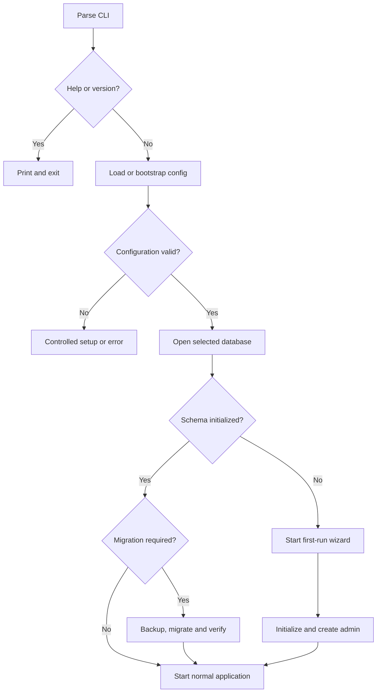
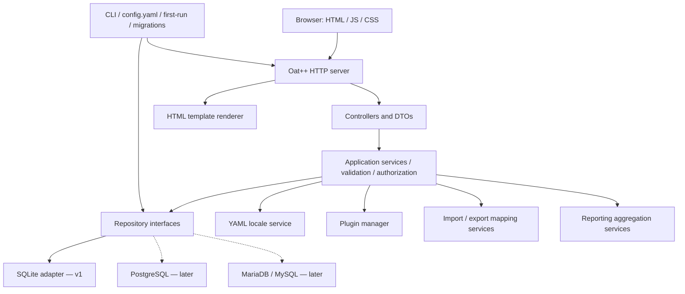

# PVLedger — Web Application Specification

**Document version:** Draft v0.5  
**Date:** 2026-11-23  
**Product:** PVLedger  
**Slogan (as supplied):** “Manager your personal assets with privacy”  
**Document status:** Working draft — requirements and proposed architecture; not a final implementation contract  
**Database reference:** `pvledger_database_spec(3).md` — *PVLedger Database Specification, Draft v0.7.1* (derived by that specification from `pvledger(7).sql`; adds `date INTEGER NOT NULL` to both new income tables)  
**Target release:** v1 (SQLite-first)  
**Scope of this revision:** Carry forward all v0.4 requirements and database spec v0.7.1 (20 tables/119 columns), and add the corrected `pvledger` executable name, statically linked core build, left-hand vertical navigation, database-populated reference selectors, file import/export wizards and chart-based reporting. No database schema changes are authorized by v0.5.

> **Reading guide:** **Required** means supplied by the project owner or established in the attached database specification. **Proposed** is a starting implementation choice that may be changed. **Later** means explicitly deferred or not yet specified. The database specification and its source SQL govern the *existing* schema; this document must not be read as permission to modify it silently.

---

## 1. Project overview

PVLedger is a privacy-oriented, self-hosted web application for managing personal financial accounts, balances, expenses, actual and planned income, debts, taxes, and related reference information. It runs as a standalone C++ web server and provides a browser-based interface. Application records remain in the database selected by the operator; the first release uses a local SQLite database.

### 1.1 Goals

1. Allow users to manage their personal financial information through a straightforward, multilingual web UI.
2. Keep the application suitable for local/private hosting without requiring a third-party cloud service.
3. Separate application code, HTML templates, JavaScript menu behavior, YAML translations, data access, and plugins.
4. Support a first-run initialization workflow and safe future schema upgrades.
5. Make future database engines and extensions possible without redesigning the whole application.
6. Offer controlled file-based import/export and accessible financial reporting without requiring a cloud service.

### 1.2 Scope and terminology

- **Instance:** One running PVLedger installation backed by its configured database.
- **Current account:** Checking/current funds account stored in `pvl_accounts_current`.
- **Credit account:** Account whose `amount` is the remaining debt, not the credit limit.
- **Savings account:** Account whose `amount` is the current funds held.
- **Financial entry:** Actual or planned income, expense, planned expense, recurring expense, debt, or tax record.
- **Income record:** A named actual or planned income amount associated with an existing current/checking account. Income status and posting behavior are not yet defined by the database.
- **Historical balance snapshot:** A dated *account balance* record in `pvl_account_history_current` or `pvl_account_history_savings`; it is not a transaction, cash flow, or live account balance.
- **Locale:** String such as `en_US`, `ru_RU`, `kk_KZ`, or `de_DE` corresponding to a YAML language file.
- **Plugin:** A locally installed extension discovered from the configured plugins directory and managed through the application registry.
- **Reference selector:** A form field backed by an existing database relationship; it stores the referenced record ID but shows a human-readable name/display name/username.
- **Import:** User-initiated file parsing, review, mapping and validated writes to existing PVLedger records; not bank synchronization.
- **Export:** User-initiated, authorized extraction of selected records into a downloadable file.
- **Report:** A filtered, read-only representation of persisted financial records, shown as charts and accessible tables.

**Outside v1 unless separately approved:** bank synchronization, online accounts/cloud services, investment portfolios, market-rate currency conversion, attachments, payment initiation, and automatic tax filing. The word *assets* in the product name/slogan does not imply that the current database already models real estate, vehicles, or securities.

### 1.3 Release strategy

| Area | v1 | Later |
|---|---|---|
| Backend | C++ / Oat++ | Continue same core |
| Build | CMake; **statically linked core `pvledger` executable** | Platform/toolchain and plugin compatibility validation |
| Database | SQLite | PostgreSQL; MariaDB / MySQL |
| UI | Server-rendered HTML placeholders + JavaScript-generated **left-side vertical menu**, database-backed selectors | Optional richer UI |
| Languages | File-backed locale system; initial `en_US`, with `ru_RU`, `kk_KZ`, `de_DE` supported as language-pack targets | Additional YAML packs |
| Authentication | Local users and roles | External identity integrations only if approved |
| Plugin system | Discover, validate, enable/disable registered local plugins; minimal extension API | Wider extension API, distribution and compatibility guarantees |
| Financial features | Work with records represented by the current 20-table database, including current/savings balance history and actual/planned income; add user-driven CSV/QIF/OFX/QFX import, export and reports | Additional accounting/asset models after schema changes |

---

## 2. Technology and platform

### 2.1 Required stack

| Layer | Technology | Notes |
|---|---|---|
| Backend / HTTP | **C++ with Oat++** | Controllers, request/response DTOs, routing, web server |
| Build | **CMake** | Executable target and output filename **`pvledger`**; statically linked core release binary |
| Database — v1 | **SQLite** | Oat++ SQLite adapter or equivalent dedicated repository implementation |
| Database — later | **PostgreSQL**, **MariaDB / MySQL** | Backend interfaces and engine-specific SQL/migrations |
| Database scripts | **SQL** | Initial schema, seed data, incremental migrations |
| Server views | **HTML templates with placeholders** | No SPA framework required |
| Client behavior | **JavaScript** | Left-side vertical menu, database-backed selectors, import/export wizard steps, report chart interactions |
| Localization | **YAML files** | One file per locale, e.g. `en_US.yaml` |
| File configuration | **YAML** | `config.yaml` |
| Themes | CSS and related assets | Theme selected in database, resources loaded from themes path |

**Proposed technical baseline:** C++17 or newer, with dependency versions pinned and validated by CI. **Required release packaging:** link the `pvledger` executable and its required core dependencies statically on supported release targets; exact toolchain and compatibility tests are specified in §13.4–13.6. Do not assume that PostgreSQL and MariaDB/MySQL share identical SQL or Oat++ adapters. Oat++ documents `oatpp-sqlite` and `oatpp-postgresql`; a MariaDB/MySQL data-access strategy still needs to be selected.

### 2.2 Runtime deployment (proposed)

- Run as a single HTTP server process on Linux initially; cross-platform support may be added or validated separately.
- Bind to `127.0.0.1` by default. Configurable host exposure can be introduced explicitly for trusted networks.
- Serve the UI and the JSON API from the same origin.
- If the instance is reachable across a network, deploy HTTPS through a reverse proxy or an explicitly configured TLS server.
- No telemetry, remote account, or outbound network traffic is required for normal use.
- **Optional Docker deployment:** supply a root `Dockerfile` and `docker-compose.yaml` alongside direct/native CMake build and deployment. Docker must not be required to develop or run PVLedger.

---

## 3. Functional requirements

| ID | Requirement | Status | Priority |
|---|---|---|---|
| APP-001 | Launch `pvledger -c /path_to_config_file` | Required | Must |
| APP-002 | Support `pvledger --help` and `pvledger --version` | Required | Must |
| APP-003 | Load and validate file-based settings from `config.yaml` | Required | Must |
| APP-004 | Use SQLite in v1 and preserve an interface for future database backends | Required | Must |
| APP-005 | Detect uninitialized instance and start a first-run wizard | Required | Must |
| APP-006 | Create the first user as part of initial setup | Required | Must |
| APP-007 | Support multilingual UI from locale-specific YAML files | Required | Must |
| APP-008 | Allow an admin to change the instance name, locale, currency and theme | Required / database-backed | Must |
| APP-009 | Implement login/logout and server-side authorization | Proposed application requirement | Must |
| APP-010 | Display and manage current, savings and credit accounts | Required by database scope | Must |
| APP-011 | Display and manage banks, countries and currencies | Required by database scope | Must |
| APP-012 | Display and manage expenses, categories, planned/recurring entries | Required by database scope | Must |
| APP-013 | Display and manage debts and taxes | Required by database scope | Must |
| APP-014 | Support three seeded user roles | Required by database | Must |
| APP-015 | Discover and manage local plugins | Required capability | Must |
| APP-016 | Run ordered, data-preserving DB migrations on upgrade | Required by DB version design | Must |
| APP-017 | Generate the main navigation menu with JavaScript | Required | Must |
| APP-018 | Permit UI theme selection and loading from configured theme directory | Required by settings/path design | Should |
| APP-019 | Provide basic financial summaries on a dashboard | Proposed | Should |
| APP-020 | Offer API documentation and automated tests | Proposed | Should |
| APP-021 | Add PostgreSQL support | Later | Later |
| APP-022 | Add MariaDB / MySQL support | Later | Later |
| APP-023 | Organize C++ implementation under `src/` and header files under `src/headers/` | Required | Must |
| APP-024 | Keep web page HTML templates in root `templates/` and client JavaScript in root `js/` | Required | Must |
| APP-025 | Store documentation under `docs/`, including application and database specifications in `docs/spec/`; provide root `README.md` | Required | Must |
| APP-026 | Provide root `Dockerfile` and `docker-compose.yaml` for **optional** container build and deployment | Required deliverables; optional deployment | Should |
| APP-027 | Support historical balance records for current/checking accounts via `pvl_account_history_current` | Required by DB v0.6.1 | Must |
| APP-028 | Support historical balance records for savings accounts via `pvl_account_history_savings` | Required by DB v0.6.1 | Must |
| APP-029 | Enforce mandatory history `id_account`, `date`, and `amount` fields and their parent-account foreign keys | Required by DB v0.6.1 | Must |
| APP-030 | Keep history snapshots distinct from live balances; do not infer automatic snapshot creation or synchronization | Required schema interpretation; automation undecided | Must |
| APP-031 | Initialize new databases using the v0.7.1 schema and one-time reference seeds; support safe, data-preserving upgrades from earlier schema versions | Required by DB v0.7.1 | Must |
| APP-032 | Support `pvl_income` actual-income records against a required current/checking account | Required by DB v0.7.1 | Must |
| APP-033 | Support `pvl_income_planned` planned-income records against a required current/checking account | Required by DB v0.7.1 | Must |
| APP-034 | For both income tables, enforce required `id_account`, `name`, `amount`, `status`, and `date` fields; validate date as Unix time and enforce foreign-key integrity | Required by DB v0.7.1 | Must |
| APP-035 | Keep income `status` mappings and transitions undefined until approved; never reuse planned-expense status mapping implicitly | Required schema interpretation | Must |
| APP-036 | Do not infer account balance posting, snapshot creation, or planned-to-actual income conversion from income table existence | Required schema interpretation; workflow undecided | Must |
| APP-037 | Expose proposed income and planned-income browser views and versioned REST resources, with authorized list/detail and a path to CRUD once status rules are defined | Proposed | Should |
| APP-038 | Support v0.6.1 → v0.7 additive income-table migration and v0.7 → v0.7.1 mandatory-date migration (only automatically for empty income tables) | Required by DB migration contract | Must |
| APP-039 | When migrating populated v0.7 income tables, block unsafe date-column enforcement pending accurate historic backfill and a reviewed table rebuild | Required by DB migration contract | Must |
| APP-040 | Preserve the existing current/savings balance-history behavior and the 430 seed records | Required by DB v0.7.1 | Must |
| APP-041 | Name the generated CMake executable and installed CLI command **`pvledger`** (not `vpledger`) | Required by owner, v0.5 | Must |
| APP-042 | Produce a **statically linked** `pvledger` core release binary and verify its linkage on each supported target | Required by owner, v0.5 | Must |
| APP-043 | Place a **vertical primary menu along the left edge** of the desktop web layout | Required by owner, v0.5 | Must |
| APP-044 | Populate fields representing database foreign keys from their referenced tables, displaying human-friendly names/display names/usernames while submitting actual IDs | Required by owner, v0.5 | Must |
| APP-045 | Provide a file-based **Import Wizard** accepting CSV, QIF and OFX/QFX inputs | Required by owner, v0.5 | Must |
| APP-046 | Provide a guided **Export Wizard** to select records, filters and file output, with safe download behavior | Required by owner, v0.5 | Must |
| APP-047 | Provide a **Reports** menu with pie charts for suitable categorical financial breakdowns | Required by owner, v0.5 | Must |
| APP-048 | Provide balance-versus-time charts based on stored current/savings history snapshots | Required by owner, v0.5 | Must |
| APP-049 | Import preview, account/column mapping, validation, duplicate review and error reporting occur before committing records | Proposed safeguards to satisfy import safely | Must |
| APP-050 | Exports and reports are role- and account-scoped, currency-aware and do not fabricate missing accounting data | Proposed safeguards to satisfy export/report safely | Must |

### 3.1 Main UI pages and modules

| UI section | Main pages / actions | Existing tables |
|---|---|---|
| Dashboard | Overview, balance totals by currency, outstanding debt, recent expenses | Aggregates from financial tables |
| Accounts | Current, savings, credit; list, create, view, edit, delete if unreferenced; view dated balance history for current and savings | `pvl_accounts_current`, `pvl_accounts_savings`, `pvl_accounts_credit`, `pvl_account_history_current`, `pvl_account_history_savings` |
| Expenses | Actual expenses, categories, planned expenses, recurring entries | `pvl_expenses`, `pvl_expenses_categories`, `pvl_expenses_planned`, `pvl_expenses_recurring` |
| Income | Actual income and planned income: browse, filter by account/date/status and maintain records after status policies are finalized (UI proposal) | `pvl_income`, `pvl_income_planned` |
| Liabilities | Debts, taxes | `pvl_debts`, `pvl_taxes` |
| Reference data | Banks, currencies, countries | `pvl_banks`, `pvl_currencies`, `pvl_countries` |
| Administration | Users, roles, plugins, instance settings | `pvl_users`, `pvl_user_roles`, `pvl_plugins`, `pvl_settings` |
| Data import | Import wizard; upload file, select format, map fields/accounts, preview, validate, confirm and review results | File input → explicit mappings to existing tables; no new import table required |
| Data export | Export wizard; choose dataset, format, filters, fields and download | Read-only extraction from authorized existing tables |
| Reports | Pie charts for categories and other valid breakdowns; balance-vs-time line charts; date/account/currency filters and accessible data tables | Aggregates of existing finance tables; current/savings histories for time series |
| System | Login, first-run setup, help/about, error pages | Application services |

**Required navigation placement:** a **vertical sidebar on the left** on desktop/tablet layouts. **Proposed menu order:** Dashboard · Accounts (Current / Savings / Credit; Balance History on Current/Savings account detail) · Income (Actual / Planned) · Expenses (Actual / Planned / Recurring / Categories) · Debts · Taxes · Banks · **Reports** (Expense Breakdown / Income Overview / Balance History) · **Data** (Import / Export) · Administration (Users / Plugins / Settings) · Reference Data (Countries / Currencies) · About. Child items should expand beneath the parent item. On narrow screens, preserve the menu as a left-origin sliding drawer opened by an accessible menu control; do not change it to a top horizontal desktop menu.

**CRUD behavior:** All forms validate required relationships, show readable errors, and prevent deletion of records that are still referenced by foreign keys. Reference seeds must not be reset on application restarts. A Viewer can see only authorized records; menu hiding is cosmetic, not a security boundary.

### 3.2 Account and financial display rules

The following meanings are **required by the database specification**:

| Database field | Meaning in UI |
|---|---|
| `pvl_accounts_current.amount` | Current available funds in a current/checking account |
| `pvl_accounts_savings.amount` | Current funds in a savings account |
| `pvl_account_history_current.amount` | Historical funds balance at the recorded timestamp for its linked current/checking account |
| `pvl_account_history_savings.amount` | Historical funds balance at the recorded timestamp for its linked savings account |
| `pvl_accounts_credit.amount` | Remaining debt on a credit account |
| `pvl_debts.amount` | Currently outstanding debt |
| `pvl_taxes.amount` | Tax amount for the record |
| `pvl_expenses.amount` | Expense amount |
| `pvl_expenses_planned.amount` | Expected/planned expense amount |
| `pvl_expenses_recurring.amount` | Recurring-expense amount (without a modeled frequency yet) |
| `pvl_income.amount` | Actual income amount for a linked current/checking account; recording does not itself imply balance posting |
| `pvl_income_planned.amount` | Planned income amount for a linked current/checking account; not a received payment |

**Important unresolved transaction rule:** Existing tables do not define whether creating/editing expenses **or income** automatically changes a current-account balance. Income has no independent currency FK: its amount is naturally interpreted in the linked current account's currency, but this is not a database-enforced conversion or posting rule. **Do not silently implement automatic balance changes in v1** before the owner selects and specifies the accounting rule. Until then, balances and financial entries can be recorded without inferring transfers, automatic deposits, automatic history snapshots or currency conversions. The UI must avoid implying that two values in different currencies can simply be added.

**Planned expense status codes (`pvl_expenses_planned.status`):**

| Value | UI label |
|---:|---|
| `0` | Planned |
| `1` | Processed |
| `2` | Processed with changes |
| `3` | Declined |

The source SQL permits `NULL` and does not enforce these codes. The application should validate its accepted values; treatment of existing `NULL` values is an open decision. Processing a planned expense into an actual `pvl_expenses` row requires an explicitly defined workflow to avoid duplicate records.

**Recurring expenses:** `pvl_expenses_recurring` has no recurrence interval/frequency field. v1 may provide manual CRUD for these records, but automatic recurring scheduling requires an approved schema extension or other explicitly specified rule store.

**Timestamps:** The `date` fields of both account-history tables **and both income tables** are `INTEGER NOT NULL`. Other pre-existing `date` and `billing_date` fields retain their original nullability. Draft application convention is Unix epoch **seconds** in UTC; locale-specific formatting is a presentation concern. Exact income event/posting timing, timezone, date-only behavior and snapshot cutoff need final definition.

### 3.3 Historical balance snapshots (database v0.6.1)

The database adds **two** separate tables for account balances at specific points in time. The following schema shape is authoritative; page design and operations are proposed.

| Table | Required account relationship | Required snapshot fields | Meaning |
|---|---|---|---|
| `pvl_account_history_current` | `id_account INTEGER NOT NULL` → `pvl_accounts_current.id` | `date INTEGER NOT NULL`; `amount REAL NOT NULL` | Current/checking account funds held at the recorded time |
| `pvl_account_history_savings` | `id_account INTEGER NOT NULL` → `pvl_accounts_savings.id` | `date INTEGER NOT NULL`; `amount REAL NOT NULL` | Savings account funds held at the recorded time |

Each table also contains `id INTEGER PRIMARY KEY AUTOINCREMENT`. Both foreign keys use `NO ACTION` on update and delete, and every SQLite connection must have foreign-key enforcement enabled. A history record **must belong to an existing account**; the account's own `id_currency` determines the snapshot currency, because neither history table has an `id_currency` field.

**Required interpretation:** `amount` is an *absolute balance at `date`*, not a transaction amount, debit/credit, balance change, or current/live balance. `pvl_accounts_current.amount` and `pvl_accounts_savings.amount` remain the separate current balances. No SQL trigger or documented rule synchronizes snapshots with those live amounts. Do not automatically change either value from edits to the other until the behavior has been explicitly specified.

**Proposed v1 UI:** Show a chronological history table (date/time, amount, linked account currency) and optional trend chart in current/savings account detail screens; permit viewing/filtering by a date range. A create/edit/delete form for history entries is a *proposed* UI operation, subject to an approved snapshot capture and correction policy. Do not fabricate past balances by extrapolating current values or expenses.

**Explicitly not specified in the database:** snapshot frequency (daily, end-of-day, manual or on change), duplicate-handling policy for the same `(id_account, date)`, retrospective corrections, chart downsampling and account-history retention. There is **no unique `(id_account, date)` constraint** and **no composite index on those two columns** in the uploaded specification. Any app-side restriction or index requires a separately approved decision/migration. These history tables do not cover credit accounts. All timestamps follow the draft UTC Unix-seconds convention, not an enforced database time-zone setting.

### 3.4 Actual and planned income (database v0.7.1)

The database adds **two** income tables in v0.7, then v0.7.1 makes their respective `date` columns mandatory. The following physical field contracts are authoritative; page design, status codes, accounting effects and workflows are not.

| Table | Field | SQLite type / requirement | Meaning |
|---|---|---|---|
| `pvl_income` | `id` | `INTEGER` primary key, autoincrement | Actual income record ID |
| `pvl_income` | `id_account` | `INTEGER NOT NULL`; FK → `pvl_accounts_current.id` | Existing associated current/checking account |
| `pvl_income` | `amount` | `REAL NOT NULL` | Recorded income amount |
| `pvl_income` | `name` | `TEXT NOT NULL` | Required income label |
| `pvl_income` | `status` | `INTEGER NOT NULL` | Required, but code meanings are undefined |
| `pvl_income` | `description` | `TEXT NULL` | Optional notes |
| `pvl_income` | `date` | `INTEGER NOT NULL` | Income event Unix timestamp (UTC seconds by draft convention) |
| `pvl_income_planned` | `id` | `INTEGER` primary key, autoincrement | Planned income record ID |
| `pvl_income_planned` | `id_account` | `INTEGER NOT NULL`; FK → `pvl_accounts_current.id` | Existing associated current/checking account |
| `pvl_income_planned` | `name` | `TEXT NOT NULL` | Required planned income label |
| `pvl_income_planned` | `amount` | `REAL NOT NULL` | Planned income amount |
| `pvl_income_planned` | `status` | `INTEGER NOT NULL` | Required, but code meanings are undefined |
| `pvl_income_planned` | `description` | `TEXT NULL` | Optional notes |
| `pvl_income_planned` | `date` | `INTEGER NOT NULL` | Expected/planned event Unix timestamp (UTC seconds by draft convention) |

**Hard constraints:** Both FKs are required and use `NO ACTION` on update/delete. No independent `id_currency`, `id_user`, processed-at timestamp, created-at timestamp, link between actual and planned income, status `CHECK`, or automatic accounting trigger is defined. An income amount can be displayed with the *linked account's* currency; an income record with a nonexistent account must be rejected. Neither income table is a balance-history snapshot.

**Proposed UI behavior:** Display actual and planned income separately with account, amount, currency (from account), date and status. Provide date-range and account filters and readable display of unknown status integers while code semantics are undecided. The status should not be labeled “Processed” or otherwise interpreted based on the **planned-expense** code map. Forms should require all five non-key required fields and validate numeric/timestamp types; domain-specific status choices, create/update processing buttons and completion actions must await an approved status transition table. The ability to perform basic CRUD is a proposed design, not a workflow established by the schema.

**No implied posting/settlement:** Creating an actual income row does not automatically increase `pvl_accounts_current.amount`; creating planned income does not create actual income; changing either does not automatically write `pvl_account_history_current`. Define receipt/booking dates, negative amount policy, correction/deletion semantics, visibility through parent account ownership, currency handling and planned→actual reconciliation before adding those behaviors.

**Validation:** `date` must be an integer Unix timestamp, with UTC epoch seconds as the draft convention. The database has no default for either `date` and no constraint enforcing timestamp units; missing values must be rejected. `amount` and `status` are non-NULL (`REAL` and `INTEGER` respectively), but no positive-only amount rule or status code range exists in the schema. If incoming values are not yet understood, do not fabricate a business state.


### 3.5 Database-backed reference fields in the UI (v0.5)

**Required behavior:** In create/edit/filter forms and applicable tables, any field corresponding to a database foreign key must obtain selectable items from its *actual referenced table*. The submitted/persisted value remains the referenced primary-key ID; the visible UI label must be a human-readable field instead of an unexplained numeric ID. Where the source table has `name`, show it. For users prefer `displayname` when present, otherwise `username`; where display name is not populated and username is null, use a clearly identified safe fallback such as `User #<id>` only as a last resort. Do **not** change the stored schema or imply that labels are unique IDs.

| Relational field(s) / context | Lookup table | Primary visible label |
|---|---|---|
| `id_bank` on current/savings/credit accounts | `pvl_banks` | `name` |
| `pvl_banks.id_countries` | `pvl_countries` | `name` (optionally append `iso` to disambiguate) |
| `id_currency` on accounts/expenses/planned expenses, `pvl_settings.default_currency` | `pvl_currencies` | `name` (optionally append `iso`) |
| `id_user` on account forms | `pvl_users` | `displayname` → `username` |
| `pvl_users.id_role` | `pvl_user_roles` | `name` |
| `id_current_account` on credit account, and current-account `id_account` on expenses, planned/recurring expenses, debts, taxes, actual/planned income | `pvl_accounts_current` | `name` (optionally append user/currency if authorized) |
| `pvl_account_history_current.id_account` | `pvl_accounts_current` | `name` |
| `pvl_account_history_savings.id_account` | `pvl_accounts_savings` | `name` |
| `id_category` on expenses and recurring expenses | `pvl_expenses_categories` | `name` |

**Proposed implementation:** A reusable lookup/select component queries authorized, filtered lookup endpoints; small lists may preload, while large lists should use paginated search/autocomplete. Populate before the user edits the field, keep the current selection visible, refresh when another selection affects valid choices, and localize validation/empty/loading states. The backend always verifies that the submitted ID exists, matches the required table and is allowed for the current user. Do not rely on the HTML label as the key or assume that all table columns named `id_*` have the same relationship. No new database tables are required.

### 3.6 Import Wizard — CSV, QIF and OFX/QFX (v0.5)

**Required:** Add a step-based Import Wizard reachable from the left navigation. It accepts local files in **CSV**, **QIF**, and **OFX/QFX** formats. OFX/QFX support is file parsing, not a bank connection or online synchronization. This wizard does **not** assume an unmodeled general transaction table exists.

**Proposed workflow:** (1) select a file and detect/confirm format; (2) select the target current account and intended target data type (e.g., actual expenses or actual income), with the destination restricted to currently modeled fields; (3) map source columns/payees, dates, amount signs, currencies and categories to supported PVLedger fields; (4) preview parsed rows, required fields, validation errors, and potential duplicates; (5) explicitly confirm authorized writes; (6) show imported/skipped/failed counts and downloadable error details. CSV mapping should allow delimiter, encoding, header, decimal separator, and date-format choices. QIF parsing should support its applicable account/transaction conventions; OFX/QFX should parse supported SGML/XML variants and transaction identifiers when present. Unsupported formats/record types must be explained, not silently discarded.

**Data integrity and security:** Never automatically post imported rows to a live account balance or create history snapshots; those accounting workflows remain undecided in §3.2–3.4. Where the source lacks a mandatory field (for example, `pvl_income.status`), request a deliberate mapping or rule approved for that table rather than inventing a code. Preserve date accuracy and currency context; do not silently convert foreign currencies. Validate file size, encoding, content type, malformed OFX/XML, duplicate detection and account/role permissions. Show duplicate candidates with a review choice (e.g. skip/import) rather than assuming uniqueness that the schema does not enforce. Use transactions or clearly disclosed batch-commit behavior; partial import results must be auditable in the result summary without adding a database audit table implicitly.

### 3.7 Export Wizard (v0.5)

**Required:** Add an Export Wizard reachable from the left navigation. Users can choose which authorized data to export, such as accounts, history snapshots, expenses, actual/planned income, debts, taxes, and supported reference information. Offer filters (account, dates, status where defined, currency), a preview/count, and download of the resulting file.

**Proposed formats:** **CSV is the baseline output format**; QIF and standard OFX are additional targets only for datasets representable in those formats. QFX output is **not guaranteed** because of institution-specific conventions, even though QFX input is required. JSON may be added as a PVLedger-native interchange format. Define field sets and how account IDs are represented (stable IDs plus readable names) before finalizing each exporter. Do not claim that an export is a full database backup, a bidirectional lossless round trip, or an unsupported financial interchange standard.

**Proposed workflow:** Choose scope → choose format → set columns/locale/date/currency options → preview record count and compatibility warnings → confirm → download. Exports must respect backend authorization, protect passwords/secrets, escape CSV spreadsheet-formula risks, use predictable filenames and UTF-8 where possible, stream larger files with resource limits, and clearly state which fields/formats cannot be represented. File generation must not change balances or other financial data.

### 3.8 Reports and charts (v0.5)

**Required:** Include a left-sidebar **Reports** section supporting **pie charts** and **balances versus time** charts, with filtering and clear labels. Reports are read-only; access is checked server-side for every chart and its data endpoint.

| Report | Suggested visualization | Source/accuracy rule |
|---|---|---|
| Expense distribution by category | Pie chart with amounts and percentages, plus accessible table | `pvl_expenses` grouped by `pvl_expenses_categories`, respecting account/currency/date filtering |
| Expense distribution by account | Pie chart with legend and table | Actual `pvl_expenses` grouped by linked current account; one currency at a time |
| Income versus expenses over a period | Time series or grouped bars (proposed) | Actual `pvl_income` and `pvl_expenses` only; income status treatment awaits approved rules |
| Current account balance history | Balance vs. time **line chart** with points | Actual snapshots from `pvl_account_history_current.date/amount` |
| Savings account balance history | Balance vs. time **line chart** with points | Actual snapshots from `pvl_account_history_savings.date/amount` |

**Required interpretation:** Time-series plots use recorded Unix-second timestamps, displayed in the chosen UI locale/timezone; they do **not** synthesize daily balances between snapshots. Credit accounts have no balance-history table. Histories may contain multiple records at one timestamp; graph behavior for equal timestamps should be documented rather than treated as a database uniqueness guarantee. Do not merge values in different currencies without an approved exchange-rate model, and do not represent planned income as received income or planned expenses as actual spending.

**Proposed UI:** Chart type and filter controls, account/currency selector populated through §3.5, configurable date range, readable legends/units, a no-data state and a synchronized accessible tabular view. Chart calculations should be testable independently of the JavaScript chart renderer. Financial reports may also be downloadable through the Export Wizard; that is a proposed integration, not a new database requirement.

---

## 4. First-run wizard

### 4.1 Startup and detection

On startup, PVLedger loads its selected configuration, validates paths and database settings, and determines whether the database schema exists and whether initialization is complete. An initialized instance has the expected schema, **exactly one** `pvl_settings` row, and at least one usable administrator account. If there is a database version mismatch, the migration procedure runs before normal application routes become available.

**Proposed setup-safety rule:** Before an administrator exists, only setup routes are available and the server binds to loopback. If `config.yaml` has not yet been created, use an explicitly documented bootstrap address/port (proposed `127.0.0.1:8080`) and create the requested `-c` file only after the user saves validated settings. Do not expose an unclaimed administrator-creation route to the public Internet.

### 4.2 Wizard screens (proposed order)

1. **Welcome / Language** — choose available locale (`en_US`, `ru_RU`, `kk_KZ`, `de_DE`, etc.); load translations immediately; preview app name.
2. **Database** — SQLite path for v1; future engines display host, port, database, username and password options but are disabled until supported.
3. **Application server** — choose listening port, confirm local/private network exposure and configuration file location.
4. **Instance preferences** — optional instance name (default blank), default currency, and theme.
5. **Administrator** — create the first user with username, password and optional display/personal names. Assign seeded role ID `1` (Administrator).
6. **Review and initialize** — show a redacted settings summary; validate paths, permissions, database write access and locale files; initialize schema and reference data.
7. **Complete** — confirm setup and direct the administrator to login/dashboard; setup routes become unavailable after successful completion.

### 4.3 Wizard persistence and error handling

- Write database engine details, endpoint port, directories and database connection data to `config.yaml`.
- Write `db_version`, `lang`, `instance_name`, `default_currency`, `theme` and other relevant persisted preferences to the **single** `pvl_settings` record.
- On a **fresh** database, create all **20 v0.7.1 tables** (including both account-history tables) and apply the **430 authoritative reference rows once**: 249 countries, 178 currencies and 3 roles. Create the first user separately; the SQL does not seed one. `CREATE TABLE IF NOT EXISTS` does **not** make fixed-ID seed `INSERT` statements repeatable: detect previous initialization and skip/reconcile seeds rather than blindly rerunning them.
- Run database changes inside transactions where supported. Never leave a half-initialized database silently marked complete.
- Create a settings record once; subsequent starts reuse it and do not reset user changes.
- Handle invalid locale, duplicate username, unwritable config, failed database connection and incomplete initialization with recoverable error messages.
- Write configuration atomically (temporary file then rename where supported), preserve restrictive permissions, and never log passwords or connection secrets.
- The v0.7.1 schema described by the updated database specification has no `DROP TABLE` statements. Treat fresh initialization and incremental upgrades as separate workflows; never run a full seed script as an upgrade or restart action.

---

## 5. Command-line interface

### 5.1 Required commands

```text
pvledger -c /path_to_config_file
pvledger --help
pvledger --version
```

| Option | Required behavior |
|---|---|
| `-c <path>` | Load the specified YAML configuration file; if not yet created, use this as the target path for first-run setup if its directory is writable. |
| `--help` | Print syntax, options and short descriptions, then exit successfully without starting the web server. |
| `--version` | Print application name and semantic version, and optionally build/commit details; do not require database access. |

**Proposed additions (not yet required):** `--check-config`, `--migrate`, `--backup <path>`, `--verbose` and `--log-level`. Whether plain `pvledger` without `-c` looks for a default config remains an open decision.

### 5.2 Startup state machine



---

## 6. Configuration model

Two stores are **required**. Configuration that must be known before database access belongs in `config.yaml`; mutable application/user-facing preferences belong in `pvl_settings`.

### 6.1 `config.yaml` — file-based bootstrap/runtime configuration

**Required categories:** database engine; corresponding database connection parameters; application port; language files path; plugins path; themes path.

**Example v1 configuration (proposed keys):**

```yaml
# PVLedger example config.yaml — illustrative draft format
app:
  host: "127.0.0.1"       # proposed security-oriented default
  port: 8080               # configurable

database:
  engine: "sqlite"         # sqlite | postgresql | mariadb | mysql (later)
  sqlite:
    path: "./data/pvledger.sqlite"
  # postgresql:             # later
  #   host: "127.0.0.1"
  #   port: 5432
  #   database: "pvledger"
  #   username: "pvledger"
  #   password_env: "PVLEDGER_DB_PASSWORD"
  # mariadb:                # later; MySQL analogous
  #   host: "127.0.0.1"
  #   port: 3306
  #   database: "pvledger"
  #   username: "pvledger"
  #   password_env: "PVLEDGER_DB_PASSWORD"

paths:
  languages: "./lang"
  plugins: "./plugins"
  themes: "./themes"
```

**Proposed security and validation rules:**

- `password_env` is a **proposed application feature**, not native YAML substitution. If implemented, PVLedger explicitly reads the named environment variable; document alternatives and supported precedence. Direct YAML `password` can be supported if truly needed, but must be redacted from logs/UI and protected with filesystem permissions.
- Resolve relative paths relative to the config file's directory, not the process working directory; document this as the chosen rule.
- Reject unknown database engines and invalid ports (`1`–`65535`); check required files/directories.
- Never print secrets with `--help`, `--version` or startup logs.
- Changing database engine in this file does **not** automatically migrate data between engines.

### 6.2 Database-backed preferences (`pvl_settings`)

The attached schema defines these fields:

| Field | Role / behavior |
|---|---|
| `id` | Row identifier; application enforces one-row invariant |
| `db_version` | Current database schema version for migration planning |
| `instance_name` | Customizable name in UI; blank initially |
| `lang` | Current application language, chosen at setup |
| `default_currency` | Optional FK to `pvl_currencies.id` |
| `demo_mode` | Integer flag; behavior/code mapping not yet specified |
| `theme` | Selected theme identifier/name |

**Proposed preference precedence:** `config.yaml` owns connectivity and directory paths; `pvl_settings` owns instance display/preferences. For locale, use a setup/browser fallback only before DB initialization. The single configured locale is instance-wide until a per-user preference model is added.

---

## 7. Localization and internationalization

### 7.1 Required behavior

- Translation files are UTF-8 YAML located in the configured language directory: `en_US.yaml`, `ru_RU.yaml`, `kk_KZ.yaml`, `de_DE.yaml`, etc.
- The application discovers installed languages and exposes them in the wizard and settings UI.
- Text strings in server-rendered templates, JavaScript menus, forms, validation messages, notifications and error pages use translation keys; avoid hardcoded English in business UI.
- `pvl_settings.lang` stores the selected locale identifier (`en_US`, etc.).
- Language changes should affect the next rendered response and dynamically rebuilt menu, without changing financial data.

### 7.2 Proposed YAML format

```yaml
# lang/en_US.yaml
meta:
  locale: en_US
  name: English (United States)
  direction: ltr
app:
  name: PVLedger
  slogan: "Manager your personal assets with privacy"
menu:
  dashboard: Dashboard
  accounts: Accounts
  current_accounts: Current accounts
  savings_accounts: Savings accounts
  credit_accounts: Credit accounts
  expenses: Expenses
  income: Income
  planned_income: Planned income
  reports: Reports
  expense_breakdown: Expense breakdown
  balance_trends: Balance history
  data: Data
  import: Import
  export: Export
  settings: Settings
wizard:
  title: Initial setup
  create_admin: Create administrator
  import_preview: Review import
  import_confirm: Import selected records
  export_select: Select export data
reports:
  no_data: No data for the selected filters
  balance_over_time: Balance over time
lookups:
  select_value: Select a value
  no_matches: No matching records
buttons:
  save: Save
  cancel: Cancel
errors:
  required: "{field} is required"
```

**Proposed fallback:** Requested locale → `en_US` string → visibly flagged missing-translation key in development (do not expose sensitive internals in production). Validate YAML parse errors at startup. Keep stable keys across languages; document variable interpolation and pluralization behavior before writing complete translation packs.

### 7.3 Dates, currency and number formatting

- Keep underlying amounts and timestamps independent from translations.
- Format dates/numbers consistently for the active locale; support Unicode and non-Latin alphabets.
- Currency labels should use the ISO code supplied in `pvl_currencies.iso` where present; names in the database remain the supplied localized names, not automatically translated versions.
- Cross-currency summation requires an approved exchange-rate model; it is not a localization feature.

---

## 8. Frontend templates, navigation and themes

### 8.1 Rendering model (proposed)

- Oat++ serves complete HTML pages based on templates, while JSON endpoints supply list/form data and selected dynamic content.
- Template placeholders use a documented syntax such as `{{page.title}}`, `{{current_user.display_name}}`, `{{content}}` and `{{asset.theme_css}}` (syntax is illustrative, not a committed template engine).
- **All substitutions are HTML-escaped by default.** Only controlled, explicitly trusted template fragments may contain HTML markup; avoid raw injection from user-provided text.
- **Required desktop layout:** header + persistent **left vertical navigation/sidebar** + main content to its right + footer. The vertical menu remains visible while navigating across ordinary pages; narrow screens use a left-origin accessible drawer. Templates must not store authentication/authorization policy.

**Illustrative base template:**

```html
<!doctype html>
<html lang="{{locale}}">
<head>
  <meta charset="utf-8">
  <meta name="viewport" content="width=device-width, initial-scale=1">
  <title>{{page.title}} — {{app.name}}</title>
  <link rel="stylesheet" href="{{asset.theme_css}}">
</head>
<body>
  <header>{{app.name}}</header>
  <div class="app-layout">
    <aside id="sidebar" class="sidebar sidebar--left">
      <nav id="pvledger-menu" aria-label="Main navigation"></nav>
    </aside>
    <main id="main-content">{{content}}</main>
  </div>
  <script src="/assets/js/menu.js" defer></script>
</body>
</html>
```

### 8.2 JavaScript-generated menu

- `menu.js` builds a **left-aligned vertical navigation tree** from a stable menu definition (or from a server endpoint such as `GET /api/v1/ui/menu`).
- Use translation keys and current locale when creating visible labels.
- The server filters available menu entries by role and enabled plugin registrations.
- Child sections expand **vertically under their parent**; support active-route highlighting, keyboard focus/ARIA, and a compact left-edge mobile drawer (not a desktop top navigation bar). Reports and Data (Import/Export) are first-class menu groups.
- Client-side menu hiding must **never** substitute for backend route permission checks.
- Plugin menu items are validated and namespaced to avoid collisions.

### 8.3 Theme system

- Theme files live under `paths.themes`, with a default fallback theme supplied in the distribution.
- `pvl_settings.theme` selects the active theme identifier.
- Themes should supply CSS, colors, static assets and optionally layout overrides if approved.
- Enforce path containment and only serve allowlisted static files; a theme identifier must not become arbitrary filesystem access.
- User-switchable theme support is proposed as an instance-wide preference in v1.

---

## 9. Authentication, users and authorization

### 9.1 Source contract

- The first user is created by the setup wizard; no users are present in initial SQL seed data.
- Users live in `pvl_users`; roles in `pvl_user_roles`; every user requires a valid `id_role`.
- Seeded roles and fixed IDs: `1` **Administrator**, `2` **Read/Write**, `3` **Viewer**.
- The current database contract stores `pvl_users.password` as a 64-character hex **SHA-256** digest by application convention. The schema also permits `NULL`; new user creation should require credentials even though SQL does not enforce it.

**Security decision needed before production:** Plain SHA-256 is unsuitable for password storage, as it is fast and provides no built-in per-password salt/work factor. The owner-confirmed database convention is recorded here for fidelity, **not endorsed as a safe production scheme**. Prefer a salted adaptive password KDF such as Argon2id and a controlled migration of the password representation before an Internet-accessible release.

### 9.2 Proposed permissions

| Operation | Administrator | Read/Write | Viewer |
|---|---|---|---|
| View authorized financial/reference records | Yes | Yes | Yes |
| Create/update financial records | Yes | Yes | No |
| Delete eligible unreferenced financial records | Yes | Yes | No |
| Change instance settings | Yes | No | No |
| Manage users/roles/plugins | Yes | No | No |
| Apply DB migrations | Server maintenance process only | No | No |

**Undecided:** Whether financial records are visible to all users or only to their `id_user` owner. Current schema includes `id_user` on account tables but not directly on all child records. No role privileges are defined in SQL; the table above is a proposal. `pvl_users.is_admin` is present alongside `id_role` and needs a single, non-contradictory authorization rule.

### 9.3 Session and application security (proposed)

- Authenticate on server; use an HttpOnly, SameSite session cookie, with `Secure` when served over HTTPS.
- Regenerate session on login; enforce inactivity expiration and logout invalidation.
- Require CSRF defenses for cookie-authenticated state-changing requests.
- Validate DTOs and form inputs server-side; parameterize SQL; escape HTML; sanitize errors.
- Limit login attempts and avoid revealing whether a username exists.
- Protect configuration and DB files with restrictive permissions; never log credentials, cookies or financial record payloads.
- Disable setup and admin-creation endpoints after initialization; do not allow unsafe plugin code to run by default.

---

## 10. Database architecture and schema compatibility

### 10.1 Authoritative database reference

**The attached database specification v0.7.1 is the authority** for the exact SQLite table/column names, types, nullability, foreign keys, indexes, seed IDs and initial data. It derives the v0.7.1 schema from `pvledger(7).sql` by adding `date INTEGER NOT NULL` to each income table; the original v0.7 SQL alone does **not** include those two fields. Summary: **20 tables, 119 columns, 26 foreign keys (25 required, 1 optional), one explicit secondary index and 430 seed records** (249 countries + 178 currencies + 3 roles). This revision updates the application specification from the attached *database specification*; the derived SQL and migration files named there were not provided here and must be obtained/verified before implementation.

**Table inventory:**

| Category | Tables |
|---|---|
| Accounts | `pvl_accounts_current`, `pvl_accounts_savings`, `pvl_accounts_credit` |
| Balance history (new in DB v0.6) | `pvl_account_history_current`, `pvl_account_history_savings` |
| Expenses/planning | `pvl_expenses`, `pvl_expenses_categories`, `pvl_expenses_planned`, `pvl_expenses_recurring` |
| Income (added in DB v0.7/v0.7.1) | `pvl_income`, `pvl_income_planned` |
| Other financial | `pvl_debts`, `pvl_taxes` |
| Reference | `pvl_banks`, `pvl_countries`, `pvl_currencies` |
| Administration | `pvl_users`, `pvl_user_roles`, `pvl_settings`, `pvl_plugins` |

**Existing constraints and gotchas:**

- SQLite connections must enable `PRAGMA foreign_keys=ON`.
- **25 foreign keys are required** and the sole optional FK is `pvl_settings.default_currency`; all use `NO ACTION` on deletes and updates. Do not rely on automatic cascading deletion. Both history `id_account` foreign keys are `NOT NULL`, as are history `date` and `amount`. Both new income account references and their `name`, `amount`, `status`, `date` fields are also `NOT NULL`.
- The unique `ux_pvl_currencies_iso` index allows multiple `NULL` ISO codes; country ISO has no schema-level uniqueness constraint.
- Financial `amount` fields are SQLite `REAL`, not fixed precision. Earlier financial amounts remain nullable as originally defined; both history and both income `amount` fields are **NOT NULL**. Rounding and eventual decimal migration need a policy.
- Historical balances are snapshots, not transaction deltas or live account balances; no SQL triggers reconcile the two representations. Neither history table enforces a unique `(id_account, date)` pair or supplies an index on it.
- Both income tables require `date INTEGER NOT NULL` and `status INTEGER NOT NULL`. Income statuses have **no approved mappings**; planned expense codes 0–3 do not apply by implication. Income tables have no separate currency field or FK to one another.
- The v0.7.1 schema is a **derived** revision: do not run the unchanged `pvledger(7).sql` and claim its two income date columns exist.
- The v0.7.1 schema described by the reference has no `DROP TABLE` statements but uses non-idempotent fixed-ID reference inserts. Treat one-time seeding separately from repeatable schema detection.
- `pvl_settings` must contain exactly one row **by application rule**; SQL itself does not enforce it.
- `db_version` is a database schema version, **not** the document version or app binary version.
- Recurrence frequency, role permissions, other integer flags, and detailed billing/interest conventions are not specified by the schema.

### 10.2 Repository and adapter design (proposed)

Define interfaces such as `IDatabaseConnection`, `IAccountRepository`, `IAccountHistoryRepository`, `IIncomeRepository`, `IPlannedIncomeRepository`, `IExpenseRepository`, `ISettingsRepository`, `IUserRepository`, and `IMigrationRunner`. Oat++ controllers call services; services call repositories. Central business rules should not depend on SQLite-specific SQL. Use dedicated per-engine SQL when syntax differs.

**Engine policy:**

| Engine | Availability | Notes |
|---|---|---|
| `sqlite` | v1 | Local database file; Oat++ SQLite adapter available |
| `postgresql` | Later | Oat++ PostgreSQL adapter available; distinct SQL and sequence handling |
| `mariadb` | Later | Select and validate compatible data-access implementation |
| `mysql` | Later | Select and validate compatible data-access implementation |

An engine switch is a new connection target, **not an automatic cross-engine migration**. Cross-engine export/import, including primary-key mapping and type conversion, is separate future work.

### 10.3 Initialization and migration policy

1. **Fresh database only:** Create the **20-table, 119-column v0.7.1** schema from the *derived and verified* v0.7.1 SQL. Import the 430 explicit-ID reference rows exactly once and create the first administrator separately. The schema uses `CREATE TABLE IF NOT EXISTS`, but the fixed-ID seed `INSERT`s are **not idempotent**; do not rerun the complete initializer on a populated instance.
2. **Existing database:** Read the singleton `pvl_settings.db_version`, compare against supported migration versions, make a backup and run only the missing incremental migrations. Commit/update the tracked schema version only after validation succeeds. Do not reset application settings or duplicate seed data.
3. **Earlier history migrations:** v0.5 → v0.6.1 adds the current/savings balance-history tables; v0.6 → v0.6.1 requires reconciling any `NULL pvl_account_history_current.id_account` links before rebuilding that table with `NOT NULL`. Do not discard orphaned history to force the migration.
4. **v0.6.1 → v0.7:** Add `pvl_income` and `pvl_income_planned` without recreating the previous 18 tables or reseeding data. The database specification references `pvledger_migration_v0.6.1_to_v0.7.sql` for this step (a named external artifact, **not included with this application-spec update**).
5. **v0.7 → v0.7.1:** Add `date INTEGER NOT NULL` to **both** income tables. The referenced `pvledger_migration_v0.7_to_v0.7.1.sql` is safe to execute automatically **only when both tables are empty**. The spec recommends running that SQLite script with `sqlite3 -bail`. Never blindly add a required column without a default to a populated SQLite table.
6. **Populated v0.7 income tables:** **Block automatic migration**; inspect existing rows, gather accurate historic timestamps and use a specifically reviewed, data-preserving backfill/table-rebuild procedure to enforce `date NOT NULL`. Do **not** invent timestamps, silently create defaults, delete records, or claim migration success before verifying row counts and data.
7. **General verification:** Check all 20 tables, both mandatory income dates, `25` required foreign keys (`26` total), source seed counts, and stored user/finance data; use `PRAGMA foreign_keys=ON` on every SQLite connection and `PRAGMA foreign_key_check` as part of validation. Refuse unknown newer schema versions and unsupported downgrades. For future PostgreSQL/MySQL/MariaDB backends, use engine-specific migration SQL.
8. **Provenance rule:** `pvledger(7).sql` by itself is only **v0.7**, not final v0.7.1. The updated database specification names the derived `pvledger_schema_v0.7.1.sql` and migration files; obtain the actual approved files under `sql/sqlite/` before a build/deploy can claim v0.7.1 support.

**Integration note:** Oat++ has a schema migration facility, but its version bookkeeping must be reconciled with the project requirement to keep the current schema version in `pvl_settings.db_version`. Use one authoritative migration flow or an explicitly synchronized design; do not maintain conflicting migration versions.

---

## 11. REST API sketch (proposed)

The browser UI should use a versioned, same-origin API prefix `/api/v1`. This is a *route proposal*; exact payloads, status codes, RBAC filters and business transitions need implementation-level definitions. Controllers use Oat++ DTOs and services. Return JSON for API requests; use HTML views for browser navigation.

| Resource | Example routes | Typical functionality |
|---|---|---|
| Session | `POST /api/v1/auth/login`, `POST /api/v1/auth/logout`, `GET /api/v1/auth/me` | Authentication and current user |
| Dashboard | `GET /api/v1/dashboard` | Aggregated summary grouped by currency |
| Accounts | `/api/v1/accounts/current`, `/api/v1/accounts/savings`, `/api/v1/accounts/credit` | GET collection; POST create; GET/PATCH/DELETE `/{id}` |
| Current account balance history | `GET /api/v1/accounts/current/{id}/history` and proposed `POST /api/v1/accounts/current/{id}/history` | List dated absolute balances; creation pending snapshot policy |
| Savings account balance history | `GET /api/v1/accounts/savings/{id}/history` and proposed `POST /api/v1/accounts/savings/{id}/history` | List dated absolute balances; creation pending snapshot policy |
| Banks | `/api/v1/banks` | CRUD |
| Countries | `/api/v1/countries` | Read/list; admin-managed edits if allowed |
| Currencies | `/api/v1/currencies` | Read/list; admin-managed edits if allowed |
| Expenses | `/api/v1/expenses` | CRUD |
| Expense categories | `/api/v1/expense-categories` | CRUD |
| Planned expenses | `/api/v1/planned-expenses` | CRUD and validated status changes |
| Recurring expenses | `/api/v1/recurring-expenses` | CRUD only pending recurrence model |
| Actual income | `GET /api/v1/income`, `GET /api/v1/income/{id}`; proposed `POST /api/v1/income`, `PATCH/DELETE /api/v1/income/{id}` | Account-scoped actual income records; writes/transition logic need approved status rules |
| Planned income | `GET /api/v1/planned-income`, `GET /api/v1/planned-income/{id}`; proposed `POST /api/v1/planned-income`, `PATCH/DELETE /api/v1/planned-income/{id}` | Account-scoped planned income records; no automatic conversion to actual income |
| Debts | `/api/v1/debts` | CRUD |
| Taxes | `/api/v1/taxes` | CRUD |
| Users | `/api/v1/users` | Admin CRUD; avoid exposing password digests |
| Roles | `/api/v1/roles` | Read roles; modification policy TBD |
| Reference lookup values | `GET /api/v1/lookups/{resource}` (or existing authorized list endpoints) | Resolve `{id,label}` options from the correct referenced table, including user displayname/username fallback |
| Import | `POST /api/v1/import/preview`, `POST /api/v1/import/commit` (proposed) | Parse CSV/QIF/OFX/QFX; map records, preview warnings, confirm validated writes |
| Export | `POST /api/v1/export/preview`, `POST /api/v1/export/download` (proposed) | Authorized dataset/field/filter selection and file download; CSV first |
| Reports | `GET /api/v1/reports/expense-categories`, `GET /api/v1/reports/balances` (proposed) | Filtered pie/time-series datasets; scoped by account, currency and dates |
| Settings | `GET/PATCH /api/v1/settings` | Admin preference changes |
| Plugins | `/api/v1/plugins`, `POST /api/v1/plugins/{id}/enable` | Admin management and plugin state |
| UI support | `GET /api/v1/ui/menu`, `GET /api/v1/i18n/{locale}` | Navigation / client translation data |
| System | `GET /api/v1/system/health`, `GET /api/v1/system/version` | Minimal non-sensitive status |
| Setup | `/setup/*` | Only available during secure first run |

**Proposed API conventions:**

- Validate all IDs and foreign-key references; `404` for not found, `409` for integrity conflicts, `400`/`422` for invalid input, `401`/`403` for auth failures. For history, enforce existing parent account and non-null timestamp/balance, and get snapshot currency from its parent account; never expose history from another account without authorization. For income, require an existing current account and non-NULL `name`, `amount`, integer `status`, and integer Unix `date`; derive display currency only from the linked current account. Until status mappings are approved, do not expose implicit processing/settlement actions or use planned-expense state codes.
- List routes support `page`, `page_size`, `sort` and allowlisted filter parameters; proposed income filters include `id_account`, start/end `date`, and raw `status` code (without inventing labels). Reference lookups must filter to authorized rows and return display labels alongside stable IDs; write routes must validate the submitted IDs against actual FKs.
- Import/export endpoints are **proposals**, not part of the database contract. Use size/row/time limits, authenticated sessions, CSRF protection for mutations, validation-only preview, explicit commit, and unguessable short-lived upload/job references where applicable. Report/export results must recheck access at request time and never expose user passwords or configuration secrets.
- Never expose password digest or database credentials in API responses.
- Return consistent error JSON, e.g. `{"error":{"code":"VALIDATION_ERROR","message":"..."}}`, with localized display text as a separate concern.
- The API must apply all authorization and user-data visibility rules independently of UI navigation.
- Provide a developer OpenAPI specification; `oatpp-swagger` is an optional documented integration.

---

## 12. Plugin architecture

### 12.1 Required capabilities

- Read the plugin base path from `config.yaml` (`paths.plugins`).
- Discover installed plugins from their directories or manifest files.
- Register plugin records in existing `pvl_plugins` (`id`, `name`, `enabled`, `path`).
- Allow an administrator to view, enable and disable installed plugins.
- Prevent incompatible or invalid plugins from loading and surface errors without crashing the host where practical.
- Let plugins contribute UI menu items and translations when supported by the extension API.

### 12.2 Proposed v1 contract

```yaml
# plugins/sample-plugin/plugin.yaml — example only
id: "example.sample"
name: "Sample plugin"
version: "0.1.0"
api_version: 1
entrypoint: "sample_plugin.so"   # platform-dependent
locales: "lang/"
menu:
  - key: "sample.overview"
    label_key: "plugins.sample.menu.overview"
    route: "/plugins/example.sample/overview"
```

**Recommended boundary:** Use a versioned C-compatible ABI (or another deliberately stable interface) rather than passing unstable C++ objects across arbitrary plugin/shared-library boundaries. V1 extension points can include route registration, menu contribution, locale packs and plugin start/stop callbacks. Define unload/reload semantics; if safe unloading is not feasible, state that enable/disable takes effect after restart.

**Security:** Native plugins execute code with the application's privileges. Treat plugins as trusted local software, not sandboxed modules. Do not download or execute remote plugins automatically. Validate manifest paths, require administrative installation, and avoid plugin access to credential/configuration internals by default. `pvl_plugins.enabled` is an application-defined integer; propose `0=disabled`, `1=enabled` pending approval.

---

## 13. Proposed code structure and build

### 13.1 Component layering



### 13.2 Project repository structure

The following **top-level paths and their purposes are required** by the project owner. Nested modules and additional support directories shown in the tree are **proposed**, and can be adjusted as the implementation develops. All paths are relative to the repository root. Forward slashes in this document represent directory separators; the requested `src\headers` and `docs\spec` paths are `src/headers/` and `docs/spec/` on Linux.

```text
pvledger/
├── CMakeLists.txt                 # Root CMake build definition (required by build system)
├── README.md                      # Project overview, build and setup instructions
├── Dockerfile                     # Optional Docker image build
├── docker-compose.yaml            # Optional Docker deployment configuration
├── src/                           # C++ application source code
│   ├── main.cpp                   # Application entry point
│   ├── headers/                   # C++ header files (.h/.hpp)
│   │   ├── config/
│   │   ├── controllers/
│   │   ├── services/
│   │   ├── repositories/
│   │   └── plugins/
│   ├── cli/
│   ├── config/
│   ├── bootstrap/
│   ├── controllers/
│   ├── dto/
│   ├── services/                   # History, income, import/export and report services
│   ├── repositories/               # History/income and report query repositories
│   │   ├── interfaces/
│   │   └── sqlite/
│   ├── migrations/
│   ├── auth/
│   ├── i18n/
│   ├── plugins/
│   ├── import_export/             # Proposed CSV, QIF, OFX/QFX parsers/exporters
│   ├── reports/                   # Proposed report aggregation/data shaping
│   └── ui/                        # UI integration / HTML rendering C++ code
├── templates/                     # HTML templates for web pages
│   ├── layout.html
│   ├── login.html
│   ├── setup/
│   ├── pages/                     # Financial pages and reports
│   └── wizards/                   # Proposed import/export wizard templates
├── js/                            # JavaScript files
│   ├── menu.js
│   ├── import-wizard.js            # Proposed wizard interactions
│   ├── export-wizard.js            # Proposed wizard interactions
│   ├── reports.js                 # Proposed chart rendering
│   └── app.js
├── docs/                          # Documentation
│   ├── spec/                      # Application, database and related specifications
│   │   ├── application_spec.md
│   │   └── database_spec.md
│   └── api/                       # Proposed API documentation
├── config/                        # Proposed example/runtime config location
│   └── config.example.yaml
├── lang/                          # Proposed default location for YAML language packs
│   ├── en_US.yaml
│   ├── ru_RU.yaml
│   ├── kk_KZ.yaml
│   └── de_DE.yaml
├── themes/                        # Proposed default theme assets
│   └── default/
│       ├── theme.css
│       └── assets/
├── plugins/                       # Proposed default plugin directory
│   └── README.md
├── sql/                           # Proposed database SQL scripts / migrations
│   ├── sqlite/
│   │   ├── schema_init.sql
│   │   ├── seed_reference.sql
│   │   └── migrations/             # Additive history/income and date-column upgrades
│   ├── postgresql/                # Later
│   └── mariadb/                   # Later
├── tests/                         # Proposed test suites
│   ├── unit/
│   ├── integration/
│   ├── fixtures/                  # Add safe CSV/QIF/OFX/QFX samples
│   └── reports/
└── cmake/                         # Proposed CMake helper modules
```

The root `Dockerfile` and `docker-compose.yaml` are **part of the project structure**; using Docker is **not mandatory**. `config/`, `lang/`, `themes/`, `plugins/`, `sql/`, `tests/` and `cmake/` are suggested support locations, not additional paths specified by the owner. The runtime paths for language packs, plugins and themes remain configurable through `config.yaml`.

### 13.3 Required directory and file responsibilities

| Path | Purpose / implementation rule |
|---|---|
| `src/` | C++ implementation and Oat++ application logic (`.cpp` and related source files). |
| `src/headers/` | Project-owned C++ declarations (`.h` / `.hpp`), optionally organized into module subdirectories. Do not introduce a separate top-level `include/` as the canonical header location. |
| `templates/` | Server-rendered HTML templates and reusable page/layout fragments. C++ rendering code belongs in `src/`, not here. |
| `js/` | Client-side JavaScript, including the required menu generator (`js/menu.js`). Do not put the canonical JavaScript source under `web/static/js/`. |
| `docs/` | Documentation root (guides, API material, developer notes). |
| `docs/spec/` | Application specification, database specification and future architecture/interface specifications. The filenames shown above are proposed. |
| `README.md` | Root-level overview; prerequisites; native CMake build; configuration; starting the application; optional Docker instructions; links to `docs/spec/`. |
| `Dockerfile` | Reproducible, optional Docker image build for PVLedger and its required runtime assets. |
| `docker-compose.yaml` | Optional container deployment definition with config/database persistence and a configurable web port. |

### 13.4 CMake expectations

- Define an executable target **`pvledger`** (`add_executable(pvledger ...)`), C++ standard, warnings, and install rules; the final output filename and installed command must be `pvledger`.
- Treat `src/` as the C++ source root and `src/headers/` as the canonical project-header location (for example with `target_include_directories(pvledger PRIVATE src/headers)`).
- **Required static core release build:** link compatible, pinned **static** builds of Oat++, SQLite integration, YAML parsing, template rendering and other core dependencies. Use an explicit release static-link option/toolchain configuration and fail CI when required static libraries are unavailable; merely setting `BUILD_SHARED_LIBS=OFF` is insufficient to guarantee a static final binary.
- Use build options to turn optional database backends, plugin support and API documentation on/off without changing core application logic.
- Copy/install `templates/`, `js/`, `lang/`, `themes/` and example config into documented runtime locations; preserve the ability to override applicable paths through `config.yaml`.
- Configure CTest (or equivalent) with unit/integration test targets.
- Keep third-party dependency retrieval reproducible; avoid unpinned downloads in production build scripts.
- **Native build is the primary supported workflow; Docker must remain optional.**

**Proposed native build commands:**

```bash
cmake -S . -B build -DCMAKE_BUILD_TYPE=Release -DPVLEDGER_STATIC=ON
cmake --build build --parallel
ctest --test-dir build --output-on-failure
./build/pvledger --version
./build/pvledger -c ./config/config.yaml
```

The commands describe the target developer workflow; the repository and `CMakeLists.txt` have not yet been generated.

### 13.5 Static linking and plugin compatibility

**Required release artifact:** `pvledger` is a statically linked core C++ executable on each declared supported platform. Core Oat++/HTTP, SQLite, YAML and necessary runtime libraries must be included in the executable rather than depending on shared `.so`/`.dylib`/`.dll` versions at launch. In a Linux release build, the selected toolchain should make the core binary self-contained; a musl-based toolchain is a **proposed** strategy if full static linking is required. Do not assume fully static glibc networking/name-service features are automatically portable or safe in every environment.

**Release verification (required):** CI must inspect the built binary with platform-appropriate tools (for example `file`, `readelf -d` and/or `ldd` on Linux) and run it in a minimal clean environment with `--help`, `--version`, SQLite initialization and a basic HTTP smoke test. Package templates, translations, themes and any plugins as **separate data/extension assets**; static linking does not embed those assets automatically.

**Plugin trade-off requiring a design decision:** Existing plugin requirements include optional loadable extensions. A fully static core does not mean that loadable native plugins are also statically embedded. If in-process `.so` plugins are retained, loading them dynamically is an explicit extension-time exception to a no-dynamic-code deployment policy and may have C runtime/ABI compatibility constraints; plugin failures must not prevent the core from starting. If **no dynamic loading at all** is required, choose an alternative (built-in plugins, out-of-process plugin executables with an IPC interface, or another approved sandboxed interface). Do not promise a pure-static executable and unrestricted in-process dynamic C++ plugins as an automatically compatible combination. This decision does **not** authorize changes to `pvl_plugins` in the database.

### 13.6 Optional Docker build and deployment

- **`Dockerfile`** must define how to build and package the **statically linked** `pvledger` core executable and its required runtime assets. A multi-stage CMake build is recommended to keep the runtime image smaller.
- **`docker-compose.yaml`** must define a PVLedger service that can build from the root `Dockerfile` and optionally mount a `config.yaml`, the SQLite database location and other configurable asset directories as needed.
- Persistent SQLite data and local configuration must survive container replacement. Avoid baking real user data or secrets into images.
- The application still uses `pvledger -c <path>` inside the container; port mappings must be consistent with the configured application port and chosen bind address.
- Document volume ownership/permissions, backup behavior, network exposure, and where to supply local configuration. The deployment should default to private/local access rather than automatically publishing financial data to the public Internet.
- Docker Compose is an optional operational convenience, not a replacement for CMake or a dependency of normal application execution.

**Proposed Docker workflow (once files are implemented):**

```bash
docker build -t pvledger:local .
docker compose -f docker-compose.yaml up --build -d
docker compose -f docker-compose.yaml down
```

The exact service configuration, image base, volume mappings, listening address, and exposed ports remain implementation decisions.

---

## 14. Non-functional requirements

| Topic | Draft requirement |
|---|---|
| Privacy | Self-hosted operation; no required cloud connection or telemetry; user controls database and configuration files |
| Security | Authentication, role checks, SQL parameterization, CSRF protection, HTML escaping, protected setup and plugin loading |
| Data integrity | Enforce all 26 foreign keys (25 required); require non-null history account/date/amount and non-null income account/name/amount/status/date; preserve historical records, income records and users on upgrade; use transactions for multi-record operations |
| Backup/restore | Document SQLite file-backup procedure and backup-before-migration policy; test restore |
| Internationalization | UTF-8 for database/UI/YAML; locale fallback; translation-key validation |
| Portability | Separate OS/platform paths and database integrations from business services; validate statically linked release output on each supported OS/toolchain |
| Reliability | Structured startup errors; reject bad configs/migrations; graceful shutdown and database close |
| Observability | Redacted structured logs, bounded log size and basic health checks |
| Accessibility | Semantic HTML; keyboard-accessible left vertical menu and drawers; correctly labeled lookup fields, charts with table alternatives, error messages and sufficient contrast |
| Performance | Pagination for large lists and lookup selectors; bounded import/export streaming; report query limits; indexed/parameterized queries; agree measurable targets during implementation |
| Compatibility | Versioned API, plugin ABI and migration compatibility checks |
| Testing | Unit, integration, end-to-end first-run, locale, plugin and authorization tests |

**v0.5 operational requirements:** The core executable must pass static-link verification; import processing must be reviewable and resilient to malformed or malicious source files; exports must be limited to an authenticated user's authorized data; reports must use only real persisted values and must not aggregate unrelated currencies.

### 14.1 Minimum test cases

- CMake target and installed filename are exactly `pvledger`; release builds pass platform static-link inspection and a minimal-runtime smoke test.
- Desktop menu is vertical at the left, includes Reports and Data (Import/Export), keeps submenu groups beneath their parents and is accessible on keyboard/mobile devices.
- Every FK form field uses its actual referenced table for selectable options and shows a readable label; user selectors prefer `displayname`, then `username`; IDs, never display labels, are submitted and validated server-side.
- CSV, QIF and OFX/QFX test fixtures (including encodings, malformed input, duplicated transactions, sign conventions and unusual dates) preview correctly; unrecognized records/errors cannot be silently committed.
- Import requires user-approved account/field mapping and confirmation, honors account permissions, and does not change live balances/history or invent required income status values.
- Export wizard filters to allowed account data, produces correctly escaped downloadable CSV, does not include password digests/secrets, and clearly rejects unsupported QIF/OFX round trips.
- Reports render pie breakdowns and current/savings balance-versus-time charts from verified records; empty/duplicate-timestamp datasets have defined display behavior, mixed currencies are separated, and chart data equals its accessible table values.
- CLI help/version exit without loading the DB; invalid `-c` path shows actionable error.
- SQLite first-run wizard creates schema, exactly one settings row, correct reference counts and first administrator.
- Restart preserves data, selected language, theme, currency and instance name without rerunning seeds.
- Unauthenticated requests cannot access financial pages/API; Viewer cannot modify; Read/Write cannot change admin settings.
- Invalid FK, deletion with references and invalid planned-expense status yield controlled errors.
- Both income tables reject missing `id_account`, `name`, `amount`, `status`, or `date`; reject nonexistent current accounts, non-integer status/date and invalid timestamp payloads; accept optional `description`.
- Income and planned-income dates round-trip as Unix UTC seconds by draft convention. Status codes are not mapped to the four planned-expense statuses; display raw unknown status codes safely until mappings are approved.
- Viewing/creating/correcting income must not silently mutate current-account balances or write history snapshots; planned income does not silently become actual income. Authorization checks apply via the related account and approved user-visibility policy.
- Creating history rows without `id_account`, `date` or `amount` fails; an account history entry cannot refer to a nonexistent current/savings account or the wrong account type.
- History `amount` is displayed as an absolute balance in the parent account currency; editing/viewing history never silently changes the live `pvl_accounts_current.amount` / `pvl_accounts_savings.amount`, or vice versa.
- The schema itself permits more than one history record with an identical account/timestamp pair; tests do not assume a uniqueness constraint or `(id_account, date)` index exists.
- Fresh v0.7.1 initialization creates 20 tables, 119 columns, 26 foreign keys (25 required), required income dates and 430 reference rows exactly once; subsequent starts do not rerun fixed-ID seed inserts.
- v0.5→v0.6.1 upgrade adds both history tables without destroying data; v0.6→v0.6.1 upgrade detects NULL current-history account links, blocks unsafe conversion and preserves the affected rows.
- v0.6.1→v0.7 adds only the two income tables, preserving prior records and seed data. v0.7→v0.7.1 succeeds for empty income tables and blocks safely for populated ones until exact timestamps can be backfilled and NOT NULL constraints enforced by a reviewed rebuild.
- Verify that raw `pvledger(7).sql` alone is *not* accepted as the v0.7.1 schema because it lacks both mandatory income `date` columns.
- All available locale packs parse, required translation keys exist or fall back, Cyrillic/Kazakh/German Unicode renders correctly.
- Malformed or incompatible plugin does not compromise startup; disabled plugin routes/menu are unavailable.
- Migration runs once, preserves user entries and refuses downgrade/unsupported schema.
- Forms and APIs handle missing values, SQL injection attempts, template escaping and CSRF checks.
- Multiple currencies display separately without fictitious conversion.

---

## 15. Implementation milestones (suggested)

| Phase | Deliverables | Completion check |
|---|---|---|
| **M0 — Skeleton** | CMake project following `src/`, `src/headers/`, `templates/`, `js/` and `docs/spec/`; root `README.md`, optional-deployment `Dockerfile` and `docker-compose.yaml`; `pvledger` statically linked release executable, CLI, Oat++ server and tests | Native binary passes static-link check and clean-environment smoke test; Docker packaging can be validated separately |
| **M1 — Storage & bootstrap** | YAML config, SQLite repo, 20-table v0.7.1 schema/one-time seed initialization, staged upgrades from v0.5/v0.6/v0.6.1/v0.7 and singleton settings | Fresh setup and restart pass schema/integrity tests; no repeated fixed-ID seeds |
| **M2 — Localization & wizard** | YAML locale loader, setup UI, first admin, persisted locale/instance/theme/currency | End-to-end first-run works in at least one completed locale |
| **M3 — Security & base UI** | Login/logout, sessions, roles, templating, **left vertical JS menu**, themes, shared database reference selectors | Role enforcement and lookup label/ID behavior validated on pages and API |
| **M4 — Financial modules** | CRUD/forms for banks, accounts, expenses, categories, planned/recurring, debts and taxes; actual/planned income listing and status-aware forms after code rules are agreed; dated balance history display for current/savings and an approved snapshot-entry workflow | Data validation, income required fields and dates, historical balance semantics and FK behaviors tested |
| **M5 — Import/export and reports** | CSV/QIF/OFX/QFX import preview/commit, CSV-first export wizard, Reports menu with category pie charts and account balance timelines | Format fixtures, permissions, time-series accuracy and safe export tests pass |
| **M6 — Plugins & stabilization** | Plugin registry/loader compatible with static core strategy, safe defaults, documentation, backup/restore guidance, regression tests | Plugin enable/disable, static binary and upgrade tests pass |
| **M7 — Future databases** | PostgreSQL support, then MariaDB/MySQL adapters and migrations | Each backend passes common integration suite |

Each milestone may be split into issues. No schedule, team size, or release date is assumed.

---

## 16. Open decisions and risks

These are **not** settled by the attached database contract or the original application brief.

1. **Balance calculation:** Should expense records automatically debit account balances, or are balances edited manually? What happens when an expense is modified/deleted, and when currencies differ? Keep this separate from historical balance snapshot creation.
2. **Password storage:** Keep the requested SHA-256 representation only for prototype compatibility, or approve migration to Argon2id before real deployment?
3. **User isolation:** May users view one another's finances? How do `id_user`, roles and child records establish ownership?
4. **`is_admin` vs. `id_role`:** Which field determines administrator privileges and how is conflicting data handled?
5. **Recurring expenses:** What recurrence frequency, scheduling/processing rules and schema changes are required?
6. **Planned-expense processing:** How does “Processed with changes” create/link a real expense, and what happens to account balances?
7. **`REAL` money representation:** Preserve as-is in v1 or migrate to fixed precision; define rounding and currency minor units.
8. **Interest/billing fields:** What unit (percentage vs fraction), accrual rule and exact meaning does `billing_date` have?
9. **`demo_mode`, `enabled`, and flags:** Define `0`/`1`/`NULL` semantics and demo-data behavior.
10. **Currency conversion:** Whether to support exchange rates and consolidated multi-currency net worth (requires additional model).
11. **Instance language:** One global language only (current schema) or per-user locale preference (requires new storage)?
12. **Missing config and deployment:** Default config location, bootstrap port, binding behavior, HTTPS strategy and Linux/Windows/macOS support.
13. **MariaDB/MySQL integration:** Choose adapter/library, SQL dialect conventions, testing strategy and deployment support.
14. **Plugin compatibility:** Stable API/ABI, signing/distribution policy, plugin permission model and restart requirements.
15. **Settings details:** Should blank `instance_name` be `NULL` or `''`? Define valid `db_version` format.
16. **Brand copy:** Supplied slogan is **“Manager your personal assets with privacy”**. Confirm whether intended wording is **“Manage your personal assets with privacy”** before changing UI copy.
17. **Data portability details:** Import/export wizards are now required. Define exact mapping templates, supported QIF/OFX variants, initial importable datasets, fidelity expectations, and whether UI backups or cross-engine migration are also needed.
18. **Scope of “assets”:** Whether to add non-bank assets (property, investments, vehicles, cash) after v1; not modeled today.
19. **Snapshot creation:** Should balances be captured manually, at day-end, periodically or on balance changes? Define time zone/day boundary and timestamp choice.
20. **Snapshot corrections and duplicates:** Should multiple snapshots for one `(id_account, date)` be accepted, merged or rejected by application logic? Current SQL imposes no uniqueness constraint.
21. **History retention and account deletion:** Define what happens to a current/savings account with dependent snapshots, given `NO ACTION` foreign keys. Specify any archived-account approach separately.
22. **History performance:** Whether to add a composite index on `(id_account, date)` after measuring query needs; this index remains absent from DB v0.7.1.
23. **Migration recovery:** How to resolve legacy v0.6 current-history rows with `NULL id_account` before enforcing v0.6.1's NOT NULL constraint, without losing balances.
24. **Income status mappings:** Define values and transitions for `pvl_income.status` and `pvl_income_planned.status` separately; do not apply planned-expense `0`–`3` codes without approval.
25. **Income event timestamps:** Confirm when `pvl_income.date` is recorded (receipt versus booking), and the meaning of `pvl_income_planned.date`; agree UTC epoch seconds, timezone display, and corrections.
26. **Income accounting:** Should actual income automatically credit a linked current account? Define treatment on edits/deletes, negative amounts, transaction posting and optional balance snapshots; none is implied by SQL.
27. **Planned income lifecycle:** Whether planned income may be converted/reconciled to actual income, whether duplicates are allowed, and how a link would be represented (the schema has no planned→actual FK).
28. **Income currency and ownership:** Confirm using the linked current account's currency, and how record access is constrained through `id_account` and account `id_user`.
29. **Populated v0.7 upgrade:** Determine how historical dates will be recovered and how the two income tables can be safely rebuilt while preserving all records. Auto-migration must block until resolved.
30. **Static build targets:** Confirm required OS/architecture combinations, toolchain (including libc on Linux), licensing and feasibility of static builds for each dependency.
31. **Plugin loading versus static core:** Choose dynamic extension exception, built-in modules, or out-of-process plugin contract; define ABI/runtime compatibility and isolation.
32. **Import semantics:** Decide which existing table(s) each supported source format may populate and how to handle OFX/QFX variants, duplicate identifiers, signed amounts, multi-currency data and income status fields.
33. **Export formats:** Confirm whether QIF and OFX output are required beyond baseline CSV, and whether QFX output is desired/feasible; define supported data/field mapping and round-trip limitations.
34. **Reports:** Choose chart library, approved available report metrics, timestamp/duplicate plotting policy, default currency filters and how statuses affect actual-income charts.

---

## 17. Acceptance criteria for a first usable release

A first usable release is ready for review when all of the following are demonstrated:

- [ ] The CMake output/installed executable is named **`pvledger`** (no remaining `vpledger` command) and `pvledger --help` / `pvledger --version` work without an initialized DB.
- [ ] `pvledger -c <config-path>` starts a local Oat++ web server or launches secure first-run setup.
- [ ] Valid YAML config controls SQLite path, port, language path, plugins path and themes path.
- [ ] The wizard selects a locale, configures settings, creates the first admin and finishes without exposing setup routes afterward.
- [ ] Database matches the attached v0.7.1 contract: **20 tables, 119 columns, 26 foreign keys (25 required, 1 optional), one explicit secondary index** and **430 reference rows imported once**.
- [ ] Exactly one `pvl_settings` record exists after setup; `db_version` is used for migrations.
- [ ] Users can log in/out and role checks are enforced on both UI and API routes.
- [ ] Browser pages and JavaScript-generated **vertical left-hand menu** display from YAML translations and HTML templates, with accessible nested groups and responsive left drawer.
- [ ] Forms with database relationships automatically list valid referenced records, displaying name/displayname/username as appropriate; values submitted/stored are FK IDs and the server independently enforces permissions.
- [ ] Import Wizard accepts CSV, QIF and OFX/QFX, performs mapping/preview/duplicate review/validation before explicit commit and reports row-level outcomes without unapproved balance changes.
- [ ] Export Wizard can select authorized records and filters and produce at least a correctly escaped CSV download; additional format availability is accurately labeled.
- [ ] Reports includes pie charts and current/savings balance-versus-time charts driven by real persisted values, with currency-aware filters and tabular accessibility alternatives.
- [ ] Existing financial modules remain available with edits where authorized; amounts and the **planned-expense** status meanings match the DB spec. Income status values are not assigned invented meanings.
- [ ] Actual and planned income can be listed by account/date, with records linked to existing current accounts; forms/APIs enforce required `id_account`, `name`, `amount`, `status` and `date`. Any income write or processing workflow follows separately approved status/business rules, with no unapproved account posting.
- [ ] Current/savings account details can display historical absolute balances from their respective new history tables, with correct currency and timestamps; required history `id_account`, `date` and `amount` are validated.
- [ ] Snapshot records are not treated as transactions or live balances; no unapproved automatic synchronization occurs, and the DB is not assumed to enforce unique snapshot times.
- [ ] Fresh startup does not repeat fixed-ID seed inserts; upgrades from v0.5, v0.6, v0.6.1 and v0.7 preserve existing data, including legacy v0.6 null history links and populated v0.7 income rows that need date backfill before a v0.7.1 migration.
- [ ] Plugin discovery, registration and controlled enable/disable work with at least one sample plugin.
- [ ] No unsafe cross-currency aggregation or unapproved automatic balance mutation is performed.
- [ ] Restore/upgrade tests preserve an existing database; errors are logged without secrets.
- [ ] Required repository paths exist: `src/`, `src/headers/`, `templates/`, `js/`, `docs/`, `docs/spec/`, root `README.md`, `Dockerfile` and `docker-compose.yaml`.
- [ ] CMake builds a **statically linked core `pvledger` release executable** without Docker, verified on each supported target; optional Docker build/Compose deployment persists SQLite data and does not require committing secrets. Any plugin dynamic-loading exception is documented.
- [ ] Source, build steps, configuration reference and extension guidelines are documented.

---

## 18. References

**No database schema modifications are introduced by this application-spec revision.** The import, export, chart and lookup requirements are application features layered on top of the existing 20-table schema.

**Project reference (authoritative for schema):** `pvledger_database_spec(3).md`, **PVLedger Database Specification (Draft v0.7.1)**, supplied with this revision. It identifies `pvledger(7).sql` as the v0.7 baseline and describes the derived `pvledger_schema_v0.7.1.sql`, which adds **required `date INTEGER NOT NULL`** columns to `pvl_income` and `pvl_income_planned`. The actual SQL source, derived SQL and migration scripts are **not attached to this specific message**; obtain and verify the approved files under version control before implementing initializer/migrations. This application specification does not replace the authoritative column-by-column database specification.

**Technical implementation references (official Oat++ documentation; checked November 2026):**

- Oat++ starter project and CMake project layout: https://oatpp.io/docs/start/project/
- Oat++ ORM and documented database adapters: https://oatpp.io/docs/components/orm/
- SQLite adapter: https://oatpp.io/docs/modules/oatpp-sqlite/
- PostgreSQL adapter: https://oatpp.io/docs/modules/oatpp-postgresql/
- Example Oat++ CRUD / SQLite service: https://oatpp.io/examples/crud/
- Optional Swagger/OpenAPI integration: https://oatpp.io/docs/modules/oatpp-swagger/

**Change log:**

| Revision | Date | Changes |
|---|---|---|
| v0.1 | 2026-11-22 | Initial web application specification based on project requirements and database specification v0.5. |
| v0.2 | 2026-11-22 | Confirmed root folder structure (`src/headers/`, `templates/`, `js/`, `docs/spec/`), root `README.md`, and optional Dockerfile/Compose build and deployment; aligned CMake, milestones and acceptance criteria. |
| v0.3 | 2026-11-22 | Aligned with database spec v0.6.1: 18-table inventory; added current/savings balance histories and NOT NULL account/date/amount rules; clarified snapshot semantics/UI/API; added one-time seed safety, v0.5/v0.6 migration paths, tests, and unresolved snapshot policies. |
| v0.4 | 2026-11-23 | Aligned with database spec v0.7.1: 20 tables, 119 columns, 26 FKs; two actual/planned income tables with mandatory dates, amounts, account links, names and statuses; proposed UI/API/services, safe staged migrations, validation and tests; unresolved income statuses and posting retained. |
| v0.5 | 2026-11-23 | Corrected binary name to `pvledger`; required statically linked core build, vertical left sidebar, database-driven FK selectors, CSV/QIF/OFX/QFX import wizard, export wizard and chart reports; updated architecture, UI, API, milestones, tests, security and acceptance criteria without schema changes. |

