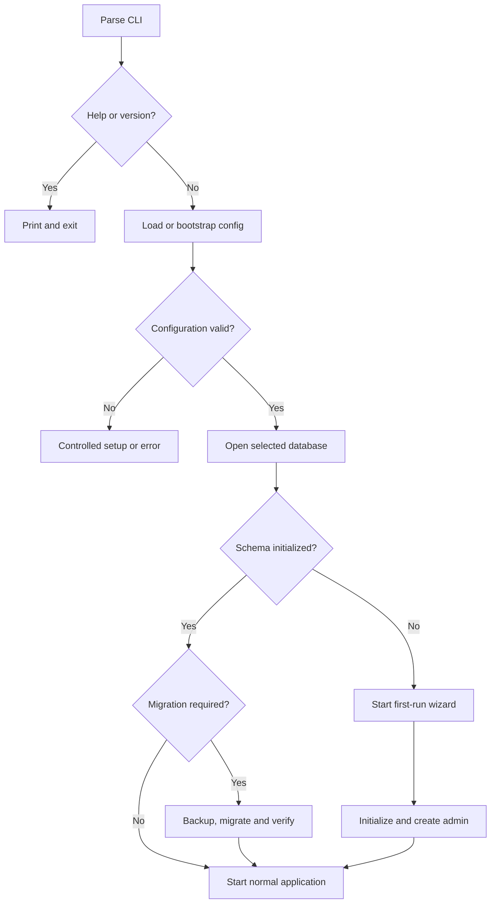
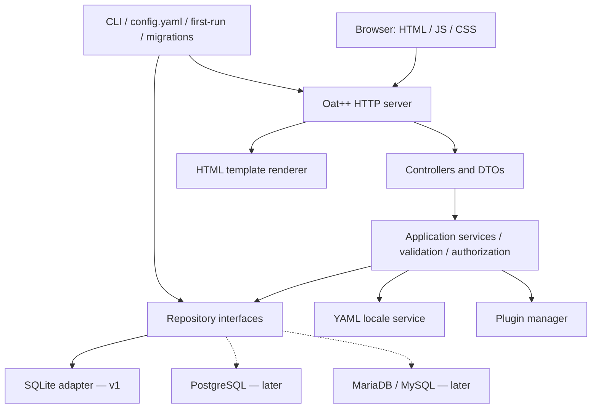

# PVLedger — Web Application Specification

**Document version:** Draft v0.1  
**Date:** 2026-11-22  
**Product:** PVLedger  
**Slogan (as supplied):** “Manager your personal assets with privacy”  
**Document status:** Initial working draft — requirements and proposed architecture; not a final implementation contract  
**Database reference:** `pvledger_database_spec(1).md` — *PVLedger Database Specification, Draft v0.5*  
**Target release:** v1 (SQLite-first)

> **Reading guide:** **Required** means supplied by the project owner or established in the attached database specification. **Proposed** is a starting implementation choice that may be changed. **Later** means explicitly deferred or not yet specified. The database specification and its source SQL govern the *existing* schema; this document must not be read as permission to modify it silently.

---

## 1. Project overview

PVLedger is a privacy-oriented, self-hosted web application for managing personal financial accounts, balances, debts, taxes, expenses, and related reference information. It runs as a standalone C++ web server and provides a browser-based interface. Application records remain in the database selected by the operator; the first release uses a local SQLite database.

### 1.1 Goals

1. Allow users to manage their personal financial information through a straightforward, multilingual web UI.
2. Keep the application suitable for local/private hosting without requiring a third-party cloud service.
3. Separate application code, HTML templates, JavaScript menu behavior, YAML translations, data access, and plugins.
4. Support a first-run initialization workflow and safe future schema upgrades.
5. Make future database engines and extensions possible without redesigning the whole application.

### 1.2 Scope and terminology

- **Instance:** One running PVLedger installation backed by its configured database.
- **Current account:** Checking/current funds account stored in `pvl_accounts_current`.
- **Credit account:** Account whose `amount` is the remaining debt, not the credit limit.
- **Savings account:** Account whose `amount` is the current funds held.
- **Financial entry:** Expense, planned expense, recurring expense, debt, or tax record.
- **Locale:** String such as `en_US`, `ru_RU`, `kk_KZ`, or `de_DE` corresponding to a YAML language file.
- **Plugin:** A locally installed extension discovered from the configured plugins directory and managed through the application registry.

**Outside v1 unless separately approved:** bank synchronization, online accounts/cloud services, investment portfolios, market-rate currency conversion, attachments, payment initiation, and automatic tax filing. The word *assets* in the product name/slogan does not imply that the current database already models real estate, vehicles, or securities.

### 1.3 Release strategy

| Area | v1 | Later |
|---|---|---|
| Backend | C++ / Oat++ | Continue same core |
| Build | CMake | — |
| Database | SQLite | PostgreSQL; MariaDB / MySQL |
| UI | Server-rendered HTML placeholders + JavaScript-generated menu | Optional richer UI |
| Languages | File-backed locale system; initial `en_US`, with `ru_RU`, `kk_KZ`, `de_DE` supported as language-pack targets | Additional YAML packs |
| Authentication | Local users and roles | External identity integrations only if approved |
| Plugin system | Discover, validate, enable/disable registered local plugins; minimal extension API | Wider extension API, distribution and compatibility guarantees |
| Financial features | Work with records represented by current 16-table database | Additional accounting/asset models after schema changes |

---

## 2. Technology and platform

### 2.1 Required stack

| Layer | Technology | Notes |
|---|---|---|
| Backend / HTTP | **C++ with Oat++** | Controllers, request/response DTOs, routing, web server |
| Build | **CMake** | One executable named `vpledger` |
| Database — v1 | **SQLite** | Oat++ SQLite adapter or equivalent dedicated repository implementation |
| Database — later | **PostgreSQL**, **MariaDB / MySQL** | Backend interfaces and engine-specific SQL/migrations |
| Database scripts | **SQL** | Initial schema, seed data, incremental migrations |
| Server views | **HTML templates with placeholders** | No SPA framework required |
| Client behavior | **JavaScript** | Menu building, localized dynamic messages and simple interactions |
| Localization | **YAML files** | One file per locale, e.g. `en_US.yaml` |
| File configuration | **YAML** | `config.yaml` |
| Themes | CSS and related assets | Theme selected in database, resources loaded from themes path |

**Proposed technical baseline:** C++17 or newer, with dependency versions pinned and validated by CI. Do not assume that PostgreSQL and MariaDB/MySQL share identical SQL or Oat++ adapters. Oat++ documents `oatpp-sqlite` and `oatpp-postgresql`; a MariaDB/MySQL data-access strategy still needs to be selected.

### 2.2 Runtime deployment (proposed)

- Run as a single HTTP server process on Linux initially; cross-platform support may be added or validated separately.
- Bind to `127.0.0.1` by default. Configurable host exposure can be introduced explicitly for trusted networks.
- Serve the UI and the JSON API from the same origin.
- If the instance is reachable across a network, deploy HTTPS through a reverse proxy or an explicitly configured TLS server.
- No telemetry, remote account, or outbound network traffic is required for normal use.

---

## 3. Functional requirements

| ID | Requirement | Status | Priority |
|---|---|---|---|
| APP-001 | Launch `vpledger -c /path_to_config_file` | Required | Must |
| APP-002 | Support `vpledger --help` and `vpledger --version` | Required | Must |
| APP-003 | Load and validate file-based settings from `config.yaml` | Required | Must |
| APP-004 | Use SQLite in v1 and preserve an interface for future database backends | Required | Must |
| APP-005 | Detect uninitialized instance and start a first-run wizard | Required | Must |
| APP-006 | Create the first user as part of initial setup | Required | Must |
| APP-007 | Support multilingual UI from locale-specific YAML files | Required | Must |
| APP-008 | Allow an admin to change the instance name, locale, currency and theme | Required / database-backed | Must |
| APP-009 | Implement login/logout and server-side authorization | Proposed application requirement | Must |
| APP-010 | Display and manage current, savings and credit accounts | Required by database scope | Must |
| APP-011 | Display and manage banks, countries and currencies | Required by database scope | Must |
| APP-012 | Display and manage expenses, categories, planned/recurring entries | Required by database scope | Must |
| APP-013 | Display and manage debts and taxes | Required by database scope | Must |
| APP-014 | Support three seeded user roles | Required by database | Must |
| APP-015 | Discover and manage local plugins | Required capability | Must |
| APP-016 | Run ordered, data-preserving DB migrations on upgrade | Required by DB version design | Must |
| APP-017 | Generate the main navigation menu with JavaScript | Required | Must |
| APP-018 | Permit UI theme selection and loading from configured theme directory | Required by settings/path design | Should |
| APP-019 | Provide basic financial summaries on a dashboard | Proposed | Should |
| APP-020 | Offer API documentation and automated tests | Proposed | Should |
| APP-021 | Add PostgreSQL support | Later | Later |
| APP-022 | Add MariaDB / MySQL support | Later | Later |

### 3.1 Main UI pages and modules

| UI section | Main pages / actions | Existing tables |
|---|---|---|
| Dashboard | Overview, balance totals by currency, outstanding debt, recent expenses | Aggregates from financial tables |
| Accounts | Current, savings, credit; list, create, view, edit, delete if unreferenced | `pvl_accounts_current`, `pvl_accounts_savings`, `pvl_accounts_credit` |
| Expenses | Actual expenses, categories, planned expenses, recurring entries | `pvl_expenses`, `pvl_expenses_categories`, `pvl_expenses_planned`, `pvl_expenses_recurring` |
| Liabilities | Debts, taxes | `pvl_debts`, `pvl_taxes` |
| Reference data | Banks, currencies, countries | `pvl_banks`, `pvl_currencies`, `pvl_countries` |
| Administration | Users, roles, plugins, instance settings | `pvl_users`, `pvl_user_roles`, `pvl_plugins`, `pvl_settings` |
| System | Login, first-run setup, help/about, error pages | Application services |

**Proposed navigation:** Dashboard · Accounts (Current / Savings / Credit) · Expenses (Actual / Planned / Recurring / Categories) · Debts · Taxes · Banks · Administration (Users / Plugins / Settings) · Reference Data (Countries / Currencies) · About.

**CRUD behavior:** All forms validate required relationships, show readable errors, and prevent deletion of records that are still referenced by foreign keys. Reference seeds must not be reset on application restarts. A Viewer can see only authorized records; menu hiding is cosmetic, not a security boundary.

### 3.2 Account and financial display rules

The following meanings are **required by the database specification**:

| Database field | Meaning in UI |
|---|---|
| `pvl_accounts_current.amount` | Current available funds in a current/checking account |
| `pvl_accounts_savings.amount` | Current funds in a savings account |
| `pvl_accounts_credit.amount` | Remaining debt on a credit account |
| `pvl_debts.amount` | Currently outstanding debt |
| `pvl_taxes.amount` | Tax amount for the record |
| `pvl_expenses.amount` | Expense amount |
| `pvl_expenses_planned.amount` | Expected/planned expense amount |
| `pvl_expenses_recurring.amount` | Recurring-expense amount (without a modeled frequency yet) |

**Important unresolved transaction rule:** Existing tables do not define whether creating/editing an expense automatically changes a current-account balance, nor how to apply cross-currency expenses. **Do not silently implement automatic balance changes in v1** before the owner selects and specifies the accounting rule. Until then, balances and financial entries can be recorded without inferring transfers or currency conversions. The UI must avoid implying that two values in different currencies can simply be added.

**Planned expense status codes (`pvl_expenses_planned.status`):**

| Value | UI label |
|---:|---|
| `0` | Planned |
| `1` | Processed |
| `2` | Processed with changes |
| `3` | Declined |

The source SQL permits `NULL` and does not enforce these codes. The application should validate its accepted values; treatment of existing `NULL` values is an open decision. Processing a planned expense into an actual `pvl_expenses` row requires an explicitly defined workflow to avoid duplicate records.

**Recurring expenses:** `pvl_expenses_recurring` has no recurrence interval/frequency field. v1 may provide manual CRUD for these records, but automatic recurring scheduling requires an approved schema extension or other explicitly specified rule store.

**Timestamps:** Existing `date` and `billing_date` fields are nullable SQL integers. Draft interpretation is Unix seconds in UTC, formatted in the UI for the user's selected locale; timezone and date-only behavior need final definition.

---

## 4. First-run wizard

### 4.1 Startup and detection

On startup, PVLedger loads its selected configuration, validates paths and database settings, and determines whether the database schema exists and whether initialization is complete. An initialized instance has the expected schema, **exactly one** `pvl_settings` row, and at least one usable administrator account. If there is a database version mismatch, the migration procedure runs before normal application routes become available.

**Proposed setup-safety rule:** Before an administrator exists, only setup routes are available and the server binds to loopback. If `config.yaml` has not yet been created, use an explicitly documented bootstrap address/port (proposed `127.0.0.1:8080`) and create the requested `-c` file only after the user saves validated settings. Do not expose an unclaimed administrator-creation route to the public Internet.

### 4.2 Wizard screens (proposed order)

1. **Welcome / Language** — choose available locale (`en_US`, `ru_RU`, `kk_KZ`, `de_DE`, etc.); load translations immediately; preview app name.
2. **Database** — SQLite path for v1; future engines display host, port, database, username and password options but are disabled until supported.
3. **Application server** — choose listening port, confirm local/private network exposure and configuration file location.
4. **Instance preferences** — optional instance name (default blank), default currency, and theme.
5. **Administrator** — create the first user with username, password and optional display/personal names. Assign seeded role ID `1` (Administrator).
6. **Review and initialize** — show a redacted settings summary; validate paths, permissions, database write access and locale files; initialize schema and reference data.
7. **Complete** — confirm setup and direct the administrator to login/dashboard; setup routes become unavailable after successful completion.

### 4.3 Wizard persistence and error handling

- Write database engine details, endpoint port, directories and database connection data to `config.yaml`.
- Write `db_version`, `lang`, `instance_name`, `default_currency`, `theme` and other relevant persisted preferences to the **single** `pvl_settings` record.
- Insert initial schema and **430 authoritative reference rows** from the source SQL: 249 countries, 178 currencies and 3 roles. Create the first user separately; the SQL does not seed one.
- Run database changes inside transactions where supported. Never leave a half-initialized database silently marked complete.
- Create a settings record once; subsequent starts reuse it and do not reset user changes.
- Handle invalid locale, duplicate username, unwritable config, failed database connection and incomplete initialization with recoverable error messages.
- Write configuration atomically (temporary file then rename where supported), preserve restrictive permissions, and never log passwords or connection secrets.

---

## 5. Command-line interface

### 5.1 Required commands

```text
vpledger -c /path_to_config_file
vpledger --help
vpledger --version
```

| Option | Required behavior |
|---|---|
| `-c <path>` | Load the specified YAML configuration file; if not yet created, use this as the target path for first-run setup if its directory is writable. |
| `--help` | Print syntax, options and short descriptions, then exit successfully without starting the web server. |
| `--version` | Print application name and semantic version, and optionally build/commit details; do not require database access. |

**Proposed additions (not yet required):** `--check-config`, `--migrate`, `--backup <path>`, `--verbose` and `--log-level`. Whether plain `vpledger` without `-c` looks for a default config remains an open decision.

### 5.2 Startup state machine



---

## 6. Configuration model

Two stores are **required**. Configuration that must be known before database access belongs in `config.yaml`; mutable application/user-facing preferences belong in `pvl_settings`.

### 6.1 `config.yaml` — file-based bootstrap/runtime configuration

**Required categories:** database engine; corresponding database connection parameters; application port; language files path; plugins path; themes path.

**Example v1 configuration (proposed keys):**

```yaml
# PVLedger example config.yaml — illustrative draft format
app:
  host: "127.0.0.1"       # proposed security-oriented default
  port: 8080               # configurable

database:
  engine: "sqlite"         # sqlite | postgresql | mariadb | mysql (later)
  sqlite:
    path: "./data/pvledger.sqlite"
  # postgresql:             # later
  #   host: "127.0.0.1"
  #   port: 5432
  #   database: "pvledger"
  #   username: "pvledger"
  #   password_env: "PVLEDGER_DB_PASSWORD"
  # mariadb:                # later; MySQL analogous
  #   host: "127.0.0.1"
  #   port: 3306
  #   database: "pvledger"
  #   username: "pvledger"
  #   password_env: "PVLEDGER_DB_PASSWORD"

paths:
  languages: "./lang"
  plugins: "./plugins"
  themes: "./themes"
```

**Proposed security and validation rules:**

- `password_env` is a **proposed application feature**, not native YAML substitution. If implemented, PVLedger explicitly reads the named environment variable; document alternatives and supported precedence. Direct YAML `password` can be supported if truly needed, but must be redacted from logs/UI and protected with filesystem permissions.
- Resolve relative paths relative to the config file's directory, not the process working directory; document this as the chosen rule.
- Reject unknown database engines and invalid ports (`1`–`65535`); check required files/directories.
- Never print secrets with `--help`, `--version` or startup logs.
- Changing database engine in this file does **not** automatically migrate data between engines.

### 6.2 Database-backed preferences (`pvl_settings`)

The attached schema defines these fields:

| Field | Role / behavior |
|---|---|
| `id` | Row identifier; application enforces one-row invariant |
| `db_version` | Current database schema version for migration planning |
| `instance_name` | Customizable name in UI; blank initially |
| `lang` | Current application language, chosen at setup |
| `default_currency` | Optional FK to `pvl_currencies.id` |
| `demo_mode` | Integer flag; behavior/code mapping not yet specified |
| `theme` | Selected theme identifier/name |

**Proposed preference precedence:** `config.yaml` owns connectivity and directory paths; `pvl_settings` owns instance display/preferences. For locale, use a setup/browser fallback only before DB initialization. The single configured locale is instance-wide until a per-user preference model is added.

---

## 7. Localization and internationalization

### 7.1 Required behavior

- Translation files are UTF-8 YAML located in the configured language directory: `en_US.yaml`, `ru_RU.yaml`, `kk_KZ.yaml`, `de_DE.yaml`, etc.
- The application discovers installed languages and exposes them in the wizard and settings UI.
- Text strings in server-rendered templates, JavaScript menus, forms, validation messages, notifications and error pages use translation keys; avoid hardcoded English in business UI.
- `pvl_settings.lang` stores the selected locale identifier (`en_US`, etc.).
- Language changes should affect the next rendered response and dynamically rebuilt menu, without changing financial data.

### 7.2 Proposed YAML format

```yaml
# lang/en_US.yaml
meta:
  locale: en_US
  name: English (United States)
  direction: ltr
app:
  name: PVLedger
  slogan: "Manager your personal assets with privacy"
menu:
  dashboard: Dashboard
  accounts: Accounts
  current_accounts: Current accounts
  savings_accounts: Savings accounts
  credit_accounts: Credit accounts
  expenses: Expenses
  settings: Settings
wizard:
  title: Initial setup
  create_admin: Create administrator
buttons:
  save: Save
  cancel: Cancel
errors:
  required: "{field} is required"
```

**Proposed fallback:** Requested locale → `en_US` string → visibly flagged missing-translation key in development (do not expose sensitive internals in production). Validate YAML parse errors at startup. Keep stable keys across languages; document variable interpolation and pluralization behavior before writing complete translation packs.

### 7.3 Dates, currency and number formatting

- Keep underlying amounts and timestamps independent from translations.
- Format dates/numbers consistently for the active locale; support Unicode and non-Latin alphabets.
- Currency labels should use the ISO code supplied in `pvl_currencies.iso` where present; names in the database remain the supplied localized names, not automatically translated versions.
- Cross-currency summation requires an approved exchange-rate model; it is not a localization feature.

---

## 8. Frontend templates, navigation and themes

### 8.1 Rendering model (proposed)

- Oat++ serves complete HTML pages based on templates, while JSON endpoints supply list/form data and selected dynamic content.
- Template placeholders use a documented syntax such as `{{page.title}}`, `{{current_user.display_name}}`, `{{content}}` and `{{asset.theme_css}}` (syntax is illustrative, not a committed template engine).
- **All substitutions are HTML-escaped by default.** Only controlled, explicitly trusted template fragments may contain HTML markup; avoid raw injection from user-provided text.
- Common layout: header + navigation container + main content + footer. Templates must not store authentication/authorization policy.

**Illustrative base template:**

```html
<!doctype html>
<html lang="{{locale}}">
<head>
  <meta charset="utf-8">
  <meta name="viewport" content="width=device-width, initial-scale=1">
  <title>{{page.title}} — {{app.name}}</title>
  <link rel="stylesheet" href="{{asset.theme_css}}">
</head>
<body>
  <header>{{app.name}}</header>
  <nav id="pvledger-menu" aria-label="Main navigation"></nav>
  <main id="main-content">{{content}}</main>
  <script src="/assets/js/menu.js" defer></script>
</body>
</html>
```

### 8.2 JavaScript-generated menu

- `menu.js` builds the navigation tree from a stable menu definition (or from a server endpoint such as `GET /api/v1/ui/menu`).
- Use translation keys and current locale when creating visible labels.
- The server filters available menu entries by role and enabled plugin registrations.
- Menu can contain nested groups, active-route highlighting and responsive/mobile layout.
- Client-side menu hiding must **never** substitute for backend route permission checks.
- Plugin menu items are validated and namespaced to avoid collisions.

### 8.3 Theme system

- Theme files live under `paths.themes`, with a default fallback theme supplied in the distribution.
- `pvl_settings.theme` selects the active theme identifier.
- Themes should supply CSS, colors, static assets and optionally layout overrides if approved.
- Enforce path containment and only serve allowlisted static files; a theme identifier must not become arbitrary filesystem access.
- User-switchable theme support is proposed as an instance-wide preference in v1.

---

## 9. Authentication, users and authorization

### 9.1 Source contract

- The first user is created by the setup wizard; no users are present in initial SQL seed data.
- Users live in `pvl_users`; roles in `pvl_user_roles`; every user requires a valid `id_role`.
- Seeded roles and fixed IDs: `1` **Administrator**, `2` **Read/Write**, `3` **Viewer**.
- The current database contract stores `pvl_users.password` as a 64-character hex **SHA-256** digest by application convention. The schema also permits `NULL`; new user creation should require credentials even though SQL does not enforce it.

**Security decision needed before production:** Plain SHA-256 is unsuitable for password storage, as it is fast and provides no built-in per-password salt/work factor. The owner-confirmed database convention is recorded here for fidelity, **not endorsed as a safe production scheme**. Prefer a salted adaptive password KDF such as Argon2id and a controlled migration of the password representation before an Internet-accessible release.

### 9.2 Proposed permissions

| Operation | Administrator | Read/Write | Viewer |
|---|---|---|---|
| View authorized financial/reference records | Yes | Yes | Yes |
| Create/update financial records | Yes | Yes | No |
| Delete eligible unreferenced financial records | Yes | Yes | No |
| Change instance settings | Yes | No | No |
| Manage users/roles/plugins | Yes | No | No |
| Apply DB migrations | Server maintenance process only | No | No |

**Undecided:** Whether financial records are visible to all users or only to their `id_user` owner. Current schema includes `id_user` on account tables but not directly on all child records. No role privileges are defined in SQL; the table above is a proposal. `pvl_users.is_admin` is present alongside `id_role` and needs a single, non-contradictory authorization rule.

### 9.3 Session and application security (proposed)

- Authenticate on server; use an HttpOnly, SameSite session cookie, with `Secure` when served over HTTPS.
- Regenerate session on login; enforce inactivity expiration and logout invalidation.
- Require CSRF defenses for cookie-authenticated state-changing requests.
- Validate DTOs and form inputs server-side; parameterize SQL; escape HTML; sanitize errors.
- Limit login attempts and avoid revealing whether a username exists.
- Protect configuration and DB files with restrictive permissions; never log credentials, cookies or financial record payloads.
- Disable setup and admin-creation endpoints after initialization; do not allow unsafe plugin code to run by default.

---

## 10. Database architecture and schema compatibility

### 10.1 Authoritative database reference

**The attached database specification v0.5 remains the authority** for the exact SQLite column names, types, nullability, foreign keys, indexes, seed IDs, and initial data. Summary: **16 tables, 97 columns, 22 foreign keys, one explicit secondary index and 430 seed records** (249 countries + 178 currencies + 3 roles).

**Table inventory:**

| Category | Tables |
|---|---|
| Accounts | `pvl_accounts_current`, `pvl_accounts_savings`, `pvl_accounts_credit` |
| Transactions/planning | `pvl_expenses`, `pvl_expenses_categories`, `pvl_expenses_planned`, `pvl_expenses_recurring` |
| Other financial | `pvl_debts`, `pvl_taxes` |
| Reference | `pvl_banks`, `pvl_countries`, `pvl_currencies` |
| Administration | `pvl_users`, `pvl_user_roles`, `pvl_settings`, `pvl_plugins` |

**Existing constraints and gotchas:**

- SQLite connections must enable `PRAGMA foreign_keys=ON`.
- Required FKs use `NO ACTION` for deletes and updates; do not rely on automatic cascading deletion.
- The unique `ux_pvl_currencies_iso` index allows multiple `NULL` ISO codes; country ISO has no schema-level uniqueness constraint.
- Financial `amount` fields are SQLite `REAL`, not fixed precision. Rounding and eventual decimal migration need a policy.
- `pvl_settings` must contain exactly one row **by application rule**; SQL itself does not enforce it.
- `db_version` is a database schema version, **not** the document version or app binary version.
- Recurrence frequency, role permissions, other integer flags, and detailed billing/interest conventions are not specified by the schema.

### 10.2 Repository and adapter design (proposed)

Define interfaces such as `IDatabaseConnection`, `IAccountRepository`, `IExpenseRepository`, `ISettingsRepository`, `IUserRepository`, and `IMigrationRunner`. Oat++ controllers call services; services call repositories. Central business rules should not depend on SQLite-specific SQL. Use dedicated per-engine SQL when syntax differs.

**Engine policy:**

| Engine | Availability | Notes |
|---|---|---|
| `sqlite` | v1 | Local database file; Oat++ SQLite adapter available |
| `postgresql` | Later | Oat++ PostgreSQL adapter available; distinct SQL and sequence handling |
| `mariadb` | Later | Select and validate compatible data-access implementation |
| `mysql` | Later | Select and validate compatible data-access implementation |

An engine switch is a new connection target, **not an automatic cross-engine migration**. Cross-engine export/import, including primary-key mapping and type conversion, is separate future work.

### 10.3 Initialization and migration policy

1. Detect schema absence: initialize only a fresh database with the approved SQL and seed data.
2. Detect existing schema: read singleton `pvl_settings.db_version` and compare with supported migration versions.
3. If upgrading: check compatibility, create a recoverable backup, apply ordered data-preserving migration scripts, and verify resulting schema/version.
4. Never run a `DROP TABLE`-based fresh initialization script against a populated database.
5. Refuse unsupported downgrade and unknown newer schema versions with a clear error.
6. Make seed operations deterministic and non-destructive; never overwrite users or changed settings.
7. Maintain per-engine migrations as needed and test them against real engines before enabling those backends.

**Integration note:** Oat++ has a schema migration facility, but its version bookkeeping must be reconciled with the project requirement to keep the current schema version in `pvl_settings.db_version`. Use one authoritative migration flow or an explicitly synchronized design; do not maintain conflicting migration versions.

---

## 11. REST API sketch (proposed)

The browser UI should use a versioned, same-origin API prefix `/api/v1`. This is a *route proposal*; exact payloads, status codes, RBAC filters and business transitions need implementation-level definitions. Controllers use Oat++ DTOs and services. Return JSON for API requests; use HTML views for browser navigation.

| Resource | Example routes | Typical functionality |
|---|---|---|
| Session | `POST /api/v1/auth/login`, `POST /api/v1/auth/logout`, `GET /api/v1/auth/me` | Authentication and current user |
| Dashboard | `GET /api/v1/dashboard` | Aggregated summary grouped by currency |
| Accounts | `/api/v1/accounts/current`, `/api/v1/accounts/savings`, `/api/v1/accounts/credit` | GET collection; POST create; GET/PATCH/DELETE `/{id}` |
| Banks | `/api/v1/banks` | CRUD |
| Countries | `/api/v1/countries` | Read/list; admin-managed edits if allowed |
| Currencies | `/api/v1/currencies` | Read/list; admin-managed edits if allowed |
| Expenses | `/api/v1/expenses` | CRUD |
| Expense categories | `/api/v1/expense-categories` | CRUD |
| Planned expenses | `/api/v1/planned-expenses` | CRUD and validated status changes |
| Recurring expenses | `/api/v1/recurring-expenses` | CRUD only pending recurrence model |
| Debts | `/api/v1/debts` | CRUD |
| Taxes | `/api/v1/taxes` | CRUD |
| Users | `/api/v1/users` | Admin CRUD; avoid exposing password digests |
| Roles | `/api/v1/roles` | Read roles; modification policy TBD |
| Settings | `GET/PATCH /api/v1/settings` | Admin preference changes |
| Plugins | `/api/v1/plugins`, `POST /api/v1/plugins/{id}/enable` | Admin management and plugin state |
| UI support | `GET /api/v1/ui/menu`, `GET /api/v1/i18n/{locale}` | Navigation / client translation data |
| System | `GET /api/v1/system/health`, `GET /api/v1/system/version` | Minimal non-sensitive status |
| Setup | `/setup/*` | Only available during secure first run |

**Proposed API conventions:**

- Validate all IDs and foreign-key references; `404` for not found, `409` for integrity conflicts, `400`/`422` for invalid input, `401`/`403` for auth failures.
- List routes support `page`, `page_size`, `sort` and allowlisted filter parameters.
- Never expose password digest or database credentials in API responses.
- Return consistent error JSON, e.g. `{"error":{"code":"VALIDATION_ERROR","message":"..."}}`, with localized display text as a separate concern.
- The API must apply all authorization and user-data visibility rules independently of UI navigation.
- Provide a developer OpenAPI specification; `oatpp-swagger` is an optional documented integration.

---

## 12. Plugin architecture

### 12.1 Required capabilities

- Read the plugin base path from `config.yaml` (`paths.plugins`).
- Discover installed plugins from their directories or manifest files.
- Register plugin records in existing `pvl_plugins` (`id`, `name`, `enabled`, `path`).
- Allow an administrator to view, enable and disable installed plugins.
- Prevent incompatible or invalid plugins from loading and surface errors without crashing the host where practical.
- Let plugins contribute UI menu items and translations when supported by the extension API.

### 12.2 Proposed v1 contract

```yaml
# plugins/sample-plugin/plugin.yaml — example only
id: "example.sample"
name: "Sample plugin"
version: "0.1.0"
api_version: 1
entrypoint: "sample_plugin.so"   # platform-dependent
locales: "lang/"
menu:
  - key: "sample.overview"
    label_key: "plugins.sample.menu.overview"
    route: "/plugins/example.sample/overview"
```

**Recommended boundary:** Use a versioned C-compatible ABI (or another deliberately stable interface) rather than passing unstable C++ objects across arbitrary plugin/shared-library boundaries. V1 extension points can include route registration, menu contribution, locale packs and plugin start/stop callbacks. Define unload/reload semantics; if safe unloading is not feasible, state that enable/disable takes effect after restart.

**Security:** Native plugins execute code with the application's privileges. Treat plugins as trusted local software, not sandboxed modules. Do not download or execute remote plugins automatically. Validate manifest paths, require administrative installation, and avoid plugin access to credential/configuration internals by default. `pvl_plugins.enabled` is an application-defined integer; propose `0=disabled`, `1=enabled` pending approval.

---

## 13. Proposed code structure and build

### 13.1 Component layering



### 13.2 Suggested repository layout

```text
pvledger/
├── CMakeLists.txt
├── cmake/
├── README.md
├── config/
│   └── config.example.yaml
├── lang/
│   ├── en_US.yaml
│   ├── ru_RU.yaml
│   ├── kk_KZ.yaml
│   └── de_DE.yaml
├── themes/
│   └── default/
│       ├── theme.css
│       └── assets/
├── plugins/
│   └── README.md
├── sql/
│   ├── sqlite/
│   │   ├── schema_init.sql
│   │   ├── seed_reference.sql
│   │   └── migrations/
│   ├── postgresql/          # later
│   └── mariadb/             # later
├── web/
│   ├── templates/
│   │   ├── layout.html
│   │   ├── login.html
│   │   ├── setup/
│   │   └── pages/
│   └── static/
│       ├── js/menu.js
│       └── css/
├── src/
│   ├── main.cpp
│   ├── cli/
│   ├── config/
│   ├── bootstrap/
│   ├── controllers/
│   ├── dto/
│   ├── services/
│   ├── repositories/
│   │   ├── interfaces/
│   │   └── sqlite/
│   ├── migrations/
│   ├── auth/
│   ├── i18n/
│   ├── templates/
│   ├── plugins/
│   └── ui/
├── include/pvledger/
├── tests/
│   ├── unit/
│   ├── integration/
│   └── fixtures/
└── docs/
    ├── application_spec.md
    ├── database_spec.md
    └── api/
```

### 13.3 CMake expectations

- Define an executable target `vpledger`, C++ standard, warnings, and install rules.
- Link compatible, pinned dependencies for Oat++, SQLite integration, YAML parsing, template rendering and optionally testing/Swagger.
- Use build options to turn optional database backends, plugin support and API documentation on/off without changing core application logic.
- Copy/install `lang/`, `web/`, `themes/` and example config into documented locations.
- Configure CTest (or equivalent) with unit/integration test targets.
- Keep third-party dependency retrieval reproducible; avoid unpinned downloads in production build scripts.

**Proposed example commands:**

```bash
cmake -S . -B build -DCMAKE_BUILD_TYPE=Release
cmake --build build --parallel
ctest --test-dir build --output-on-failure
./build/vpledger --version
./build/vpledger -c ./config/config.yaml
```

The commands describe the target developer workflow; the repository and `CMakeLists.txt` have not yet been generated.

---

## 14. Non-functional requirements

| Topic | Draft requirement |
|---|---|
| Privacy | Self-hosted operation; no required cloud connection or telemetry; user controls database and configuration files |
| Security | Authentication, role checks, SQL parameterization, CSRF protection, HTML escaping, protected setup and plugin loading |
| Data integrity | Enforce foreign keys; use transactions for multi-record operations; preserve records on upgrade |
| Backup/restore | Document SQLite file-backup procedure and backup-before-migration policy; test restore |
| Internationalization | UTF-8 for database/UI/YAML; locale fallback; translation-key validation |
| Portability | Separate OS/platform paths and database integrations from business services |
| Reliability | Structured startup errors; reject bad configs/migrations; graceful shutdown and database close |
| Observability | Redacted structured logs, bounded log size and basic health checks |
| Accessibility | Semantic HTML, keyboard navigation, form labels, error messages and sufficient contrast |
| Performance | Pagination for large lists; indexed/parameterized queries; agree measurable targets during implementation |
| Compatibility | Versioned API, plugin ABI and migration compatibility checks |
| Testing | Unit, integration, end-to-end first-run, locale, plugin and authorization tests |

### 14.1 Minimum test cases

- CLI help/version exit without loading the DB; invalid `-c` path shows actionable error.
- SQLite first-run wizard creates schema, exactly one settings row, correct reference counts and first administrator.
- Restart preserves data, selected language, theme, currency and instance name without rerunning seeds.
- Unauthenticated requests cannot access financial pages/API; Viewer cannot modify; Read/Write cannot change admin settings.
- Invalid FK, deletion with references and invalid planned status yield controlled errors.
- All available locale packs parse, required translation keys exist or fall back, Cyrillic/Kazakh/German Unicode renders correctly.
- Malformed or incompatible plugin does not compromise startup; disabled plugin routes/menu are unavailable.
- Migration runs once, preserves user entries and refuses downgrade/unsupported schema.
- Forms and APIs handle missing values, SQL injection attempts, template escaping and CSRF checks.
- Multiple currencies display separately without fictitious conversion.

---

## 15. Implementation milestones (suggested)

| Phase | Deliverables | Completion check |
|---|---|---|
| **M0 — Skeleton** | CMake project, `vpledger` executable, `--help`, `--version`, Oat++ server, example config, tests | App builds and serves health/about page |
| **M1 — Storage & bootstrap** | YAML config, SQLite repo, schema/seed initialization, migrations and singleton settings | Fresh setup and restart pass integrity tests |
| **M2 — Localization & wizard** | YAML locale loader, setup UI, first admin, persisted locale/instance/theme/currency | End-to-end first-run works in at least one completed locale |
| **M3 — Security & base UI** | Login/logout, sessions, roles, templating, JS menu, themes | Role enforcement validated on pages and API |
| **M4 — Financial modules** | CRUD/forms for banks, accounts, expenses, categories, planned/recurring, debts and taxes | Data validation and FK behaviors tested |
| **M5 — Plugins & stabilization** | Plugin registry/loader, safe defaults, documentation, backup/restore guidance, regression tests | Plugin enable/disable and upgrade tests pass |
| **M6 — Future databases** | PostgreSQL support, then MariaDB/MySQL adapters and migrations | Each backend passes common integration suite |

Each milestone may be split into issues. No schedule, team size, or release date is assumed.

---

## 16. Open decisions and risks

These are **not** settled by the attached database contract or the original application brief.

1. **Balance calculation:** Should expense records automatically debit account balances, or are balances edited manually? What happens when an expense is modified/deleted, and when currencies differ?
2. **Password storage:** Keep the requested SHA-256 representation only for prototype compatibility, or approve migration to Argon2id before real deployment?
3. **User isolation:** May users view one another's finances? How do `id_user`, roles and child records establish ownership?
4. **`is_admin` vs. `id_role`:** Which field determines administrator privileges and how is conflicting data handled?
5. **Recurring expenses:** What recurrence frequency, scheduling/processing rules and schema changes are required?
6. **Planned-expense processing:** How does “Processed with changes” create/link a real expense, and what happens to account balances?
7. **`REAL` money representation:** Preserve as-is in v1 or migrate to fixed precision; define rounding and currency minor units.
8. **Interest/billing fields:** What unit (percentage vs fraction), accrual rule and exact meaning does `billing_date` have?
9. **`demo_mode`, `enabled`, and flags:** Define `0`/`1`/`NULL` semantics and demo-data behavior.
10. **Currency conversion:** Whether to support exchange rates and consolidated multi-currency net worth (requires additional model).
11. **Instance language:** One global language only (current schema) or per-user locale preference (requires new storage)?
12. **Missing config and deployment:** Default config location, bootstrap port, binding behavior, HTTPS strategy and Linux/Windows/macOS support.
13. **MariaDB/MySQL integration:** Choose adapter/library, SQL dialect conventions, testing strategy and deployment support.
14. **Plugin compatibility:** Stable API/ABI, signing/distribution policy, plugin permission model and restart requirements.
15. **Settings details:** Should blank `instance_name` be `NULL` or `''`? Define valid `db_version` format.
16. **Brand copy:** Supplied slogan is **“Manager your personal assets with privacy”**. Confirm whether intended wording is **“Manage your personal assets with privacy”** before changing UI copy.
17. **Data portability:** Import/export, backups through UI and cross-engine data migration need a separate specification.
18. **Scope of “assets”:** Whether to add non-bank assets (property, investments, vehicles, cash) after v1; not modeled today.

---

## 17. Acceptance criteria for a first usable release

A first usable release is ready for review when all of the following are demonstrated:

- [ ] `vpledger --help` and `vpledger --version` work without an initialized DB.
- [ ] `vpledger -c <config-path>` starts a local Oat++ web server or launches secure first-run setup.
- [ ] Valid YAML config controls SQLite path, port, language path, plugins path and themes path.
- [ ] The wizard selects a locale, configures settings, creates the first admin and finishes without exposing setup routes afterward.
- [ ] Database schema and seed data match the attached authoritative SQL; 430 reference rows imported once.
- [ ] Exactly one `pvl_settings` record exists after setup; `db_version` is used for migrations.
- [ ] Users can log in/out and role checks are enforced on both UI and API routes.
- [ ] Browser pages and JavaScript-generated menu display from YAML translations and HTML templates.
- [ ] All existing financial modules can be listed and edited where authorized; financial amount meanings/statuses match the DB spec.
- [ ] Plugin discovery, registration and controlled enable/disable work with at least one sample plugin.
- [ ] No unsafe cross-currency aggregation or unapproved automatic balance mutation is performed.
- [ ] Restore/upgrade tests preserve an existing database; errors are logged without secrets.
- [ ] Source, build steps, configuration reference and extension guidelines are documented.

---

## 18. References

**Project reference (authoritative for schema):** `pvledger_database_spec(1).md`, PVLedger Database Specification (Draft v0.5), supplied with this request. It in turn identifies `pvledger(3).sql` as the authoritative SQL source; that SQL is **not** attached to this request and should be carried into the source repository before implementing the initializer.

**Technical implementation references (official Oat++ documentation; checked November 2026):**

- Oat++ starter project and CMake project layout: https://oatpp.io/docs/start/project/
- Oat++ ORM and documented database adapters: https://oatpp.io/docs/components/orm/
- SQLite adapter: https://oatpp.io/docs/modules/oatpp-sqlite/
- PostgreSQL adapter: https://oatpp.io/docs/modules/oatpp-postgresql/
- Example Oat++ CRUD / SQLite service: https://oatpp.io/examples/crud/
- Optional Swagger/OpenAPI integration: https://oatpp.io/docs/modules/oatpp-swagger/

**Change log:**

| Revision | Date | Changes |
|---|---|---|
| v0.1 | 2026-11-22 | Initial web application specification based on project requirements and database specification v0.5. |

