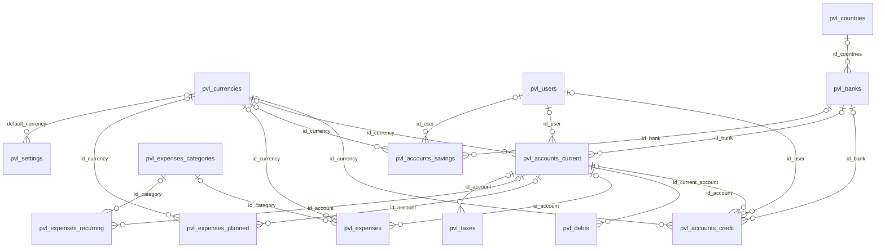

# PVLedger — Database Specification (Draft v0.2)

**Source:** `pvledger.sql` (SQLite) · **Target:** portable database design for SQLite, PostgreSQL, MySQL, MariaDB · **Status:** draft specification, user-defined decisions incorporated.

> **Provenance vs. target:** The source SQL is preserved verbatim in each table’s `source_create_sql` in the companion JSON. This revision describes the **intended target schema** (including a corrected table name and `pvl_expenses.date` type). The original SQL file is not modified. Table and most column functional descriptions are inferred and are intended to remain editable.

## 1. Overview and confirmed decisions

The schema is for a personal-finance application covering users, banks and accounts, expenses and planning, debts, taxes, settings, plugins and reference data. It defines **16 tables**, **95 columns**, **21 foreign keys**, **16 single-column primary keys**, and **one additional UNIQUE constraint** (`pvl_users.username`). The source includes no inserted data, views, triggers, explicit secondary indexes, CHECK constraints, or defaults.

| Topic | Target design decision |
|---|---|
| Date columns | Use SQL `INTEGER` for Unix timestamps, drafted as **seconds since 1970-01-01 00:00:00 UTC**. Seconds are the conventional interpretation; confirm if the application uses milliseconds. |
| State / flag columns | `status`, `enabled`, `demo_mode`, `is_admin` use application-defined integer codes such as `1`, `2`, `3`, etc. They are **not SQL BOOLEAN** fields and have no database-side enum/CHECK constraint. |
| Access control | `pvl_access_rights` stays a **placeholder**; no users/roles/permission relationships are added. |
| Spelling correction | Rename source `pvl_expenses_planed` to target **`pvl_expenses_planned`**. The original name remains in migration/provenance metadata. |
| Password | `pvl_users.password` stores an **MD5 hash as 32 hexadecimal characters** in `TEXT`. No change to source NULL policy. **Security caveat:** MD5 is not suitable for secure password storage. |
| Unchanged | Existing primary keys, foreign keys, nullability, unique constraints, monetary `REAL` types, and FK `NO ACTION` behavior remain as defined in the source. |

| Area | Tables |
|---|---|
| Accounts and institutions | `pvl_accounts_current`, `pvl_accounts_credit`, `pvl_accounts_savings`, `pvl_banks` |
| Transactions and planning | `pvl_expenses`, `pvl_expenses_planned`, `pvl_expenses_recurring`, `pvl_debts`, `pvl_taxes` |
| Reference data | `pvl_countries`, `pvl_currencies`, `pvl_expenses_categories` |
| Users and configuration | `pvl_users`, `pvl_access_rights`, `pvl_settings`, `pvl_plugins` |

**Conventions:** Table descriptions are specification metadata, not columns to add to each SQL table. Unless stated otherwise, non-PK columns remain nullable without defaults. FK nullability remains optional in 20 cases; only `pvl_debts.id_account` is `NOT NULL`. All FKs default to `NO ACTION` for UPDATE and DELETE.

## 2. Entity relationships

The diagram shows explicit foreign keys only. Nullable links indicate optional parent associations; `pvl_debts.id_account` is required. `pvl_access_rights` and `pvl_plugins` are standalone. The right-hand table names are the corrected target names.



### 2.1 Foreign-key catalog

| Child table.column | Referenced table.column | Required? | UPDATE / DELETE |
|---|---|---|---|
| `pvl_accounts_credit.id_currency` | `pvl_currencies.id` | No | NO ACTION / NO ACTION |
| `pvl_accounts_credit.id_current_account` | `pvl_accounts_current.id` | No | NO ACTION / NO ACTION |
| `pvl_accounts_credit.id_user` | `pvl_users.id` | No | NO ACTION / NO ACTION |
| `pvl_accounts_credit.id_bank` | `pvl_banks.id` | No | NO ACTION / NO ACTION |
| `pvl_accounts_current.id_currency` | `pvl_currencies.id` | No | NO ACTION / NO ACTION |
| `pvl_accounts_current.id_user` | `pvl_users.id` | No | NO ACTION / NO ACTION |
| `pvl_accounts_current.id_bank` | `pvl_banks.id` | No | NO ACTION / NO ACTION |
| `pvl_accounts_savings.id_currency` | `pvl_currencies.id` | No | NO ACTION / NO ACTION |
| `pvl_accounts_savings.id_user` | `pvl_users.id` | No | NO ACTION / NO ACTION |
| `pvl_accounts_savings.id_bank` | `pvl_banks.id` | No | NO ACTION / NO ACTION |
| `pvl_banks.id_countries` | `pvl_countries.id` | No | NO ACTION / NO ACTION |
| `pvl_debts.id_account` | `pvl_accounts_current.id` | Yes | NO ACTION / NO ACTION |
| `pvl_expenses.id_currency` | `pvl_currencies.id` | No | NO ACTION / NO ACTION |
| `pvl_expenses.id_category` | `pvl_expenses_categories.id` | No | NO ACTION / NO ACTION |
| `pvl_expenses.id_account` | `pvl_accounts_current.id` | No | NO ACTION / NO ACTION |
| `pvl_expenses_planned.id_currency` | `pvl_currencies.id` | No | NO ACTION / NO ACTION |
| `pvl_expenses_planned.id_account` | `pvl_accounts_current.id` | No | NO ACTION / NO ACTION |
| `pvl_expenses_recurring.id_account` | `pvl_accounts_current.id` | No | NO ACTION / NO ACTION |
| `pvl_expenses_recurring.id_category` | `pvl_expenses_categories.id` | No | NO ACTION / NO ACTION |
| `pvl_settings.default_currency` | `pvl_currencies.id` | No | NO ACTION / NO ACTION |
| `pvl_taxes.id_account` | `pvl_accounts_current.id` | No | NO ACTION / NO ACTION |

### 2.2 Disconnected entities

- `pvl_access_rights` is a placeholder with no current foreign-key associations. Do not create a user-rights or roles mapping until authorization requirements are specified.
- `pvl_plugins` has no foreign-key associations.
- `pvl_users` is referenced by the three account tables; it has no declared association with access rights.

## 3. Table catalog and column specifications

Each table includes an editable **`description`** field in the JSON metadata. Column descriptions capture likely function and confirmed storage decisions. The **target SQLite type** is for creation of the revised design; the **source SQLite type** records original SQL provenance. They differ only for `pvl_expenses.date` (`NUMERIC` → `INTEGER`).

### 3.1 `pvl_access_rights`

**description:** Placeholder catalog for future application access-control rights; no access-control relationships are implemented in this schema.  
**description status:** placeholder confirmed by user; fuller definition pending.

| Column | Target SQLite type | Source type | Nullable | Key / constraint | Description (draft) |
|---|---|---|---|---|---|
| `id` | `INTEGER` | `INTEGER` | NO | PK; AUTOINCREMENT | Identifier of an access-right record. |
| `name` | `TEXT` | `TEXT` | NO | NOT NULL | Access-right name or label. |
| `description` | `TEXT` | `TEXT` | YES | — | Optional explanation of the access right. |

**Current scope:** placeholder only. No access control enforcement, assignments, user-role links or role table is specified.

### 3.2 `pvl_accounts_credit`

**description:** Credit-account records, associated optionally with a bank, user, current account, and currency.  
**description status:** inferred; editable.

| Column | Target SQLite type | Source type | Nullable | Key / constraint | Description (draft) |
|---|---|---|---|---|---|
| `id` | `INTEGER` | `INTEGER` | NO | PK; AUTOINCREMENT | Credit-account identifier. |
| `id_bank` | `INTEGER` | `INTEGER` | YES | FK → `pvl_banks.id` | Associated bank, if recorded. |
| `id_user` | `INTEGER` | `INTEGER` | YES | FK → `pvl_users.id` | Associated application user, if recorded. |
| `name` | `TEXT` | `TEXT` | NO | NOT NULL | Credit-account display name. |
| `description` | `TEXT` | `TEXT` | YES | — | Optional notes about the credit account. |
| `interest` | `REAL` | `REAL` | YES | — | Interest value; unit and convention not defined. |
| `billing_date` | `INTEGER` | `INTEGER` | YES | — | Unix timestamp for credit-account billing date or event; exact business meaning pending. |
| `amount` | `REAL` | `REAL` | YES | — | Monetary amount related to the account; whether balance or limit is not defined. |
| `id_current_account` | `INTEGER` | `INTEGER` | YES | FK → `pvl_accounts_current.id` | Optionally linked current account. |
| `id_currency` | `INTEGER` | `INTEGER` | YES | FK → `pvl_currencies.id` | Account currency, if recorded. |

### 3.3 `pvl_accounts_current`

**description:** Current or checking account records, optionally associated with a bank, user, and currency.  
**description status:** inferred; editable.

| Column | Target SQLite type | Source type | Nullable | Key / constraint | Description (draft) |
|---|---|---|---|---|---|
| `id` | `INTEGER` | `INTEGER` | NO | PK; AUTOINCREMENT | Current-account identifier. |
| `id_bank` | `INTEGER` | `INTEGER` | YES | FK → `pvl_banks.id` | Associated bank, if recorded. |
| `name` | `TEXT` | `TEXT` | NO | NOT NULL | Current-account display name. |
| `amount` | `REAL` | `REAL` | YES | — | Account amount or balance; precise interpretation not documented. |
| `description` | `TEXT` | `TEXT` | YES | — | Optional notes about the current account. |
| `id_user` | `INTEGER` | `INTEGER` | YES | FK → `pvl_users.id` | Associated application user, if recorded. |
| `id_currency` | `INTEGER` | `INTEGER` | YES | FK → `pvl_currencies.id` | Account currency, if recorded. |

### 3.4 `pvl_accounts_savings`

**description:** Savings-account records with optional interest, billing date, ownership, and currency details.  
**description status:** inferred; editable.

| Column | Target SQLite type | Source type | Nullable | Key / constraint | Description (draft) |
|---|---|---|---|---|---|
| `id` | `INTEGER` | `INTEGER` | NO | PK; AUTOINCREMENT | Savings-account identifier. |
| `id_bank` | `INTEGER` | `INTEGER` | YES | FK → `pvl_banks.id` | Associated bank, if recorded. |
| `interest` | `REAL` | `REAL` | YES | — | Interest value; annual/monthly basis and unit not defined. |
| `billing_date` | `INTEGER` | `INTEGER` | YES | — | Unix timestamp for savings-account billing or interest date; exact business meaning pending. |
| `name` | `TEXT` | `TEXT` | NO | NOT NULL | Savings-account display name. |
| `description` | `TEXT` | `TEXT` | YES | — | Optional notes about the savings account. |
| `id_user` | `INTEGER` | `INTEGER` | YES | FK → `pvl_users.id` | Associated application user, if recorded. |
| `amount` | `REAL` | `REAL` | YES | — | Account amount or balance; precise interpretation not documented. |
| `id_currency` | `INTEGER` | `INTEGER` | YES | FK → `pvl_currencies.id` | Account currency, if recorded. |

### 3.5 `pvl_banks`

**description:** Bank reference records optionally associated with a country.  
**description status:** inferred; editable.

| Column | Target SQLite type | Source type | Nullable | Key / constraint | Description (draft) |
|---|---|---|---|---|---|
| `id` | `INTEGER` | `INTEGER` | NO | PK; AUTOINCREMENT | Bank identifier. |
| `name` | `TEXT` | `TEXT` | NO | NOT NULL | Bank name. |
| `description` | `TEXT` | `TEXT` | YES | — | Optional bank description. |
| `id_countries` | `INTEGER` | `INTEGER` | YES | FK → `pvl_countries.id` | Country linked to the bank, if recorded. |

### 3.6 `pvl_countries`

**description:** Country reference records with a required ISO-related code.  
**description status:** inferred; editable.

| Column | Target SQLite type | Source type | Nullable | Key / constraint | Description (draft) |
|---|---|---|---|---|---|
| `id` | `INTEGER` | `INTEGER` | NO | PK; AUTOINCREMENT | Country identifier. |
| `name` | `TEXT` | `TEXT` | YES | — | Country name, if provided. |
| `iso` | `TEXT` | `TEXT` | NO | NOT NULL | Country ISO code; standard and code length not specified. |

### 3.7 `pvl_currencies`

**description:** Currency reference records used by accounts, expenses, and settings.  
**description status:** inferred; editable.

| Column | Target SQLite type | Source type | Nullable | Key / constraint | Description (draft) |
|---|---|---|---|---|---|
| `id` | `INTEGER` | `INTEGER` | NO | PK; AUTOINCREMENT | Currency identifier. |
| `name` | `TEXT` | `TEXT` | NO | NOT NULL | Currency name. |
| `description` | `TEXT` | `TEXT` | YES | — | Optional currency description. |

### 3.8 `pvl_debts`

**description:** Debt entries linked to a required current account.  
**description status:** inferred; editable.

| Column | Target SQLite type | Source type | Nullable | Key / constraint | Description (draft) |
|---|---|---|---|---|---|
| `id` | `INTEGER` | `INTEGER` | NO | PK; AUTOINCREMENT | Debt-entry identifier. |
| `name` | `TEXT` | `TEXT` | NO | NOT NULL | Debt label or title. |
| `amount` | `REAL` | `REAL` | YES | — | Debt amount; currency is not stored directly here. |
| `description` | `TEXT` | `TEXT` | YES | — | Optional debt notes. |
| `id_account` | `INTEGER` | `INTEGER` | NO | FK → `pvl_accounts_current.id`; NOT NULL | Current account to which this debt is linked (required). |
| `date` | `INTEGER` | `INTEGER` | YES | — | Unix timestamp of the debt-related date or event. |

### 3.9 `pvl_expenses`

**description:** Expense transactions with optional account, category, and currency associations.  
**description status:** inferred; editable.

| Column | Target SQLite type | Source type | Nullable | Key / constraint | Description (draft) |
|---|---|---|---|---|---|
| `id` | `INTEGER` | `INTEGER` | NO | PK; AUTOINCREMENT | Expense identifier. |
| `id_account` | `INTEGER` | `INTEGER` | YES | FK → `pvl_accounts_current.id` | Associated current account, if recorded. |
| `amount` | `REAL` | `REAL` | YES | — | Expense amount; source uses floating-point REAL. |
| `name` | `TEXT` | `TEXT` | NO | NOT NULL | Expense title or label. |
| `date` | `INTEGER` | `NUMERIC` | YES | — | Unix timestamp of the expense date or event. |
| `description` | `TEXT` | `TEXT` | YES | — | Optional expense details. |
| `id_category` | `INTEGER` | `INTEGER` | YES | FK → `pvl_expenses_categories.id` | Expense category, if recorded. |
| `id_currency` | `INTEGER` | `INTEGER` | YES | FK → `pvl_currencies.id` | Expense currency, if recorded. |

**Type migration:** original `date NUMERIC` → target `date INTEGER`. Inspect and convert existing values before applying this change to a populated database; changing only the declaration does not convert pre-existing data.

### 3.10 `pvl_expenses_categories`

**description:** Reference catalog of categories for ordinary and recurring expenses.  
**description status:** inferred; editable.

| Column | Target SQLite type | Source type | Nullable | Key / constraint | Description (draft) |
|---|---|---|---|---|---|
| `id` | `INTEGER` | `INTEGER` | NO | PK; AUTOINCREMENT | Expense-category identifier. |
| `name` | `TEXT` | `TEXT` | NO | NOT NULL | Category name. |
| `description` | `TEXT` | `TEXT` | YES | — | Optional category details. |

### 3.11 `pvl_expenses_planned`

**description:** Planned expense records with optional account and currency links and an integer status marker.  
**description status:** inferred; editable.

| Column | Target SQLite type | Source type | Nullable | Key / constraint | Description (draft) |
|---|---|---|---|---|---|
| `id` | `INTEGER` | `INTEGER` | NO | PK; AUTOINCREMENT | Planned-expense identifier. |
| `id_account` | `INTEGER` | `INTEGER` | YES | FK → `pvl_accounts_current.id` | Associated current account, if recorded. |
| `amount` | `REAL` | `REAL` | YES | — | Expected or planned amount. |
| `name` | `TEXT` | `TEXT` | NO | NOT NULL | Planned-expense title. |
| `description` | `TEXT` | `TEXT` | YES | — | Optional planning notes. |
| `date` | `INTEGER` | `INTEGER` | YES | — | Unix timestamp of the scheduled planned expense date. |
| `status` | `INTEGER` | `INTEGER` | YES | — | Application-defined integer status code for planned expenses; meanings of values such as 1, 2 and 3 are defined in application logic. |
| `id_currency` | `INTEGER` | `INTEGER` | YES | FK → `pvl_currencies.id` | Currency for the planned expense, if recorded. |

**Naming migration:** original table name `pvl_expenses_planed` → target `pvl_expenses_planned`. For an existing SQLite DB, use `ALTER TABLE pvl_expenses_planed RENAME TO pvl_expenses_planned;` after reviewing dependent application queries, views, and migrations.

### 3.12 `pvl_expenses_recurring`

**description:** Recurring expense definitions or entries; no explicit frequency rule is present in the schema.  
**description status:** inferred; editable.

| Column | Target SQLite type | Source type | Nullable | Key / constraint | Description (draft) |
|---|---|---|---|---|---|
| `id` | `INTEGER` | `INTEGER` | NO | PK; AUTOINCREMENT | Recurring-expense identifier. |
| `name` | `TEXT` | `TEXT` | NO | NOT NULL | Recurring-expense title. |
| `description` | `TEXT` | `TEXT` | YES | — | Optional recurring-expense notes. |
| `id_category` | `INTEGER` | `INTEGER` | YES | FK → `pvl_expenses_categories.id` | Expense category, if recorded. |
| `id_account` | `INTEGER` | `INTEGER` | YES | FK → `pvl_accounts_current.id` | Associated current account, if recorded. |
| `amount` | `REAL` | `REAL` | YES | — | Recurring amount, if recorded. |
| `date` | `INTEGER` | `INTEGER` | YES | — | Unix timestamp for the recurring-expense date; recurrence frequency is not defined in this table. |

### 3.13 `pvl_plugins`

**description:** Plugin registry with optional names, enabled flags, and filesystem paths.  
**description status:** inferred; editable.

| Column | Target SQLite type | Source type | Nullable | Key / constraint | Description (draft) |
|---|---|---|---|---|---|
| `id` | `INTEGER` | `INTEGER` | NO | PK; AUTOINCREMENT | Plugin identifier. |
| `name` | `TEXT` | `TEXT` | YES | — | Plugin name, if recorded. |
| `enabled` | `INTEGER` | `INTEGER` | YES | — | Application-defined integer state code for a plugin; not constrained to a SQL BOOLEAN. |
| `path` | `TEXT` | `TEXT` | YES | — | Plugin path or location, if recorded. |

### 3.14 `pvl_settings`

**description:** Application or instance settings, including default currency and interface configuration.  
**description status:** inferred; editable.

| Column | Target SQLite type | Source type | Nullable | Key / constraint | Description (draft) |
|---|---|---|---|---|---|
| `id` | `INTEGER` | `INTEGER` | NO | PK | Settings-row identifier; no singleton constraint exists. |
| `db_version` | `TEXT` | `TEXT` | YES | — | Database version string. |
| `instance_name` | `TEXT` | `TEXT` | YES | — | Application instance name. |
| `lang` | `TEXT` | `TEXT` | YES | — | Language or locale identifier. |
| `default_currency` | `INTEGER` | `INTEGER` | YES | FK → `pvl_currencies.id` | Reference to default currency, if recorded. |
| `demo_mode` | `INTEGER` | `INTEGER` | YES | — | Application-defined integer state code for demo mode; not constrained to a SQL BOOLEAN. |
| `theme` | `TEXT` | `TEXT` | YES | — | Application display theme. |

**Primary key:** `id INTEGER PRIMARY KEY` is a SQLite rowid alias and does not explicitly include `AUTOINCREMENT`. The source does not enforce a single settings row.

### 3.15 `pvl_taxes`

**description:** Tax records optionally associated with a current account.  
**description status:** inferred; editable.

| Column | Target SQLite type | Source type | Nullable | Key / constraint | Description (draft) |
|---|---|---|---|---|---|
| `id` | `INTEGER` | `INTEGER` | NO | PK; AUTOINCREMENT | Tax-entry identifier. |
| `id_account` | `INTEGER` | `INTEGER` | YES | FK → `pvl_accounts_current.id` | Associated current account, if recorded. |
| `name` | `TEXT` | `TEXT` | YES | — | Tax name or label. |
| `amount` | `REAL` | `REAL` | YES | — | Tax amount. |
| `description` | `TEXT` | `TEXT` | YES | — | Optional tax details. |
| `date` | `INTEGER` | `INTEGER` | YES | — | Unix timestamp of the tax-related date or event. |

### 3.16 `pvl_users`

**description:** Application user records, including display information and authentication-related fields.  
**description status:** inferred; editable.

| Column | Target SQLite type | Source type | Nullable | Key / constraint | Description (draft) |
|---|---|---|---|---|---|
| `id` | `INTEGER` | `INTEGER` | NO | PK; AUTOINCREMENT | User identifier. |
| `username` | `TEXT` | `TEXT` | YES | UQ | Unique login name when non-null (the source permits null). |
| `firstname` | `TEXT` | `TEXT` | YES | — | Given name. |
| `lastname` | `TEXT` | `TEXT` | YES | — | Family name. |
| `displayname` | `TEXT` | `TEXT` | YES | — | Preferred display name. |
| `is_admin` | `INTEGER` | `INTEGER` | YES | — | Application-defined integer state code associated with administration; permissions semantics are defined in the application. |
| `password` | `TEXT` | `TEXT` | YES | — | MD5 password digest represented as 32 hexadecimal characters; existing nullable TEXT column retained. |

**Password policy:** The requested representation is an MD5 digest (32 hexadecimal characters), with no database length constraint added yet. **Warning:** MD5 is cryptographically unsuitable for storing passwords, even when salted; Argon2id, scrypt or bcrypt is recommended for any new deployment. Its use here is recorded as an explicit application requirement, not a security endorsement.

**Username uniqueness:** source `username TEXT UNIQUE` permits `NULL` and does not specify case-insensitive comparison.

## 4. Constraints, data storage, and indexing

- All 16 tables have an `id INTEGER PRIMARY KEY`; 15 explicitly use `AUTOINCREMENT`, except `pvl_settings`.
- Only `pvl_users.username` carries an additional UNIQUE constraint; it allows multiple `NULL` values under the source behavior.
- Exactly 21 single-column foreign keys are preserved with default `NO ACTION` update/delete behavior. Only `pvl_debts.id_account` is non-nullable.
- All original NOT NULL constraints remain. The spelling correction does not add or remove constraints.
- **Date representation:** `date` in `pvl_debts`, `pvl_expenses`, `pvl_expenses_planned`, `pvl_expenses_recurring`, `pvl_taxes` and `billing_date` in credit/savings accounts use `INTEGER` Unix timestamps. The draft convention is epoch **seconds**, UTC. No SQL timezone-aware type is used.
- **Application integer codes:** `pvl_expenses_planned.status`, `pvl_plugins.enabled`, `pvl_settings.demo_mode`, `pvl_users.is_admin` are ordinary `INTEGER` codes (e.g. 1, 2, 3). Their meanings and valid sets are application-managed and not enforced in SQL. Do not convert them to SQL booleans.
- **Credential storage:** `pvl_users.password` is nullable `TEXT`, designated to contain an MD5 hexadecimal hash. No format CHECK/length constraint exists in source. MD5 has serious security weaknesses for passwords.
- Source monetary amounts remain SQLite `REAL`; the fixed-precision financial type decision remains open.
- Source has no explicit secondary indexes, checks, or default values. FK indexes may be added after workload review. Enable `PRAGMA foreign_keys=ON` for each SQLite connection where FK enforcement is required.

## 5. Database portability contract

The JSON companion is the engine-neutral metadata contract. A generator should use **target** types and identifiers while preserving **source** types/DDL for audit and migration. Do not directly replay the original SQL without applying target changes.

| Logical concept | SQLite target | PostgreSQL | MySQL / MariaDB | Notes |
|---|---|---|---|---|
| Auto-generated primary keys (15 tables) | `INTEGER PRIMARY KEY AUTOINCREMENT` | `BIGINT GENERATED BY DEFAULT AS IDENTITY PRIMARY KEY` | `BIGINT AUTO_INCREMENT PRIMARY KEY` | Identity/sequence edge behavior differs; preserve IDs and reseed sequences when moving data. |
| `pvl_settings.id` | `INTEGER PRIMARY KEY` | `BIGINT PRIMARY KEY` | `BIGINT PRIMARY KEY` | Do not silently add identity behavior. |
| Unix timestamp fields | `INTEGER` (epoch seconds) | `BIGINT` (epoch seconds) | `BIGINT` (epoch seconds) | Integer-based date storage; no implicit DB timestamp conversion. `pvl_expenses.date` changes from source `NUMERIC`. |
| State/flag code fields | `INTEGER` | `INTEGER` / `BIGINT` as sized | `INT` / `BIGINT` as sized | Application-defined values such as 1, 2, 3. Not SQL `BOOLEAN`. |
| Password MD5 digest | `TEXT` | `TEXT` or `VARCHAR(32)` | `VARCHAR(32)` or `TEXT` | Prefer newer password hashing algorithms for security; validate any length rule before enforcing. |
| Other `TEXT` | `TEXT` | `TEXT` / `VARCHAR(n)` | `TEXT` / `VARCHAR(n)` | `username` may need bounded `VARCHAR` for unique indexing in MySQL/MariaDB. |
| Financial `REAL` | `REAL` | `DOUBLE PRECISION` | `DOUBLE` | Float preserves source behavior; `DECIMAL(p,s)` needs a separate business decision. |
| Foreign keys | `PRAGMA foreign_keys=ON` per connection | Native FK support | FK-capable engine such as InnoDB | Preserve 21 links and NO ACTION behavior. |

**Identifier quoting:** Use double quotes in SQLite and PostgreSQL; MySQL/MariaDB generally use backticks unless a suitable SQL mode is configured. Both original and corrected table names are lowercase.

## 6. Explicit migration changes from the supplied SQL

| Item | Source | Revised target | Migration requirement |
|---|---|---|---|
| Table name | `pvl_expenses_planed` | `pvl_expenses_planned` | Rename the table and update application references; the source SQL is left intact. |
| Expense date column | `pvl_expenses.date NUMERIC` | `pvl_expenses.date INTEGER` | Inspect stored values before conversion; target contract uses Unix seconds. |
| Other date fields | Existing `INTEGER` declarations | Remain `INTEGER` | Document epoch-seconds UTC semantics; validate any existing data. |
| Status/flag values | Unconstrained `INTEGER` | Unconstrained application-coded `INTEGER` | Implement code mapping and validation in the application. |
| Access rights | Standalone table | Standalone placeholder | Do not invent FK links now. |
| Password format | `TEXT` without a declared hash format | MD5 hex digest stored in `TEXT` | Confirm source data compatibility and set a security-hardening plan. |

**SQLite example for table spelling only:**

```sql
ALTER TABLE pvl_expenses_planed RENAME TO pvl_expenses_planned;
```

**Caution:** SQLite does not reliably change declared column types through a simple `ALTER COLUMN`; changing `pvl_expenses.date` to `INTEGER` on an existing, populated SQLite database generally involves rebuilding the table and explicitly converting/validating values. The companion JSON includes target SQLite `CREATE TABLE` definitions for fresh databases.

## 7. Remaining application-level decisions

- [ ] Confirm/replace inferred functional descriptions and define interest, balances, amounts and billing-date business semantics.
- [ ] Unix timestamps use integer seconds since the UTC epoch as the draft convention; confirm unit seconds versus milliseconds. All target date and billing_date columns are INTEGER.
- [ ] Application-defined integer states (examples 1,2,3) have no enum map or SQL CHECK constraints yet; define their meanings in the application.
- [ ] pvl_access_rights is a placeholder; future authorization table relationships remain undecided.
- [ ] The target table pvl_expenses_planned corrects the original pvl_expenses_planed; decide how to migrate any existing database, views, and application queries.
- [ ] Password storage is user-specified as MD5 hashes. MD5 is unsuitable for secure password storage; prefer Argon2id/scrypt/bcrypt for new deployments and plan a migration.
- [ ] Decide whether to migrate financial REAL fields to fixed-precision DECIMAL/NUMERIC(p,s).
- [ ] Define username size, case sensitivity and NULL behavior; source unique rule permits NULL.
- [ ] Decide whether pvl_settings should be a singleton; source allows multiple rows.
- [ ] Define country ISO standard, currency identifiers and any uniqueness constraints.
- [ ] Define recurrence rules for pvl_expenses_recurring (frequency/next-run logic not in database).
- [ ] Define FK on-update/on-delete behavior if default NO ACTION is not desired.
- [ ] Decide indexes for referencing FK columns and common access patterns.

## 8. Integration into the larger application specification

Treat this document as the database-contract module. Use the JSON companion for programmatic access to table descriptions, target/source SQL types, relationships, original and target SQLite creation SQL, data semantics and migration requirements. Future modules can add business workflows, validation, authorization, security, application-code enumerations and DB-specific DDL generators.

**Machine-readable companion:** `pvledger_database_spec.json` is metadata, not a formal JSON Schema validator. Each table has an editable `description`; every column retains source/target types and descriptions.
